::: {.content-visible when-format="pdf"}
\begin{titlepage}
\centering

\begin{flushright}
\tiny Campus de Ker Lann rue Blaise Pascal\\
BP37203 35172 BRUZ CEDEX\\
Tél : +33 (0) 2 99 05 32 32\\
communication@ensai.fr\\
www.ensai.fr\\
\end{flushright}

\IfFileExists{../interim_report/resources/ensai_logo.png}{%
\includegraphics[width=0.35\textwidth]{../interim_report/resources/ensai_logo.png}%
}{%
\IfFileExists{resources/ensai_logo.png}{%
\includegraphics[width=0.35\textwidth]{resources/ensai_logo.png}%
}{\par\vspace{0.6cm}{\huge\bfseries ENSAI}\par}}
\par
\vspace{0.4cm}

{\Large\textsc{Rapport Final}}\\
 
\vspace{1.0cm}

\rule{\textwidth}{0.5mm}\\
\vspace{0.4cm}

\begin{flushleft}
\emph{Sujet :}\\
\textbf{API de calcul de DJU}\\
\end{flushleft}

\vspace{0.4cm}
\rule{\textwidth}{0.5mm}\\

\vspace{1.0cm}

\begin{flushleft}
\emph{Groupe 12 :}\\
\textbf{Aziz Yousfi}\\
\textbf{Eudes Sterlin}\\
\textbf{Gabriel Dahan}\\
\textbf{Gwenaël Lassalle}\\
\textbf{Marceau Feral}
\end{flushleft}

\begin{flushright}
\emph{Tuteur :}\\
\textbf{Thierry Mathé}\\
\end{flushright}

\vfill 
\begin{center}
ENSAI\\
2026--2027
\end{center}
\end{titlepage}

\setcounter{tocdepth}{1}
\begingroup
\small
\setlength{\parskip}{0pt}
\tableofcontents
\endgroup
\clearpage
:::

::: {.content-visible when-format="html"}
<section class="cover" aria-label="Page de présentation">
  <div class="cover-address">Campus de Ker Lann rue Blaise Pascal<br>BP37203 35172 BRUZ CEDEX<br>Tél : +33 (0) 2 99 05 32 32<br>communication@ensai.fr<br>www.ensai.fr</div>
  
  <div class="cover-logo-fallback" style="display:none">ENSAI</div>
  <div class="cover-report">Rapport Final</div>
  <div class="cover-rule"></div><div class="cover-subject"><em>Sujet :</em><br><strong>API de calcul de DJU</strong></div><div class="cover-rule"></div>
  <div class="cover-people"><div><em>Groupe 12 :</em><br><strong>Aziz Yousfi<br>Eudes Sterlin<br>Gabriel Dahan<br>Gwenaël Lassalle<br>Marceau Feral</strong></div><div class="cover-tutor"><em>Tuteur :</em><br><strong>Thierry Mathé</strong></div></div>
  <div class="cover-school">ENSAI<br>2026–2027</div>
</section>
:::

# 1. Synthèse du projet

Les degrés-jours unifiés mesurent, pour un lieu et une période, l’écart entre la température extérieure et un seuil choisi. Ils constituent un indicateur de la demande théorique de chauffage ou de climatisation. Notre projet transforme ce calcul, initialement simple pour une station, en un service automatisé accessible par API REST pour des coordonnées géographiques ou des territoires entiers.

L’application repose sur Python, FastAPI et PostgreSQL. Les séries Météo-France sont préparées hors ligne, nettoyées puis chargées en base. Les températures locales sont estimées grâce aux stations voisines, à la distance de Haversine et à une pondération inverse du carré de cette distance. Les calculs sur des communes peuvent ensuite être agrégés à l’échelle de départements et de régions.

## Ce que l’équipe a effectivement réalisé

* Un pipeline de données depuis les relevés météo et le référentiel des communes jusqu’au stockage SQL.

* Deux parcours de calcul : un point GPS et un territoire, avec regroupement temporel quotidien, hebdomadaire, mensuel ou annuel.

* Des routes de consultation des zones, des zonages personnels, de l’authentification et de l’import CSV/JSON.

* Des tests unitaires, tests de services et tests HTTP structurés, ainsi qu’une documentation de lancement.

L’apport du projet dépasse la formule du DJU : il réside dans la fiabilité des données amont, la séparation des responsabilités, le contrôle des droits et la capacité à éviter des traitements redondants.

## Positionnement

Le projet n’est ni une plateforme de prévision météorologique ni, dans la version étudiée, un outil complet de correction des consommations énergétiques. Il fournit d’abord les indicateurs DJU qui pourraient alimenter une telle analyse dans un second temps.

Le parcours complet d’une requête explicite la difficulté technique : l’utilisateur exprime une question métier par des coordonnées ou un identifiant de territoire ; le contrôleur vérifie sa forme ; un service recherche la période effectivement couverte ; le moteur reconstitue des températures cohérentes ; les objets métier calculent et regroupent les indicateurs ; la réponse transporte également la qualité des observations. Chaque étape est nécessaire pour que la valeur finale soit interprétable, et non seulement calculable.

Le dossier d’analyse intermédiaire servait de modèle de conception. Le rapport final prend une autre posture : il confronte systématiquement les fonctionnalités prévues aux chemins de code effectivement présents. Cette évolution est essentielle dans un projet collectif, où une décision pertinente au début peut être révisée lors de l’intégration. L’intérêt pédagogique réside autant dans la justification de ces révisions que dans la restitution de l’architecture retenue.

# 2. Enjeux métiers et définition des DJU

Les DJU quantifient l’écart thermique d’une journée par rapport à un seuil conventionnel. Les DJU de chauffage augmentent lorsque la température moyenne passe sous le seuil de chauffage ; les DJU de climatisation augmentent lorsqu’elle dépasse le seuil de climatisation. Ils décrivent une sollicitation climatique potentielle et ne mesurent ni directement des kWh, ni une facture énergétique.

La température moyenne conventionnelle d'une journée est calculée par :

$$
T_m = \frac{T_{\min} + T_{\max}}{2}.
$$

Pour un seuil de chauffage $S_c$ et un seuil de climatisation $S_f$, les DJU sont définis par :

$$
\mathrm{DJU}_{\mathrm{chauffage}} = \max(0, S_c - T_m), \qquad
\mathrm{DJU}_{\mathrm{climatisation}} = \max(0, T_m - S_f).
$$

Une journée dont la température moyenne est égale au seuil fournit zéro DJU.

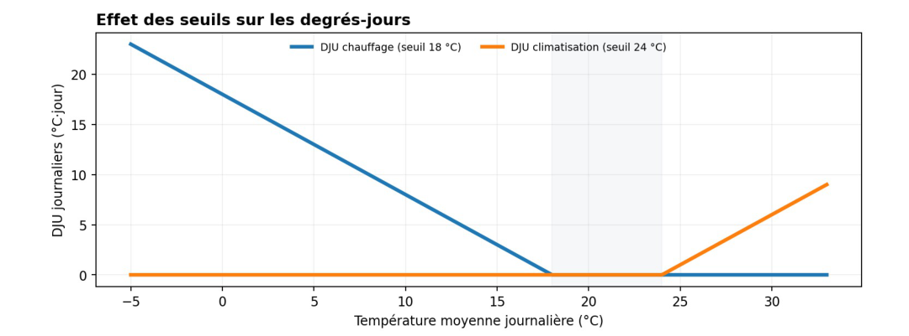{width=93%}

Le seuil est la température de référence au-delà (chauffage) ou en deçà (climatisation) de laquelle la demande conventionnelle correspondante est nulle. Il n’est pas estimé à partir des stations : il est choisi par le demandeur et transmis dans DjuPointRequest ou DjuZoneRequest. Le sujet rappelle que le SDES emploie un seuil de chauffage de 15 °C depuis 2023, contre 17 °C auparavant ; 18 °C reste un exemple illustratif, non une valeur imposée par notre API.

Un DJU est donc un indicateur conventionnel, non une mesure directe des besoins énergétiques réels d’un bâtiment. Deux logements situés au même endroit peuvent avoir les mêmes DJU et pourtant consommer très différemment en raison de leur isolation, de leur système de chauffage et de leurs usages. La méthode fournit une variable explicative climatique, qu’il faudrait articuler avec les données de consommation pour calculer une correction des variations climatiques au sens économique.

Pour un ensemble de jours, le cumul ne consiste pas à appliquer une seule fois la formule à la température moyenne de toute la période. Il faut d’abord évaluer l’écart au seuil chaque jour, puis sommer les écarts positifs. Cette distinction est importante : les journées chaudes et froides ne doivent pas se compenser artificiellement. Les deux modes, chauffage et climatisation, utilisent des seuils distincts et sont calculés indépendamment lorsque les deux sont demandés.

# 3. Cahier des charges : acteurs et besoins

Le cahier des charges fixe cinq fonctionnalités de base : F0 (préparation de la base), F1 (DJU ponctuel), F2 (consultation des zones officielles), F3 (DJU d’un territoire) et F4 (zonages personnels). Une requête de calcul délimite explicitement les dates de début et de fin, choisit au moins un seuil thermique, un pas de temps et une localisation. Les données chargées depuis 1990 représentent la fenêtre de référence potentielle ; l’intervalle demandé est une autre période, pouvant être plus court ou partiellement hors couverture.

## Trois profils, deux niveaux d’accès

* Utilisateur public : calcul ponctuel, calcul sur territoire officiel et consultation des zones disponibles.

* Utilisateur authentifié : mêmes droits, plus création, import, modification et suppression de ses propres ensembles de communes.

* Responsable de l’alimentation (appelé « administrateur » dans les cas d’utilisation) : prépare les fichiers et peuple PostgreSQL via les scripts `data/*.py`, avant les appels aux routes métier ; ce rôle n’est pas un compte « administrateur » exposé par l’API.

## Contraintes retenues

| Dimension | Exigence | Solution retenue |
|:--|:--|:--|
| Précision spatiale | Point arbitraire | Interpolation à partir des stations proches |
| Période | Jours à années | Agrégation et bornes calendaires |
| Fiabilité | Relevés incomplets | Comblement et suivi de provenance |
| Volume | Millions d'observations | Parquet hors ligne et PostgreSQL |
| Sécurité | Zonages privés | JWT et vérification de propriété |
| Réutilisation | Calculs territoriaux coûteux | Cache de résultats en base |

Le cœur du projet est le passage d’une spécification statistique à une application cohérente, capable d’expliquer les données utilisées et de renvoyer des erreurs prévisibles.

La distinction entre période de données et période demandée est déterminante. La première est contrainte par la disponibilité des relevés chargés ; la seconde relève du choix du client. L’implémentation conserve leur intersection et la signale dans un champ warning si elle est plus courte que prévu. Cette politique rend la requête exploitable tout en évitant de promettre des valeurs sur des jours absents de la base. Si l’intersection est vide, le service refuse le calcul.

Le nombre de stations et la prise en compte de l’altitude jouent un double rôle : ce sont des paramètres scientifiques qui modifient l’estimation, et des paramètres informatiques qui déterminent le coût du traitement et, pour un résultat territorial, son identité dans le cache. Ils ne doivent donc pas être laissés implicites dans la documentation de l’API. Le même couple lieu–dates peut produire plusieurs réponses justifiées selon les paramètres retenus.

# 4. Fonctionnalités et priorisation

Nous présentons ci-dessous les exigences en termes d’entrées, de résultats et de dépendances. F0 fournit les données à toutes les autres fonctions ; F1 calcule en un point, F2 découvre les territoires, F3 agrège les communes et F4 organise les zones privées. La priorité accordée aux options était FO1 (cache des résultats zonaux), puis FO3 (import de zonages) et enfin FO2 (formats JSON/CSV). Les trois options disposent aujourd’hui de code, dans les limites précisées au chapitre 19.

| Code | Fonction | Statut observé dans le code |
|:--|:--|:--|
| F0 | Préparation météo, communes et SQL | Scripts dédiés et testés |
| F1 | DJU pour un point GPS | Service et route implémentés |
| F2 | Liste et détail des zones officielles | Routes implémentées |
| F3 | DJU pour région, département ou zonage | Service avec cache territorial |
| F4 | Zonages personnalisés | CRUD protégé par authentification |
| FO1 | Persistance et cache | Résultats des zones, point non persisté |
| FO2 | Format des sorties | JSON et CSV |
| FO3 | Import de zonage | CSV et JSON transmis dans le corps JSON |

## Pourquoi cet ordre ?

F0 conditionne le calcul des températures ; F1 valide le moteur élémentaire avant F3, qui ajoute les contraintes territoriales et les pondérations. Les fonctionnalités F2 et F4 reposent sur la disponibilité du référentiel communal. Les formats de sortie et l’import enrichissent enfin des traitements déjà testables.

La conception initiale prévoyait deux niveaux de cache. L’implémentation l’a restreint : DjuService.calculate_point_dju crée des résultats sans stockage, tandis que calculate_zone_dju relit ou enregistre les calculs par sous-zone. La classe MunicipalityTemperatureDao subsiste, mais TemperatureService.get_municipality_temperatures ne l’utilise pas : on ne peut pas annoncer un cache communal opérationnel.

Le classement des exigences distingue les fonctionnalités visibles d’une requête HTTP des contraintes transversales. L’import CSV/JSON et la sortie CSV relèvent de l’ergonomie d’usage ; l’intégrité SQL, la vérification du propriétaire et le suivi des valeurs manquantes relèvent de la correction du service. Ces derniers points ne sont pas secondaires : une API qui répond vite avec des données non fiables ne remplit pas sa mission scientifique.

La matrice des fonctionnalités est donc lue avec prudence : le dépôt prouve la présence des routes et des règles de calcul ; les tests les documentent ; l’intégration sur données complètes doit encore être reconfirmée sur le commit de remise. Cette distinction entre fonctionnalité développée et validation mesurée sera reprise dans le bilan.

# 5. Organisation du travail en équipe

L’équipe de cinq élèves a utilisé un dépôt GitHub commun, des fichiers de suivi hebdomadaire dans doc/tracking et une documentation progressive en Markdown/Quarto. Le rapport intermédiaire a servi de base conceptuelle ; l’implémentation a ensuite conduit à revoir certains diagrammes et à distinguer les fonctionnalités souhaitées des fonctionnalités réellement codées.

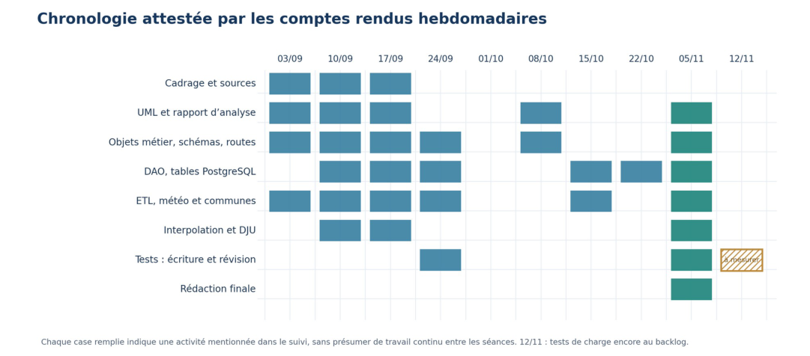{width=93%}

## Répartition documentée des réalisations

| Membre | Contributions relevées dans le suivi du 5 novembre |
|:--|:--|
| Mohamed Aziz Yousfi | Refonte des calculs DJU et tests d'objets métier |
| Eudes Sterlin | Schéma SQL, mise à jour des diagrammes et audit de l'état du code |
| Gabriel Dahan | Services, routes, authentification, zonages, cache zonal et DAO |
| Gwenaël Lassalle | Mise en page du rapport et chargement de la base distante |
| Marceau Feral | Chaîne de données, tests et vectorisation des calculs sur zones |

Ces attributions sont celles que l’équipe a consignées, et non une évaluation individuelle. Les échanges autour du code, l’harmonisation du modèle SQL et l’intégration des services illustrent la dépendance réelle entre les tâches.

Les bilans hebdomadaires montrent un développement itératif : premières routes et objets métier en septembre ; stabilisation du SQL, des DAO et des schémas en octobre ; intégration des traitements vectorisés, des formats et de l’authentification début novembre. Les tâches ont été croisées : une modification de modèle impactait fréquemment d’autres modules.

La principale difficulté organisationnelle a été la synchronisation entre code, tests, SQL et diagrammes, sans quoi plusieurs modules décrivaient des signatures incompatibles. Le travail transversal de revue et d’intégration apparaît ainsi comme une contribution technique à part entière.

# 6. Architecture logicielle en couches

Les composants réels sont identifiés par leur rôle et par leur nom. Les schémas DjuPointRequest et DjuZoneRequest valident les paramètres reçus par dju_controller.py ; DjuService orchestre les fonctions F1 et F3 ; TemperatureService.find_candidate_stations et estimate_daily_temperatures estiment les températures. DjuCalculation.run et run_for_zone appliquent les règles mathématiques. Les DAO lisent et écrivent PostgreSQL ; les scripts data/ préparent les tables avant le lancement des calculs. Les objets métier n’exécutent pas eux-mêmes de SQL.

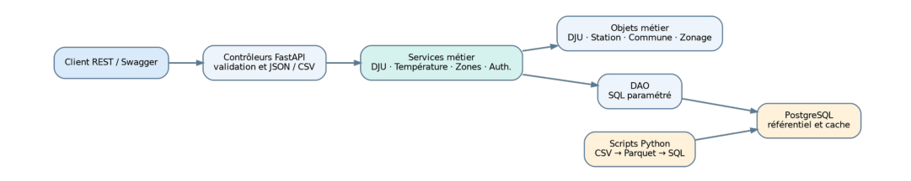{width=93%}

## Responsabilités observées

Le chemin suivi par F1 est explicite : requête HTTP $\rightarrow$ DjuPointRequest $\rightarrow$ DjuService.calculate_point_dju $\rightarrow$ TemperatureService $\rightarrow$ TemperatureReportDao $\rightarrow$ DjuCalculation.run $\rightarrow$ DjuResponse. Pour F3, DjuService demande à ZoneService de vérifier le territoire et les droits, consulte DjuDao.find_calculation, puis n’appelle TemperatureService et DjuCalculation.run_for_zone qu’en l’absence de résultat stocké. Les réponses sont construites par les contrôleurs, en JSON ou CSV.

Cette architecture rend possibles les tests isolés : plusieurs suites remplacent les DAO ou les services par des objets factices. Elle limite aussi la propagation d’un changement de schéma HTTP dans les algorithmes scientifiques.

La séparation des couches limite les dépendances croisées. Ainsi, le contrôleur n’a pas à construire des requêtes SQL, et l’objet DjuType n’a pas à connaître la structure JSON d’une réponse FastAPI. Les services constituent le point d’orchestration : ils interprètent la demande, appellent les DAO et demandent aux objets métier de calculer les valeurs. Cette distribution rend possible le remplacement de dépendances par des faux objets dans les tests, et facilite le diagnostic lorsqu’une requête échoue.

L’API est montée dans main.py par inclusion de plusieurs routeurs : /dju, /zones, /user et /user/zones. Le même point d’entrée configure l’environnement et expose une route /health pour vérifier la disponibilité du processus. La documentation interactive est fournie automatiquement par FastAPI. Il faut cependant distinguer la santé du processus et la santé de toute la chaîne : une réponse positive de /health ne démontre pas que la base distante possède toutes les observations nécessaires au calcul.

# 7. Constitution du jeu de données

Deux chaînes d’alimentation indépendantes sont exécutées avant le service en ligne. La chaîne météo lit les fichiers CSV.gz Météo-France, filtre les dates à partir de 1990 et les colonnes NUM_POSTE, DATE, TN/TX, LAT/LON et ALTI, puis produit un Parquet brut et un Parquet nettoyé avec TMIN/TMAX et leur provenance. La chaîne administrative interroge les API publiques pour obtenir le code INSEE, la région, le département, les coordonnées, la population et l’altitude des communes ; elle produit ses propres fichiers Parquet. Seul le chargement SQL final rassemble les deux sources.

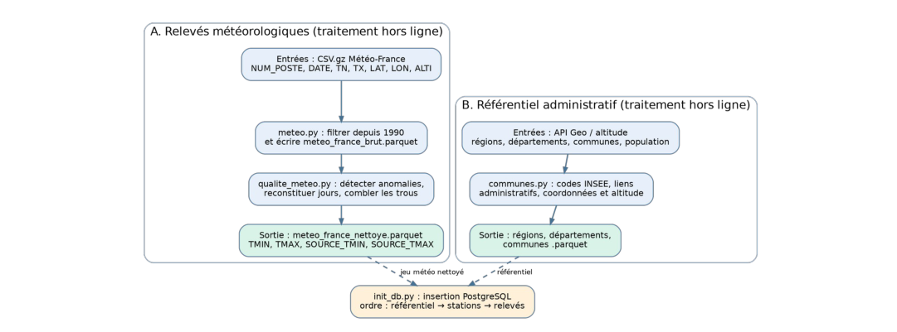{width=93%}

## Un stockage adapté aux usages

Le Parquet est un format de travail efficace pendant le nettoyage massif. PostgreSQL devient ensuite la source interrogée par l’API ; il conserve les stations, relevés, communes, zonages, types et résultats des DJU. Le script init_db.py charge les tables selon le schéma défini et utilise ON CONFLICT DO NOTHING pour éviter la réinsertion de lignes identiques.

Le compte rendu du 5 novembre mentionne un chargement de 4 555 stations et d’environ 32 millions de relevés sur la base distante. Ce chiffre provient du suivi interne ; il n’a pas été revérifié par une requête directe dans cette rédaction.

La conversion intermédiaire en Parquet répond au caractère massif des archives. Les scripts de traitement peuvent manipuler des colonnes homogènes sans reparcourir chaque CSV compressé lors d’un nouveau chargement de base. Ce stockage est une étape d’alimentation, pas le support unique des requêtes en ligne : les DAO de l’application exploitent principalement PostgreSQL pour retrouver stations, observations, zones et résultats conservés. La distinction entre traitement hors ligne et service en ligne évite de placer les téléchargements météorologiques dans le chemin critique d’une requête utilisateur.

L’ordre de chargement est aussi une condition d’intégrité. Les régions doivent exister avant les départements, les départements avant les communes, et les stations avant leurs relevés. Le script init_db.py matérialise cet ordre et utilise des insertions par lots pour la volumétrie. Les contraintes de clés étrangères, d’unicité et les clauses ON CONFLICT empêchent des incohérences évidentes lors d’une relance. Cela ne remplace toutefois ni la supervision de l’alimentation ni une validation statistique des données importées.

# 8. Fiabilisation des relevés météorologiques

La qualité est traitée hors ligne par qualite_meteo.py, avant l’insertion dans PostgreSQL et avant tout calcul F1/F3. Une mesure Tmin ou Tmax hors de $[-50 ; +50]$ °C est remplacée par une valeur manquante : le script n’élimine pas systématiquement toute la série de la station. Il écarte les lignes sans aucune température (stations ne mesurant par exemple que la pluie), puis réindexe chaque station sur un calendrier quotidien. Les anomalies et les manques sont traités séparément pour Tmin et Tmax. Les règles de couverture minimale à 65 %, de stations doublonnées à 500 m et de température constante pendant 30 jours évoquées dans la conception intermédiaire ne sont pas démontrées dans le script actuel : elles ne sont donc pas présentées ici comme implémentées.

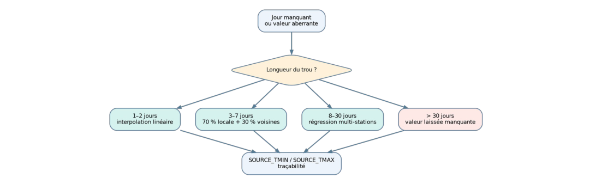{width=93%}

La stratégie est déterminée automatiquement par la longueur initiale du trou : de 1 à 2 jours, interpolation linéaire ; de 3 à 7 jours, combinaison de 70 % de tendance locale et de 30 % de stations voisines corrigées d’un écart moyen ; de 8 à 30 jours, régression multistation si les données disponibles suffisent ; au-delà de 30 jours, les valeurs manquantes sont conservées. Cinq stations voisines au maximum, dans un rayon de 50 km, peuvent participer. Ce n’est pas un paramètre que choisit l’utilisateur de l’API au moment du calcul DJU.

Après comblement, une estimation causant Tmin > Tmax est écartée sans supprimer automatiquement toute la station. La sortie nettoyée distingue SOURCE_TMIN et SOURCE_TMAX et permet à TemperatureReportDao de calculer observed, vrai uniquement si les deux valeurs sont réellement observées. DjuResult.observed_ratio donne ensuite la part de jours du résultat reposant exclusivement sur des mesures observées ; il ne constitue pas un intervalle d’incertitude statistique.

Un calendrier quotidien complet est reconstruit pour chaque station. Cela permet de distinguer l’absence d’une ligne entière d’une température nulle ou manquante, puis de calculer sans ambiguïté la longueur des trous. La méthode de comblement dépend de cette longueur initiale et non du nombre de lignes disponibles dans le fichier brut.

SOURCE_TMIN et SOURCE_TMAX tracent séparément les observations et les imputations. Le booléen observed n’est vrai que si Tmin et Tmax sont mesurées, pour chaque contribution utilisée ; observed_ratio en résume la proportion par période. Ce n’est pas une mesure d’incertitude.

# 9. Référentiel géographique et modèle SQL

Le modèle relationnel est une représentation des vraies tables de data/init_db.sql. Son noyau territorial suit la hiérarchie `regions`, `departments`, puis `municipalities` : chaque table possède une clé primaire `id`, et les codes INSEE sont uniques. La table zoning_municipalities réalise la relation plusieurs-à-plusieurs entre communes et zonages. Les tables meteo_stations et temperature_reports conservent des observations datées ; dju_types, dju_calculations et dju_results conservent les paramètres et sorties des calculs territoriaux.

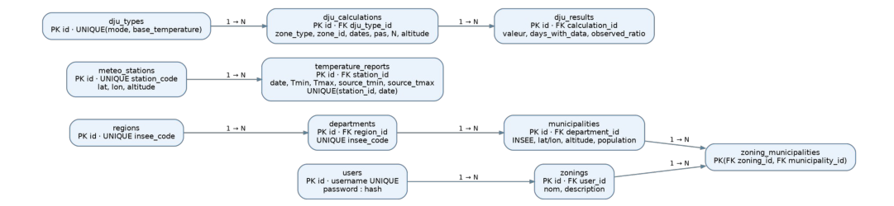{width=93%}

Un relevé météorologique contient date, station_id, temp_min, temp_max et deux informations de provenance source_tmin et source_tmax ; l’unicité (station_id, date) évite les doublons. Pour un calcul territorial, la paire (mode, base_temperature) identifie un type de DJU, et les lignes de dju_results enregistrent period_start, period_end, value, days_with_data et observed_ratio. Le schéma dessiné est celui qui existe dans le code, pas une base conceptuelle projetée.

Le fichier SQL actuel ne crée pas de table municipality_temperatures alors qu’une DAO portant ce nom subsiste dans le dépôt : le cache de séries communales apparaît donc comme une extension non raccordée dans la branche examinée.

Le schéma relationnel distingue plusieurs cardinalités : une région contient plusieurs départements ; un département regroupe des communes ; une station porte plusieurs relevés datés ; un utilisateur possède plusieurs zonages ; un zonage relie plusieurs communes par une table d’association. Cette dernière relation évite de recopier les caractéristiques d’une commune à chaque création de zone personnalisée. Une même commune peut appartenir à plusieurs ensembles sans duplication de sa géométrie, de son code INSEE ou de sa population.

La table dju_calculations conserve le contexte d’un calcul territorial : sous-zone, seuil via la table dju_types, période, pas temporel, nombre de stations et correction d’altitude. Les lignes de dju_results stockent les résultats par période et les indicateurs de couverture. Ce découpage sépare ce qui est constant sur la requête des valeurs produites pour chaque période. Dans le schéma inspecté, la table municipality_temperatures n’est pas créée : cette différence avec la conception initiale explique l’absence de réutilisation active des séries communales.

# 10. Estimation spatiale des températures

Les entrées du traitement spatial sont un dictionnaire locations : {identifiant_du_lieu : (latitude, longitude, altitude_ou_None)}, le nombre de stations N de 1 à 10 et la période de dates. TemperatureService.find_candidate_stations sélectionne les stations parmi au plus 50 candidates par lieu et fait lire leurs observations par TemperatureReportDao.get_reports_dataframe ; seules les stations ayant des relevés sur la période sont retenues. La sortie intermédiaire associe à chaque station/date une température moyenne (Tmin + Tmax)/2 et une provenance observée ou imputée.

La fonction Haversine mesure la distance dᵢ (km) entre le lieu et la station i. Les poids spatiaux sont wᵢ = 1/max(dᵢ, 0,01 km)² et ne dépendent pas de la date ; ils sont donc calculés une fois par lieu. La température estimée au jour t est T̂(t) = Σᵢ wᵢ(t) × Tᵢ,corrigée(t) / Σᵢ wᵢ(t), les poids des stations sans valeur étant exclus ce jour-là. La sortie est un couple de DataFrame Pandas indexés par date, avec une colonne par lieu : température estimée et indicateur observed.

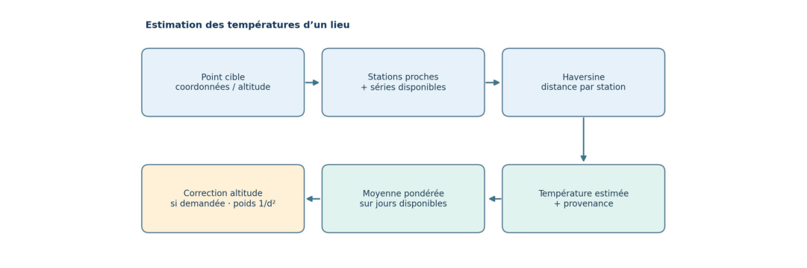{width=93%}

## Correction altimétrique

Lorsque l'altitude cible est fournie, la température de chaque station est ramenée au niveau du lieu cible selon la formule :

$$
T_{\mathrm{corrigée}} = T_{\mathrm{station}} - 0{,}0065 \times (z_{\mathrm{cible}} - z_{\mathrm{station}}),
$$

où les altitudes sont exprimées en mètres. Sans altitude cible, aucune correction n'est appliquée. Cette simplification est conforme au sujet mais ne modélise pas les microclimats. Les opérations sont vectorisées dans NumPy/Pandas : il n’existe pas de raison physique de recalculer la distance ou le poids d’une station à chaque jour.

Les coordonnées latitude–longitude imposent une mesure de distance sur la sphère : la méthode Haversine fournit le classement des candidates. Une station est conservée seulement si elle possède des relevés pendant la période demandée ; sinon, le service cherche une remplaçante parmi les candidates suivantes. Une même station n’est lue qu’une fois si elle dessert plusieurs communes du lot.

Pour chaque date, les poids sont renormalisés sur les seules stations possédant une valeur : une observation absente ne doit pas rester dans le dénominateur. Si aucune station utilisable n’a de valeur, la température demeure manquante au lieu de prendre artificiellement la valeur zéro.

# 11. Choix et robustesse de l’interpolation

Le nombre de stations demandé peut aller de 1 à 10 ; trois stations constituent la valeur par défaut. Pour chaque lieu, le code examine au maximum 50 stations candidates, ordonnées par proximité. Lorsqu’une station n’a aucun relevé durant la période, elle est remplacée par une station candidate suivante, si possible. Une même station partagée entre plusieurs communes n’est chargée qu’une fois dans un lot de requêtes.

## Gestion des absences au jour le jour

La sélection d’une station disponible sur la période ne garantit pas une mesure chaque jour. La moyenne pondérée est donc recalculée, à chaque date, sur les seules stations dont la température du jour est renseignée. Si aucune n’est exploitable, la température estimée demeure manquante ; elle n’est pas inventée à partir d’une station distante hors du jeu sélectionné.

Le service renvoie également un booléen de provenance : un jour n’est considéré comme entièrement observé que si toutes les températures effectivement utilisées proviennent de mesures observées. Cette information devient observed_ratio après agrégation des DJU.

## Principaux compromis

| Choix | Bénéfice | Limite |
|:--|:--|:--|
| Pondération 1/d² | Favorise les stations proches | Sensible à la densité locale |
| N = 3 par défaut | Coût raisonnable | Sous-échantillonnage possible |
| Correction 0,65 °C / 100 m | Prend en compte le relief | Gradient atmosphérique simplifié |
| Calculs vectorisés | Moins de boucles Python | Mémoire proportionnelle au lot |

Un poids inversement proportionnel au carré de la distance favorise fortement les stations proches tout en permettant de mobiliser une observation plus éloignée lorsque la plus proche est indisponible. Pour éviter une division par zéro au droit même d’une station, le code borne la distance à une petite valeur positive. Ce mécanisme est un choix de robustesse numérique ; il ne transforme pas automatiquement le modèle en mesure parfaite au point cible. Un contrôle de sensibilité sur différents nombres de stations resterait utile pour évaluer son impact.

La correction altimétrique repose sur un gradient fixe : pour une différence de 200 mètres entre la station et le lieu plus élevé, la température est diminuée de 1,3 °C. L’ordre des opérations a son importance : chaque température de station est d’abord ramenée à l’altitude cible, puis la moyenne pondérée est calculée. L’hypothèse de gradient constant est explicite et facile à reproduire, mais elle est moins adaptée aux inversions thermiques et aux situations locales complexes. Il s’agit d’un compromis entre simplicité, données disponibles et coût du calcul.

# 12. Calcul et agrégation des DJU

La classe DjuType calcule les DJU quotidiens. La classe DjuCalculation les rassemble par période de calendrier : jour, semaine ISO (lundi à dimanche), mois ou année. Les bornes de chaque résultat sont ramenées à l’intervalle réellement demandé. Un mois commencé le 10 n’est donc présenté qu’à partir du 10, même si son cadre calendaire est plus large.

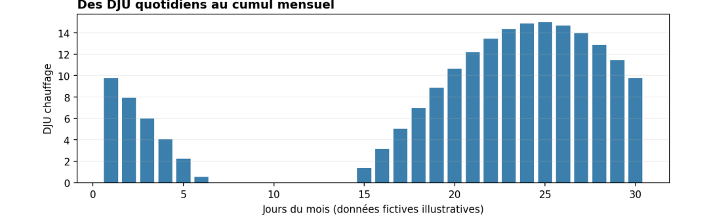{width=93%}

## Agrégation spatiale

Pour les territoires, chaque commune obtient un DJU par jour. À la date t, la moyenne de la zone est pondérée par la population des communes pour lesquelles une valeur existe : DJUzone(t) = Σ populationᵢ × DJUᵢ(t) / Σ populationᵢ. Les communes sans population renseignée sont écartées, sauf si toutes les populations sont absentes ou nulles : une moyenne simple est alors utilisée.

Le système somme ensuite les DJU zonaux sur le pas de temps demandé et renvoie pour chaque période days_with_data et observed_ratio. Il ne remplace pas implicitement les journées manquantes par zéro.

Les regroupements temporels sont définis à partir du calendrier, non de la position du premier relevé disponible. Une requête couvrant du 10 au 25 février doit donc conserver ces bornes dans le résultat de février, même si certaines journées n’ont pas pu être évaluées. Pour une semaine, la convention ISO signifie du lundi au dimanche, avec bornes réduites à l’intervalle demandé. Ces règles évitent de faire passer une somme sur vingt jours pour un cumul mensuel intégral.

Pour l’agrégation spatiale, une commune sans population exploitable reçoit un poids nul lorsque d’autres poids existent. Si toutes les populations sont absentes ou égales à zéro, le système bascule vers une moyenne simple : ce cas dégénéré est traité explicitement dans les tests. Une autre subtilité est la disponibilité quotidienne : le dénominateur pondéré ne comprend que les communes ayant une valeur ce jour. L’agrégation porte donc sur la partie effectivement observable du territoire et l’absence de données doit être signalée par les indicateurs de couverture.

# 13. F1 : DJU ponctuel par API

F1 reçoit un `DjuPointRequest` : latitude comprise entre -90 et 90, longitude entre -180 et 180, altitude facultative, `start_date`, `end_date`, `heating_threshold` et/ou `cooling_threshold`, `number_of_stations` compris entre 1 et 10 (défaut : 3), et `time_step` parmi `day`, `week`, `month`, `year` (défaut : `day`). Pydantic produit 422 si un champ est mal formé ; DjuService._check_request renvoie 400 si les dates sont inversées ou si les deux seuils sont absents, puis intersectionne la période demandée avec les dates disponibles.

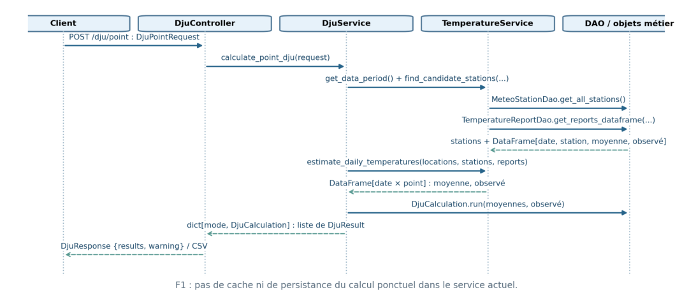{width=93%}

La fonction TemperatureService.estimate_daily_temperatures renvoie deux séries utiles à DjuCalculation.run : les moyennes quotidiennes et le booléen de provenance. Une unique estimation est réutilisée si chauffage et climatisation sont demandés ensemble ; si seul cooling_threshold est fourni, aucun calcul de chauffage n’est exécuté. La sortie DjuResponse regroupe les DjuResult par mode et porte warning lorsque la période a été raccourcie. F1 n’écrit pas de cache de résultats en base.

## Exemple de demande

Sur un calcul ponctuel, la route ne reçoit aucun identifiant de zone : l’API crée un objet DjuCalculation portant directement les coordonnées et les paramètres de l’estimation. La recherche des stations et la lecture des séries sont mutualisées pour les deux modes ; seules les formules de seuil divergent ensuite. Cette mutualisation réduit le coût d’un calcul demandant simultanément chauffage et climatisation, puisqu’il n’est pas nécessaire d’exécuter deux recherches géographiques indépendantes.

L’interface repose sur des types explicites : date au format ISO, seuil numérique, nombre de stations borné, choix du pas parmi day, week, month et year. Une erreur sur un champ est rejetée automatiquement par Pydantic, tandis qu’une incohérence entre plusieurs champs fait l’objet d’une règle dans le service. Cette distinction illustre un principe de conception réutilisable : la validation syntaxique relève du contrat d’entrée et la validation métier relève de la couche qui détient la règle scientifique.

# 14. Démonstration documentée du calcul ponctuel

Cette démonstration distingue trois niveaux de preuve : le contrat de requête, la formule numérique et le résultat JSON attendu. La réponse ci-dessous est calculée sur un JEU SYNTHÉTIQUE (températures explicitement posées) : ce n’est ni une capture d’un serveur distant ni une mesure effectuée sur les relevés PostgreSQL. Le code qui définit la structure est api/src/schema/dju_schema.py et api/src/controllers/dju_controller.py.

## Requête conforme à DjuPointRequest

```http
POST /dju/point?format=json
Content-Type: application/json

{
  "latitude": 48.11,
  "longitude": -1.68,
  "start_date": "2020-01-10",
  "end_date": "2020-01-11",
  "heating_threshold": 18,
  "cooling_threshold": 24,
  "number_of_stations": 3,
  "time_step": "day"
}
```

## Résultat attendu sur deux températures fictives

Prenons les températures moyennes journalières conventionnelles 8 °C et 15 °C ; supposons que le premier jour repose intégralement sur des mesures observées et que le second comporte au moins une valeur imputée. Les DJU de chauffage valent alors 10 et 3, ceux de climatisation valent 0 et 0. La réponse ci-dessous illustre les champs réellement définis par DjuResultItem et DjuResponse.

```json
{
  "results": {
    "heating": [
      {"period_start":"2020-01-10","period_end":"2020-01-10","value":10.0,"days_with_data":1,"observed_ratio":1.0},
      {"period_start":"2020-01-11","period_end":"2020-01-11","value":3.0,"days_with_data":1,"observed_ratio":0.0}
    ],
    "cooling": [
      {"period_start":"2020-01-10","period_end":"2020-01-10","value":0.0,"days_with_data":1,"observed_ratio":1.0},
      {"period_start":"2020-01-11","period_end":"2020-01-11","value":0.0,"days_with_data":1,"observed_ratio":0.0}
    ]
  },
  "warning": null
}
```

Interprétation : `days_with_data` indique les dates effectivement calculées ; observed_ratio porte sur la proportion de ces dates construites exclusivement à partir de mesures observées. Si l’utilisateur ne transmet que cooling_threshold, la clé heating n’apparaît pas. Si la période demandée dépasse la disponibilité globale des relevés, la date est réduite et warning l’explique.

# 15. F2 : Consultation des zones officielles

La route GET /zones permet de lister les régions, les départements ou les deux, via type=region, type=department ou type=all. Elle fournit volontairement des objets légers : identifiant, nom, type et code INSEE. Ce choix évite de transmettre d’emblée les milliers de communes lorsqu’un client cherche simplement la zone souhaitée.

## Consultation détaillée

La route GET /zones/{zone_type}/{zone_id} renvoie les communes d’une région ou d’un département ciblé, avec leur nom et leur code INSEE. Les types autorisés sont explicitement limités aux valeurs reconnues par la route. Une zone inconnue produit une erreur 404 ; un type non valide est rejeté au niveau de la validation.

## Parcours utilisateur

| Étape | Exemple | Information obtenue |
|:--|:--|:--|
| 1 | `GET /zones?type=region` | Liste courte des régions |
| 2 | Choix d'un identifiant de région | Identifiant de la cible |
| 3 | `GET /zones/region/{id}` | Région et communes associées |
| 4 | `POST /dju/zone` | Calcul pour cette zone ou ses subdivisions |

Cette séparation entre liste et détail est un ajustement apporté au modèle initial, dans lequel une liste exhaustive aurait rendu la réponse inutilement volumineuse. L’API ne propose pas encore la recherche d’une commune par son nom ; le suivi du 12 novembre la classe parmi les améliorations secondaires.

La consultation des zonages officiels joue un rôle d’exploration préalable. Le client commence par identifier un nom ou un code pertinent dans une liste de régions et de départements ; il utilise ensuite l’identifiant interne retourné pour demander le détail ou effectuer un calcul territorial. Le choix de deux routes, liste et détail, évite d’imposer à chaque consultation le transfert des listes communales complètes. L’amélioration concerne donc la lisibilité des réponses comme la maîtrise du volume JSON.

Le code INSEE représente une identité administrative stable à l’échelle des données utilisées, tandis que l’identifiant numérique de la base sert aux relations SQL et aux routes. Confondre ces deux valeurs serait une source fréquente d’erreurs pour un client. La documentation et les exemples doivent donc expliciter quel identifiant chaque chemin attend. Une recherche textuelle de commune n’est pas exposée dans la version inspectée ; son ajout améliorerait l’ergonomie sans modifier le moteur de calcul DJU proprement dit.

# 16. F3 : DJU sur un territoire

F3 reçoit un DjuZoneRequest : zone_type = region, department ou zoning ; zone_id = identifiant numérique interne, aggregation_level = zone, department ou municipality ; dates, seuil(s), nombre de stations, use_altitude et time_step. ZoneService.get_zone charge les communes (ou vérifie la propriété du zonage personnel), puis get_sub_zones définit la granularité de restitution. Entrée métier : un territoire et des paramètres de calcul ; sortie : DjuZoneResponse contenant zones[], leurs résultats par mode et un avertissement éventuel de période.

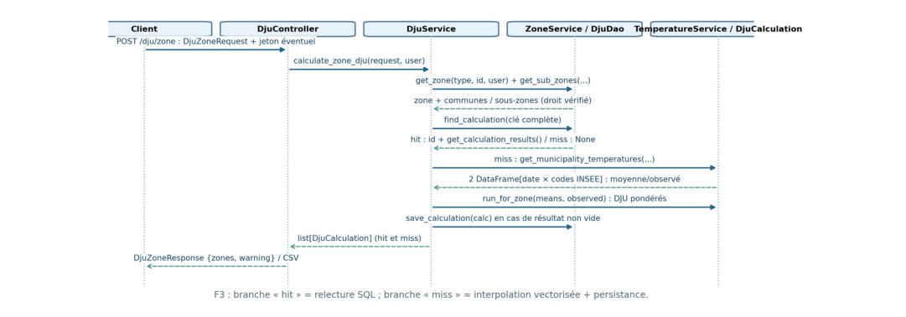{width=93%}

Pour chaque couple sous-zone/type de DJU, DjuDao.find_calculation recherche un calcul de même zone, seuil, période, pas de temps, nombre de stations et option d’altitude. En cas de succès, get_calculation_results relit les DjuResult ; en cas d’absence, TemperatureService.get_municipality_temperatures estime des tableaux Pandas par commune, DjuCalculation.run_for_zone calcule la moyenne pondérée et DjuDao.save_calculation enregistre le résultat. Cette branche n’est parcourue que pour les calculs manquants.

Le découpage par département est refusé pour un zonage personnalisé, car celui-ci n’est pas structuré par la même hiérarchie que les régions officielles. Le contrôle de propriété d’un zonage personnel précède le calcul afin d’éviter l’accès aux zones d’autrui.

Le calcul zonal prolonge le calcul en un point, mais son ordre de grandeur diffère. Une région peut regrouper plusieurs milliers de communes, chacune pouvant mobiliser plusieurs stations et des années de mesures quotidiennes. Le code évite donc la succession naïve « une commune, une requête SQL, un calcul complet » : il rassemble l’ensemble des communes à calculer, récupère les stations et les relevés communs, puis construit des tableaux de dates et de communes pour traiter les agrégations avec NumPy et Pandas.

Pour chaque sous-zone et chaque seuil, DjuService construit une clé complète de recherche du cache. Lorsqu’une valeur existe, les résultats sont relus sans refaire l’estimation. Sinon, les températures sont préparées, les DJU de chaque commune calculés et les résultats territoriaux enregistrés. Les réponses regroupent les valeurs par sous-zone et par mode. Cette organisation convient au traitement de territoires composites, même si elle ne supprime pas le coût initial potentiellement élevé d’un premier calcul sur une très grande emprise.

# 17. Démonstration territoriale et preuve de cohérence

Le parcours territorial ajoute deux opérations au calcul ponctuel : la décomposition d’une zone et l’agrégation des communes pondérée par la population. Le contrôle d’accès à un zonage personnalisé s’effectue avant le calcul. Une requête identique sur une zone officielle peut ensuite relire un résultat en cache.

## Requête HTTP et interprétation des paramètres

```http
POST /dju/zone?format=json
Content-Type: application/json

{
  "zone_type": "department", "zone_id": 35,
  "aggregation_level": "zone",
  "start_date": "2020-01-10", "end_date": "2020-01-10",
  "heating_threshold": 18, "number_of_stations": 3,
  "use_altitude": true, "time_step": "day"
}
```

Ici, 35 est l’identifiant utilisé par la fixture de test pour le département d’Ille-et-Vilaine ; pour une véritable base PostgreSQL, il faut utiliser l’identifiant renvoyé par GET /zones, et non supposer qu’il égale le code INSEE.

## Une moyenne territoriale vérifiable

Exemple pédagogique : deux communes, de populations 1 000 et 3 000, ont respectivement 12 et 8 DJU ce jour-là. La somme pondérée (1 000 × 12 + 3 000 × 8) / (1 000 + 3 000) vaut exactement 9 DJU. Dans le format zonal, le résultat se place dans zones, puis results, puis heating.

```json
{
  "zones": [{
    "zone_type": "department", "zone_id": 35,
    "name": "Ille-et-Vilaine",
    "results": {"heating": [{
      "period_start": "2020-01-10",
      "period_end": "2020-01-10",
      "value": 9.0, "days_with_data": 1,
      "observed_ratio": 1.0
    }]}
  }],
  "warning": null
}
```

Ce JSON est reconstruit à partir du contrat de réponse et d’un jeu de communes fictif. Il ne prouve pas que ces DJU ont été mesurés pour le département réel. Pour constituer une preuve d’intégration complète, l’équipe doit conserver une sortie réelle issue de /docs ou d’un POST HTTP relié à la base alimentée, avec date, paramètres et commit utilisés.

## Trace de contrôle reproductible, une fois le serveur démarré

```bash
curl -s http://localhost:5001/health
curl -s 'http://localhost:5001/zones?type=department'
# Puis POST /dju/zone via /docs avec l'identifiant réel
```

# 18. F4 : Comptes et zonages personnalisés

Les zonages personnalisés répondent à un besoin absent de la hiérarchie administrative classique : analyser un portefeuille de communes, une aire de projet ou une zone fonctionnelle choisie par l’utilisateur. Un compte est nécessaire pour enregistrer durablement ces ensembles, nommés et décrits par leur propriétaire.

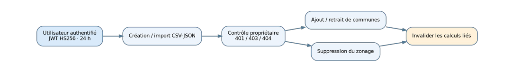{width=93%}

L’inscription utilise POST /user/register ; l’authentification POST /user/login renvoie un jeton JWT signé en HS256, valable 24 heures. Les mots de passe sont stockés sous forme de hash bcrypt. Les routes /user/zones exigent un jeton valide, puis comparent le propriétaire de la zone avec l’utilisateur authentifié.

## Cycle de vie

Un zonage peut être créé à partir d’un nom et de codes INSEE connus, consulté, enrichi ou réduit, puis supprimé. Une modification de sa composition invalide les calculs territoriaux auparavant enregistrés afin d’éviter de restituer des valeurs construites sur l’ancienne liste de communes.

Le jeton JWT transporte l’identité de l’utilisateur et une date d’expiration ; il n’est pas une autorisation générale sur toutes les ressources. À chaque accès à un zonage privé, le service charge l’objet puis vérifie explicitement l’identité de son propriétaire. Sans jeton, la réponse attendue est 401 ; pour un autre propriétaire, 403 ; pour une ressource inexistante, 404. Cette vérification doit demeurer dans la logique métier même si la route annonce déjà une dépendance d’authentification.

La modification d’une liste de communes implique une invalidation des calculs qui en dépendent. Sans elle, une requête identique en apparence pourrait relire un résultat calculé à partir d’un ancien périmètre. Le code d’actualisation supprime donc les résultats mémorisés associés au zonage après une mise à jour ; la suppression de zone entraîne également un nettoyage. Ce lien entre gestion d’objet et cache est un enjeu de cohérence plus subtil que la seule capacité à créer une ressource.

# 19. FO2 et FO3 : Sorties et imports

FO2 sélectionne le format de réponse via ?format=json (par défaut) ou ?format=csv. La sortie CSV contient zone, mode, period_start, period_end, value, days_with_data et observed_ratio. En JSON, DjuResponse regroupe les séries par mode ; DjuZoneResponse regroupe d’abord les sous-zones puis leurs modes. Si la période a été réduite, le champ warning est renseigné en JSON ; la réponse CSV du contrôleur n’a pas de colonne warning, limite à signaler pour son interprétation.

## Exemple de table CSV (données illustratives)

| zone | mode | period_start | period_end | value | days_with_data | observed_ratio |
|:--|:--|:--|:--|--:|--:|--:|
| point | heating | 2020-01-10 | 2020-01-10 | 10.0 | 1 | 1.0 |
| point | cooling | 2020-01-10 | 2020-01-10 | 0.0 | 1 | 1.0 |

FO3 permet d’importer un zonage via POST /user/zones/import. Un corps JSON fournit filename et content, éventuellement name et description. Le contenu est interprété comme CSV ou JSON selon l’extension du nom de fichier. Les CSV peuvent contenir une colonne code_insee ou placer les codes dans la première colonne ; le JSON accepte une liste ou un objet contenant codes_insee.

## Contrôles essentiels

Les codes sont nettoyés, les doublons supprimés et les codes inconnus explicitement signalés. Le serveur refuse les extensions inattendues, les contenus invalides et les zonages vides. Ce choix d’import par texte JSON évite la dépendance python-multipart, mais oblige le client à transmettre le contenu textuel du fichier.

Le CSV répond au besoin d’exploiter le résultat dans un tableur ou un logiciel statistique, alors que le JSON conserve un objet structuré utilisable par un client web ou un script. Le choix du format ne change pas les valeurs calculées : les deux sorties utilisent les objets DjuCalculation et DjuResult produits par la même couche métier. Cette unicité évite de maintenir deux chaînes scientifiques différentes qui pourraient diverger sur les arrondis, les bornes ou la prise en compte des trous de données.

L’import de zonages suit l’approche inverse : un ensemble de codes INSEE arrive sous forme de texte CSV/JSON et est normalisé avant toute écriture. Les codes vides et les doublons sont éliminés, puis chaque code restant doit correspondre à une commune de la base. Un import n’est donc pas seulement un problème de lecture de fichier ; c’est aussi une opération d’intégrité du référentiel. L’absence de mécanisme multipart rend la route plus simple à déployer, au prix d’une étape supplémentaire côté client pour lire le contenu du fichier.

# 20. Contrats HTTP et traitement des erreurs

Une API utilisable ne se limite pas à renvoyer des nombres. Elle doit aussi différencier une entrée invalide, une période sans observation, une zone inconnue, un manque d’authentification et une tentative d’accès à une ressource privée. Les schémas Pydantic constituent la première ligne de validation ; les services relèvent ensuite des ServiceError converties en réponses HTTP.

| Code | Situation documentée | Exemple |
|:--|:--|:--|
| 200 | Calcul ou consultation réussis | `POST /dju/point` |
| 201 | Création de ressource | `POST /user/zones` |
| 204 | Suppression effectuée | `DELETE /user/zones/{id}` |
| 400 | Règle métier impossible | Aucun seuil, dates inversées |
| 401 | Authentification absente ou erronée | Accès aux zonages sans jeton |
| 403 | Droits insuffisants | Zonage d'un autre utilisateur |
| 404 | Ressource ou relevés absents | Zone inexistante |
| 409 | Conflit de création | Nom d'utilisateur déjà pris |
| 422 | Erreur de schéma | Pas temporel ou coordonnées invalides |

La réponse comporte parfois warning lorsque l’intervalle demandé est plus large que les données réellement disponibles. Ce comportement est préférable à une extrapolation silencieuse, car il permet au client de distinguer une période calculée d’une période demandée.

Il reste utile de documenter, dans un client futur, le sens exact de observed_ratio : il traduit la proportion de journées calculées exclusivement à partir de relevés observés, et non une mesure statistique d’incertitude.

Les codes de réponse permettent à un consommateur d’API de savoir si une correction de sa requête est possible. Un 422 indique un type ou une valeur incompatible avec le schéma attendu ; un 400 correspond notamment à une contradiction logique, comme une date de début postérieure à la fin ou l’absence de seuil. Une réponse 404 peut signaler une zone inexistante ou aucune station exploitable ; le message d’erreur doit alors préciser quelle ressource manque, faute de quoi le client ne peut pas distinguer une erreur de géographie d’une lacune météorologique.

Les avertissements doivent être lus avec la même attention que les erreurs. Une requête allant au-delà de la dernière observation disponible peut produire un calcul partiel parfaitement cohérent, mais celui-ci n’a pas la couverture temporelle demandée. Exposer warning et days_with_data rend cette situation visible. Pour une exploitation de résultats, un tableau de bord devrait afficher ces métadonnées à côté des DJU et éviter de comparer directement deux périodes dont la couverture n’est pas comparable.

# 21. Persistance, cache et performance

Les requêtes territoriales de F3 sont potentiellement coûteuses : chaque commune requiert une interpolation sur des stations et des dates. Le service évite les requêtes par commune en regroupant les lectures de relevés et en vectorisant les matrices date × commune. Il persiste ensuite seulement les résultats zonaux par configuration de calcul, non tous les appels de l’API. F1 ne stocke pas ses résultats ; la classe MunicipalityTemperatureDao n’est pas branchée dans le calcul des communes.

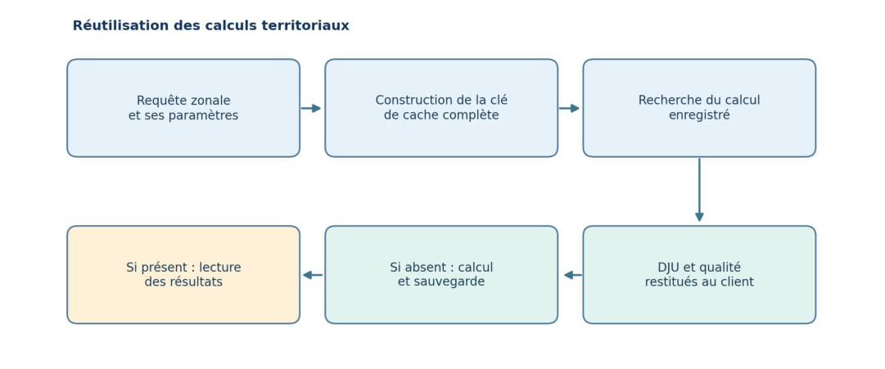{width=93%}

La clé de cache comprend la zone et son identifiant, le type de DJU (donc le seuil), les dates, le pas de temps, le nombre de stations et la prise en compte de l’altitude. Les calculs ponctuels, eux, sont explicitement déclarés « sans stockage » dans DjuService. Une DAO de températures communales existe, mais son stockage ne fait pas partie du chemin actif décrit dans TemperatureService.

La vectorisation NumPy/Pandas permet d’estimer les communes par lots plutôt qu’en relançant chaque fois des requêtes individuelles. Toutefois, le suivi du 12 novembre demande encore de chronométrer une région entière et la France : aucune durée cible validée ne peut donc être annoncée.

La recherche d’un calcul territorial utilise une clé qui incorpore toutes les variables susceptibles de faire varier le résultat. Oublier le seuil ou le nombre de stations rendrait le cache faux, même si les identifiants de territoire et les dates sont identiques. À l’inverse, relire un calcul réellement équivalent économise les interpolations et les agrégations. La méthode DjuDao.find_calculation sélectionne le dernier enregistrement correspondant, tandis que DjuDao.save_calculation conserve la valeur et ses résultats temporels.

La seule présence d’un cache ne prouve pas une performance satisfaisante. Pour l’évaluer, il faudrait comparer un premier calcul sans résultat stocké, un second calcul identique avec résultat présent et un calcul portant sur une période longue. Les mesures pertinentes incluraient le temps total, le temps SQL, le nombre de lignes transférées et l’usage mémoire. Les notes d’équipe identifient précisément cette mesure à l’échelle d’une région et de la France comme un chantier prioritaire ; elle reste distincte des optimisations déjà lisibles dans le code.

# 22. De la conception à l’implémentation : écarts expliqués

L’une des leçons du projet est que le dossier intermédiaire décrivait un objectif ; la branche actuelle documente un état d’implémentation. Pour ne pas répéter des inexactitudes, la comparaison ci-dessous distingue explicitement intention, réalisation et conséquence pour l’utilisateur. Les lignes sont vérifiées dans les services, les schémas et la définition SQL.

## Matrice d’écarts entre le dossier initial et le code

| Intention initiale | État du code inspecté | Conséquence |
|:--|:--|:--|
| Cache pour les points et les territoires | `calculate_point_dju()` ne stocke rien ; `calculate_zone_dju()` utilise le cache SQL | Ne pas annoncer de persistance générale pour F1 |
| Températures communales réutilisables | `MunicipalityTemperatureDao` existe mais n'est pas utilisée ; table absente dans `init_db.sql` | Signaler un cache communal non intégré |
| Lecture et édition des zones officielles | `GET /zones` fournit la liste et `GET /zones/{zone_type}/{zone_id}` le détail | Distinguer liste et détail |
| Import de fichiers CSV ou JSON | `POST /user/zones/import` reçoit `filename` et `content` dans du JSON | Ne pas présenter un envoi multipart |
| Pas quotidiens, mensuels, annuels | Le pas `week` ISO existe aussi ; de 1 à 10 stations sont admises | Préciser le quatrième pas et les bornes Pydantic |
| Estimation sur une période fixe | Intersection avec les dates disponibles ; `warning` en cas de réduction | Lire `warning` et `days_with_data` |
| Nettoyage avec correction saisonnière | Trous courts : linéaire ; 3 à 7 jours : hybride ; 8 à 30 jours : régression | Décrire uniquement les méthodes actives |

La comparaison est volontairement critique : elle ne dévalorise pas l’API. Elle met en évidence des choix d’implémentation défendables, des optimisations effectivement réalisées et des ambitions qui restent des perspectives. C’est aussi la raison pour laquelle les figures finales doivent utiliser les noms de méthodes du code plutôt que des objets abstraits isolés.

# 23. Stratégie de tests et couverture fonctionnelle

Le projet sépare ses tests selon trois échelles : objets métier, services et routes HTTP. Une quatrième suite teste la préparation des données. Ces tests reposent largement sur des données synthétiques et des objets factices ; ils vérifient les règles sans exiger en permanence l’accès à PostgreSQL ni au réseau météorologique.

{width=93%}

L’inventaire du dépôt recense 25 fonctions test_* dans test_business_objects.py, 35 dans test_services.py, 31 dans test_api.py et 18 dans data/test_data.py : 109 définitions au total. Ce n’est ni un nombre de tests réussis ni un pourcentage de couverture. Le fichier etat_des_lieux.md rapporte 87 tests réussis au 3 novembre ; c’est un constat historique, non une exécution de la version de remise. Des fonctions paramétrées peuvent produire davantage de cas lors de pytest.

## Ce qui est vérifié

Les assertions portent notamment sur les formules de chauffage et climatisation, les semaines ISO, la pondération par population, le comportement avec des trous de données, les corrections altimétriques, les stations partagées, les erreurs de droits, le cache zonal, les formats JSON/CSV et les codes HTTP.

Les tests d’objets métier isolent des propriétés mathématiques : un DJU ne devient pas négatif, les périodes sont correctement bornées et la population modifie bien la moyenne territoriale. Les tests de services mobilisent des stations et des relevés simulés afin de vérifier l’IDW, la correction d’altitude, les dates et le comportement du cache. Les tests HTTP s’appuient sur TestClient et sur des services de substitution pour contrôler la sérialisation des réponses et les codes de statut sans exiger de base opérationnelle.

Les tests du pipeline couvrent d’autres risques, notamment les températures aberrantes, l’absence de jours entiers, les trous courts ou longs et la mise en fichier Parquet. Cette complémentarité montre l’intérêt d’une stratégie structurée plutôt que d’un unique test de bout en bout. Elle n’élimine pas le besoin d’une campagne d’intégration sur PostgreSQL alimenté, avec des jeux représentatifs de grands territoires. La liste de fonctions observée démontre l’existence de tests ; seule leur exécution dans l’environnement cible pourra attester de leur état actuel.

# 24. Validation numérique et exemples reproductibles

## Exemple de DJU journalier

Pour un jour fictif où $T_{\min} = 4$ °C et $T_{\max} = 12$ °C, la température moyenne est de 8 °C. Avec un seuil de chauffage de 18 °C, le DJU de chauffage vaut $\max(0, 18-8) = 10$. Avec un seuil de climatisation de 24 °C, le DJU de climatisation vaut $\max(0, 8-24) = 0$. Ce résultat ne mesure pas une consommation d’énergie.

## Exemple de moyenne territoriale

Deux communes fictives ont respectivement 1 000 et 3 000 habitants, et 12 et 8 DJU le même jour. La moyenne pondérée vaut (1 000×12 + 3 000×8) / 4 000 = 9 DJU. Une moyenne simple aurait donné 10 DJU : la population change donc réellement l’indicateur final.

## Cas limites qui comptent

* Absence totale de stations sur la période : réponse d’erreur, pas une série nulle.

* Une station sans relevé un jour donné : son poids est exclu du dénominateur ce jour-là.

* Borne de période non complète : agrégation sur les dates demandées, sans ajouter de jours extérieurs.

* Seuil absent pour l’un des modes : seul le mode demandé est calculé.

* Une valeur interpolée dans le calcul : observed_ratio diminue en conséquence.

Ces calculs illustrent les propriétés vérifiées par les tests unitaires. Ils ne doivent pas être confondus avec une mesure de performance ou une validation physique sur données historiques externes.

Pour vérifier un calcul sans dépendre de toutes les couches, le protocole le plus simple consiste à préparer un petit tableau de températures connues, à calculer manuellement les DJU et à confronter les résultats à DjuType puis à DjuCalculation. On peut ajouter un jour exactement au seuil, un jour de donnée manquante et une période traversant deux mois. On obtient ainsi un jeu de tests qui explore les discontinuités du maximum, les règles calendaires et l’exclusion des valeurs absentes.

La validation de l’algorithme spatial demande une seconde démarche. Un exemple à deux stations permet de calculer à la main les poids inverse-distance ; un exemple avec altitude permet d’isoler le terme correctif. Un troisième jeu de données retire une observation sur un jour pour vérifier la renormalisation des poids. Ces tests sont complémentaires d’un contrôle sur des données physiques réelles, par exemple comparer la température estimée au relevé d’une station volontairement masquée. Cette dernière méthode fournirait une estimation empirique de l’erreur d’interpolation, qui n’est pas mesurée dans le rapport présent.

# 25. Assurance qualité : risques, preuves et priorités

Une API de données n’est fiable que si ses sources, ses calculs et ses réponses le sont. La seule existence de tests ne suffit donc pas : il faut préciser la nature de la preuve, les risques encore ouverts et les mesures qu’exigerait un environnement de production.

## Analyse des risques directement liés au projet

| Risque | Conséquence concrète | Prévention ou contrôle |
|:--|:--|:--|
| Source Météo-France inaccessible ou format modifié | F0 ne peut plus mettre les relevés à jour | Vérification des colonnes, journalisation et contrôle des dates chargées |
| Relevés manquants, aberrants ou montagneux | DJU biaisés et comparaisons trompeuses | Traçabilité de provenance, `days_with_data`, `observed_ratio` et validation future |
| Premier calcul sur un grand territoire | Latence élevée et forte mémoire intermédiaire | Vectorisation, chronométrage région/France et profil SQL à effectuer |
| Changement de zonage après calcul | Résultats de cache obsolètes | Invalidation des calculs lors de la modification ou de la suppression |
| Dépendance PostgreSQL et secrets JWT | Interruption ou accès non autorisé | `.env` local, contrôle des droits et stratégie de sauvegarde |

## Protocole de validation avant dépôt

Depuis la racine du dépôt, sur un commit figé : (1) lancer python -m pytest dans api/ et pytest data/test_data.py ; (2) relever les succès, erreurs et version Python ; (3) capturer deux appels réels à /dju/point et /dju/zone sur une même période disponible ; (4) chronométrer au moins un calcul zonal puis le réexécuter pour étudier la relecture du cache ; (5) confronter figures, schémas et tables aux fichiers source. Sans ces traces, aucun résultat d’exécution ou pourcentage de couverture n’est annoncé comme acquis.

# 26. Installation et exploitation de l’API

Le dépôt fournit des instructions de lancement reproductibles. Il requiert Python au moins 3.13, les dépendances décrites par api/pyproject.toml et des variables d’environnement de PostgreSQL et de signature JWT. Le fichier .env reste local et ne doit contenir aucun secret versionné. Les scripts de préparation des données sont lancés avant le serveur applicatif.

## Procédure de bout en bout

* Créer un environnement virtuel et installer le projet : python -m venv .venv puis pip install -e "api[dev]".

* Renseigner POSTGRES_HOST, POSTGRES_PORT, POSTGRES_DATABASE, POSTGRES_USER, POSTGRES_PASSWORD, POSTGRES_SCHEMA et JWT_SECRET dans .env.

* Exécuter successivement data/meteo.py, data/qualite_meteo.py, data/communes.py puis data/init_db.py.

* Lancer l’API depuis api/src avec python main.py, puis consulter /docs et /health.

* Lancer pytest depuis api/ et tester les scripts de données avec pytest data/test_data.py.

La documentation interactive Swagger fournie par FastAPI permet de vérifier les champs disponibles et d’envoyer des requêtes. Dans la configuration du dépôt, le port Uvicorn par défaut est 5001, modifiable via l’environnement.

## Précautions de fonctionnement

Le premier chargement peut être long compte tenu du volume brut. Les tests HTTP n’exigent pas de connexion à la base ; en revanche, une démonstration complète des calculs réels nécessite des tables PostgreSQL alimentées. Le journal du 5 novembre signale des ajustements de reconnexion automatique au serveur distant.

Le fichier .env fournit les informations de connexion SQL, le nom du schéma, le secret de signature JWT et le port du serveur. La confidentialité de ce fichier est essentielle : un mot de passe PostgreSQL ou une clé JWT publiés dans le dépôt compromettraient le contrôle des accès. Les variables doivent être différentes entre environnement local, démonstration et déploiement. La documentation de lancement indique l’ordre des scripts et permet à un tiers de reproduire la chaîne, sous réserve de disposer des autorisations et des volumes de stockage nécessaires.

L’outil Swagger documente automatiquement les champs de requête et les structures de réponse, mais une procédure d’exploitation doit aussi décrire les prérequis de données. La présence des tables ne suffit pas si elles sont vides ; il faut vérifier la couverture temporelle, la liste des stations et les territoires effectivement chargés. Pour diagnostiquer une démonstration, on peut vérifier successivement /health, la liste des zones, puis une requête ponctuelle courte sur une période connue. Cette démarche localise plus facilement un problème de démarrage, de connexion, de référentiel ou de relevés.

# 27. Limites, perspectives et conclusion

## Limites reconnues

Les performances sur un calcul national et sur une région complète restent à mesurer ; elles ne doivent pas être déduites de la seule vectorisation. La distance géographique et un gradient altimétrique constant ne suffisent pas à reproduire tous les microclimats. Le traitement des séries incomplètes limite les valeurs artificielles, sans garantir une estimation exacte. Enfin, le cache de températures communales envisagé dans le dossier intermédiaire n’est pas intégré au flux actuel, et F1 reste non persisté.

## Améliorations raisonnables

* Mesurer temps de réponse, consommation mémoire et nombre de requêtes SQL pour une région et pour la France.

* Tester un indicateur de couverture de données plus complet et documenter les effets du comblement sur les résultats.

* Raccorder ou supprimer la DAO de cache communal afin d’éviter une documentation ambiguë.

* Ajouter la recherche des communes par nom et l’ajout groupé de départements/régions aux zonages.

* Mettre à jour les diagrammes en fonction de l’implémentation stabilisée, puis lancer la suite de tests avant le dépôt.

## Conclusion

En trois mois, l’équipe est passée d’une formule de DJU et d’archives météorologiques à une API multi-couches capable d’interroger des points et des territoires, de gérer des zones privées et de restituer des résultats traçables. Le gain principal réside dans la chaîne complète : préparation des données, interpolation, calcul, contrôles, persistance et tests. Le travail restant relève désormais surtout de la mesure, de la clarification documentaire et de la consolidation de certains mécanismes de cache.

Le projet a montré que la complexité d’une API scientifique se situe moins dans la formule finale que dans ses conditions d’application. Les données météorologiques sont hétérogènes ; les zones comportent des milliers d’unités ; les paramètres changent le sens du résultat ; les utilisateurs doivent être isolés ; enfin la performance dépend de la réutilisation des calculs. La version finale est donc jugée autant sur la cohérence de ces interfaces que sur l’existence de chaque route.

Avant la remise définitive, un protocole de clôture devrait réunir cinq vérifications : exécuter la suite de tests sur la version figée ; tester les routes principales contre la base représentative ; chronométrer au moins un calcul territorial long ; rapprocher les schémas des signatures et tables courantes ; relire les remarques annotées du professeur. Ces contrôles ne supposent pas de nouveaux modules métier, mais ils conditionnent la fiabilité des conclusions. Ils constituent des prolongements réalistes d’un projet dont les fonctionnalités principales sont déjà implémentées.

# Annexe A : Sources, conventions et vérifications

## Sources de référence

* [S1] Sujet DJU fourni dans « présentation DJU.docx.pdf » (contexte, calculs, qualité et références de données).

* [S2] Dépôt GitHub équipe 12 : github.com/gabriel-dahan/ensai-it-project-2a-team12 (main, consulté le 15 novembre 2026).

* [S3] README.md, api/README.md, api/src/, data/ et data/init_db.sql du dépôt.

* [S4] Rapports de suivi doc/tracking/2026.11.05-week9.md et 2026.11.12-week10.md.

* [S5] Rapport intermédiaire « rapport_analyse_équipe_12_annoté.pdf », annotations de Thierry Mathé (septembre 2026). Consigne officielle : ludo2ne.github.io/ENSAI-2A-Projet-info/doc/french/projet/notice-eleves.html.

* [S6] Rapports modèles fournis par l’enseignant : Vélib’ Hunter (équipe 29, 2023) et Cinégram (équipe 31, 2024–2025), consultés pour la structure et la présentation des démonstrations.

## Petit glossaire

| Terme | Définition |
|:--|:--|
| DJU | Écart thermique journalier non négatif, cumulé dans le temps |
| IDW | Pondération inverse de la distance (*Inverse Distance Weighting*) |
| DAO | Couche de lecture et écriture des données (*Data Access Object*) |
| JWT | Jeton signé pour authentifier les utilisateurs |
| Parquet | Format de stockage tabulaire colonnaire |
| Observé | Valeur issue de données non estimées ou interpolées |

## Contrôles à effectuer avant le dépôt

# Annexe B.1 : Note individuelle : Aziz Yousfi

Proposition de rédaction personnelle fondée sur les journaux du projet : à relire, compléter et valider par son auteur avant remise.

## Contributions dont je peux rendre compte

Le suivi de projet me rattache aux premières recherches de sources, à la modélisation, puis à la mise en place des objets métier. Lors de la phase d’intégration, j’ai refondu le calcul dans DjuCalculation : run() reçoit une série quotidienne estimée et run_for_zone() construit des DJU agrégés par population. J’ai également contribué aux tests des objets métier.

## Difficulté technique et prise de recul à approfondir

La cohérence mathématique entre calcul unitaire, agrégation temporelle et agrégation territoriale constitue un point sensible. Le choix de pondérer par les habitants plutôt que de faire une moyenne simple modifie réellement le résultat ; les cas de communes sans population ou de journées incomplètes doivent donc être explicitement définis et testés.

## Éléments personnels restant à valider

À confirmer personnellement : un exemple de coordination avec la partie météo / DAO, une difficulté précise résolue pendant les tests, un choix que je ferais différemment.

# Annexe B.2 : Note individuelle : Eudes Sterlin

Proposition de rédaction personnelle fondée sur les journaux du projet : à relire, compléter et valider par son auteur avant remise.

## Contributions dont je peux rendre compte

Les suivis indiquent que j’ai participé à la mise en place du point d’entrée de l’API et des premières routes au démarrage, puis au développement de dju_dao.py et à l’évolution de init_db.sql. En novembre, j’ai révisé le schéma SQL, actualisé des diagrammes et consigné un état des écarts entre la conception et l’implémentation dans etat_des_lieux.md.

## Difficulté technique et prise de recul à approfondir

Le principal enjeu technique de ce périmètre est de synchroniser la structure des tables, les requêtes DAO et le moteur de calcul. Une colonne absente ou un schéma de réponse obsolète peut rendre inopérante une fonctionnalité pourtant présente dans le code. Le contrôle de ces interfaces et la traçabilité des corrections ont donc une portée fonctionnelle et pas seulement documentaire.

## Éléments personnels restant à valider

À confirmer personnellement : un problème SQL ou de coordination réellement rencontré, la façon dont l’équipe l’a résolu et mon apprentissage le plus important.

# Annexe B.3 : Note individuelle : Gabriel Dahan

Proposition de rédaction personnelle fondée sur les journaux du projet : à relire, compléter et valider par son auteur avant remise.

## Contributions dont je peux rendre compte

Les comptes rendus me rattachent à la structure du dépôt, à l’environnement Python et à la documentation initiale. En octobre, j’ai traité des blocages de démarrage et homogénéisé les réponses d’erreur. En novembre, j’ai contribué à la mise en œuvre des routes et services pour les DJU ponctuels et zonaux, les zones officielles et personnalisées, les comptes et l’import, ainsi qu’au cache zonal et à l’export CSV.

## Difficulté technique et prise de recul à approfondir

L’intégration des parcours HTTP met en évidence la nécessité de séparer trois responsabilités : validation des requêtes, orchestration métier et persistance. Une route correctement définie ne suffit pas si les services attendent d’autres noms de champs ou si les DAO ne retrouvent pas les tables alimentées. Les contrôles 401/403/404/422 et les tests de contrôleur sont particulièrement utiles pour limiter ces défauts.

## Éléments personnels restant à valider

À confirmer personnellement : l’incident d’intégration le plus marquant, la coopération entre modules et une amélioration réaliste du processus.

# Annexe B.4 : Note individuelle : Gwenaël Lassalle

Proposition de rédaction personnelle fondée sur les journaux du projet : à relire, compléter et valider par son auteur avant remise.

## Contributions dont je peux rendre compte

Les comptes rendus mentionnent des recherches sur les sources de données et le référentiel communal, la rédaction de l’introduction et de parties du dossier d’analyse, puis l’actualisation des figures. Le suivi du 5 novembre m’attribue aussi la reprise du rapport final et de sa mise en page, ainsi que le chargement dans PostgreSQL distant d’environ 4 555 stations et 32 millions de relevés.

## Difficulté technique et prise de recul à approfondir

Ce rôle relie un enjeu d’exploitation à un enjeu de restitution : des sources volumineuses doivent être réellement chargées avant les tests métier, et les schémas doivent représenter les transformations observables plutôt que seulement les intentions initiales. Une difficulté à analyser est la gestion des connexions à PostgreSQL lorsque le serveur distant clôt une session.

## Éléments personnels restant à valider

À confirmer personnellement : les difficultés exactes du chargement distant, le retour d’expérience sur la rédaction et une leçon de collaboration.

# Annexe B.5 : Note individuelle : Marceau Feral

Proposition de rédaction personnelle fondée sur les journaux du projet : à relire, compléter et valider par son auteur avant remise.

## Contributions dont je peux rendre compte

Le suivi me rattache à la constitution et au nettoyage des données météorologiques, à la gestion des valeurs manquantes, aux scripts de chargement et à la couche DAO initiale. Au début de novembre, j’ai travaillé à la chaîne meteo.py, qualite_meteo.py, communes.py puis init_db.py et à la vectorisation de l’estimation des températures et des calculs sur les communes avec NumPy et Pandas.

## Difficulté technique et prise de recul à approfondir

Les lacunes de température constituent une difficulté scientifique autant que logicielle. Le choix du comblement dépend de la durée du trou et de la disponibilité de stations voisines ; les données estimées doivent conserver leur provenance pour ne pas être présentées comme des mesures brutes. Pour les calculs territoriaux, la vectorisation évite de répliquer inutilement les mêmes lectures de relevés.

## Éléments personnels restant à valider

À confirmer personnellement : un cas réel de donnée aberrante difficile à traiter, une difficulté de performance rencontrée et une méthode de travail à reprendre.
