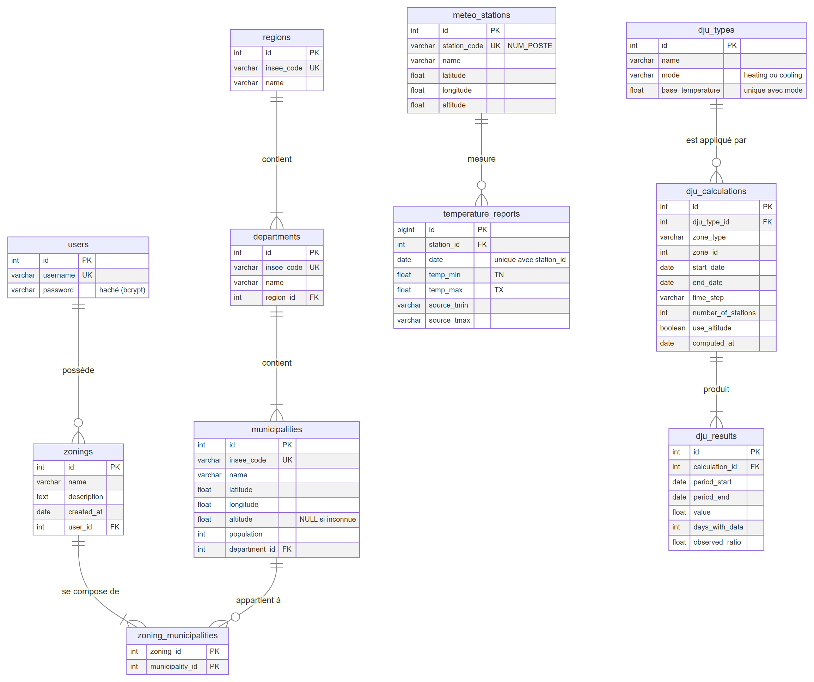
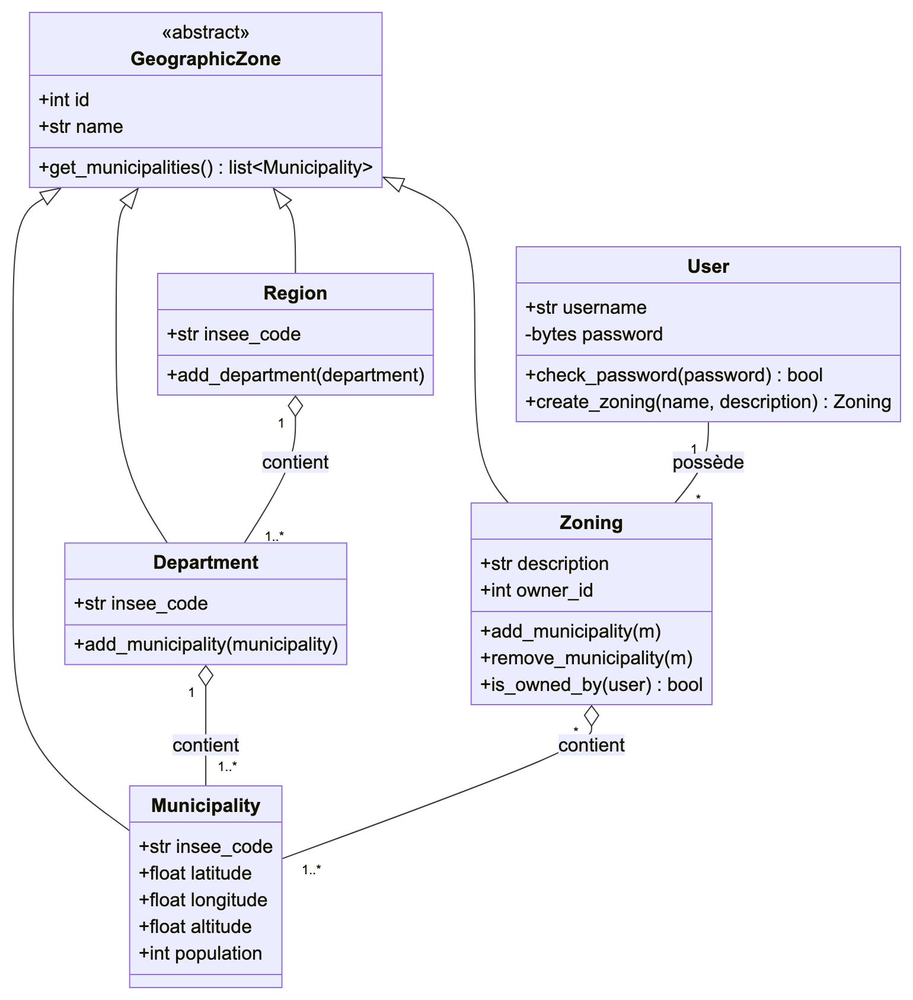
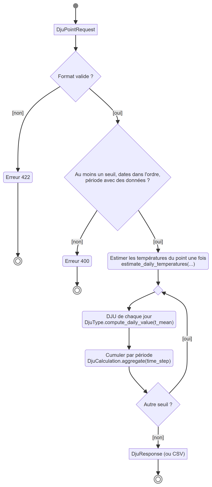
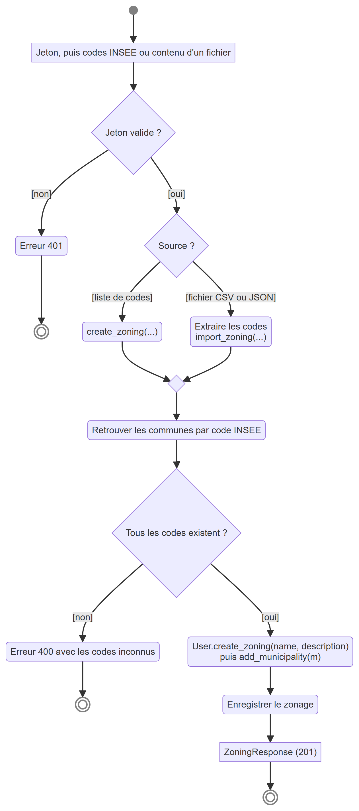
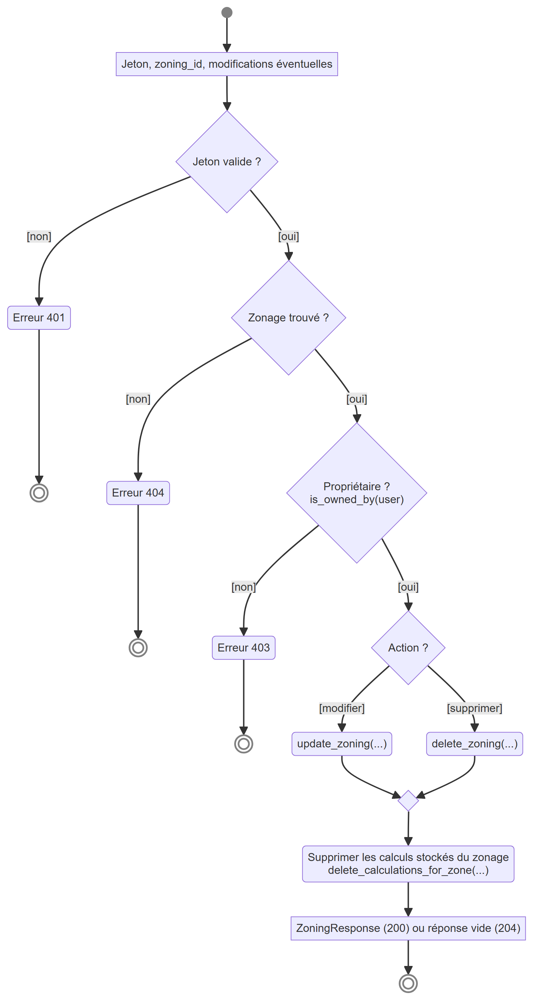
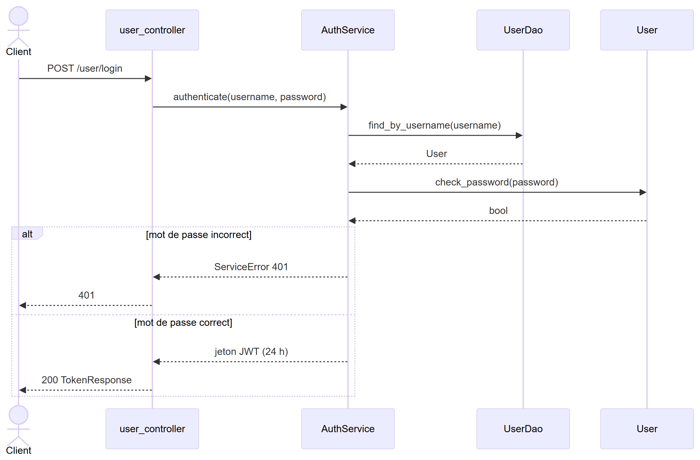
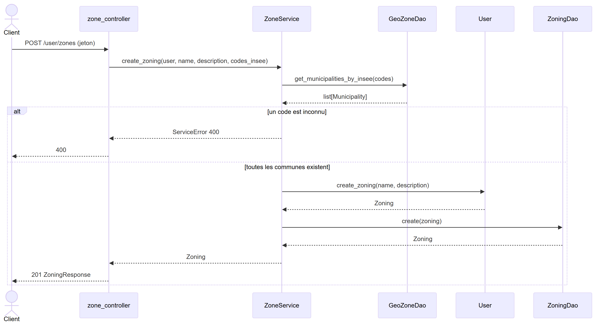

<!-- Partie document -->

\begin{titlepage}
\centering

\begin{flushright}
\tiny Campus de Ker Lann rue Blaise Pascal\\
BP37203 35172 BRUZ CEDEX\\
Tél : +33 (0) 2 99 05 32 32\\
communication@ensai.fr\\
www.ensai.fr\\
\end{flushright}

\includegraphics[width=0.35\textwidth]{ensai_logo.png}\\
\vspace{0.4cm}

{\Large\textsc{Rapport Final}}\\

\vspace{1.0cm}

\rule{\textwidth}{0.5mm}\\
\vspace{0.4cm}

\begin{flushleft}
\emph{Sujet :}\\
\textbf{API de calcul de DJU}\\
\end{flushleft}

\vspace{0.4cm}
\rule{\textwidth}{0.5mm}\\

\vspace{1.0cm}

\begin{flushleft}
\emph{Groupe 12 :}\\
\textbf{Aziz Yousfi}\\
\textbf{Eudes Sterlin}\\
\textbf{Gabriel Dahan}\\
\textbf{Gwenaël Lassalle}\\
\textbf{Marceau Feral}
\end{flushleft}

\begin{flushright}
\emph{Tuteur :}\\
\textbf{Thierry Mathé}\\
\end{flushright}

\vfill
\begin{center}
ENSAI\\
2026--2027
\end{center}
\end{titlepage}
\begingroup
\setstretch{1.0}
\setlength{\parskip}{0pt}
\setcounter{tocdepth}{1}
\tableofcontents
\endgroup

# Introduction {.unnumbered}

Dans les logements et les bureaux, la consommation d'énergie dépend beaucoup de la météo : on chauffe davantage quand il fait froid, et on climatise davantage quand il fait chaud. Quand on compare les consommations d'une année sur l'autre, il est donc difficile de savoir si une baisse vient d'une amélioration réelle (travaux, changement d'habitudes) ou simplement d'un hiver plus doux.

Pour tenir compte de cet effet, on utilise les *degrés-jours unifiés (DJU)*. Chaque jour, on mesure l'écart entre la température extérieure et un *seuil* de confort thermique, choisi par l'utilisateur dans sa requête. Ce seuil est la température au-dessus de laquelle on ne chauffe plus (ou en dessous de laquelle on ne climatise plus). Pour le chauffage, la littérature retient des valeurs de 15 à 18 °C, et le service statistique du ministère de la Transition écologique (SDES) publie par exemple des DJU calculés avec des seuils de 15 et 17 °C [@sdes_dju]. Plus il fait froid par rapport au seuil, plus les DJU de chauffage sont élevés, ce qui permet de corriger en partie l'influence de la météo sur les consommations.

En pratique, on calcule d'abord la température moyenne du jour $T_m = (T_{\min} + T_{\max}) / 2$. Pour un seuil de chauffage $S_c$ et un seuil de climatisation $S_f$, le DJU d'un jour s'écrit :

$$
\mathrm{DJU}_{\mathrm{chauffage}} = \max(0,\, S_c - T_m),
\qquad
\mathrm{DJU}_{\mathrm{climatisation}} = \max(0,\, T_m - S_f).
$$

Les valeurs quotidiennes sont ensuite additionnées sur la période et le pas de temps demandés. Pour un territoire, on fait en plus la moyenne des communes, pondérée par leur population.

Notre projet consistait à concevoir et à développer une API qui calcule et agrège ces DJU. L'utilisateur peut l'interroger sur un point GPS, sur un *zonage* officiel (département ou région) ou sur un zonage personnalisé qu'il a lui-même défini. Avant toute utilisation, un administrateur alimente l'application à partir des relevés de Météo-France et du référentiel géographique. À la fin du projet, toutes les fonctionnalités obligatoires (F0 à F4) et les trois fonctionnalités optionnelles (FO1 à FO3) sont réalisées, et la base contient les relevés quotidiens de la France entière depuis 1990 : 4 555 stations et environ 32 millions de relevés.

Nous rappelons d'abord le cahier des charges, les choix techniques, le traitement des données manquantes et l'organisation de l'équipe. Nous présentons ensuite la conception de l'API, fonctionnalité par fonctionnalité, et terminons cette partie par un bilan des changements depuis le dossier d'analyse. La dernière partie porte sur la réalisation : les passages du code qui nous ont demandé le plus de travail, les tests, la comparaison de nos résultats avec ceux du SDES, les temps de réponse et les limites de l'API.

# Spécifications et organisation

## Acteurs {#sec-acteurs}

- L'*utilisateur anonyme* calcule des DJU et consulte les zonages officiels sans compte.
- L'*utilisateur authentifié* a les mêmes droits. Il peut en plus créer, modifier, supprimer ou importer des zonages personnalisés, puis lancer des calculs dessus.
- L'*administrateur* n'utilise pas les routes de l'API. Il exécute une fois, en dehors de l'API, les scripts qui téléchargent, nettoient et chargent les données dans la base (F0).

## Notions de base

Un *zonage* est un ensemble de communes. Les zonages officiels (départements et régions) sont visibles par tous, alors qu'un zonage personnalisé n'est visible que par l'utilisateur qui l'a créé.

Le *seuil* est toujours fourni dans la requête. Si l'utilisateur ne donne qu'un seuil de chauffage, seuls les DJU de chauffage sont calculés, et de même pour la climatisation. Il peut aussi demander les deux en même temps : les températures ne sont alors estimées qu'une fois.

Enfin, il ne faut pas confondre la période des données disponibles, du 1er janvier 1990 aux derniers relevés chargés, avec la période de calcul, celle que demande l'utilisateur (`start_date` à `end_date`), avec un pas d'agrégation quotidien, hebdomadaire, mensuel ou annuel.

## Fonctionnalités de base

**F0 : initialisation des bases.** L'administrateur lance quatre scripts du dossier `data/`. Ils téléchargent les relevés quotidiens des stations Météo-France [@meteofrance_quot] et le référentiel des communes (geo.api.gouv.fr [@geo_api], altitudes de l'IGN [@ign_alti]), traitent les valeurs manquantes, puis remplissent la base PostgreSQL.

**F1 : calcul d'un DJU ponctuel.** À partir de coordonnées GPS (latitude, longitude et, si on le souhaite, altitude), le système estime la température locale puis calcule les DJU sur la période et au pas de temps demandés. Par exemple, les DJU mensuels du 1er janvier 2010 au 31 décembre 2025.

**F2 : consultation des zonages officiels.** Tout utilisateur, même non connecté, peut lister les départements et les régions, puis obtenir le détail d'une zone avec la liste de ses communes.

**F3 : calcul d'un DJU sur un territoire.** Le calcul porte sur une région, un département ou un zonage personnalisé. Les DJU communaux sont agrégés par une moyenne pondérée par la population. Le résultat peut être donné pour la zone entière, pour chacun de ses départements ou pour chacune de ses communes : par exemple, les DJU annuels de chaque département d'Île-de-France entre 2015 et 2024.

**F4 : zonages personnalisés.** Un utilisateur authentifié crée ses propres zonages à partir de codes INSEE, les modifie ou les supprime, et lance des calculs dessus.

## Fonctionnalités optionnelles

Nous présentons les fonctionnalités optionnelles dans l'ordre de priorité fixé dans le dossier d'analyse, et non dans l'ordre de leur numéro : la conservation des résultats nous paraissait la plus utile, la mise en forme la moins urgente.

**FO1 : conservation des résultats** (priorité haute). Les calculs sur un territoire sont enregistrés avec tous leurs paramètres, et une requête identique est servie directement depuis la base. Les calculs en un point ne sont pas conservés (voir @sec-cache).

**FO3 : import de zonages** (priorité moyenne). Un zonage peut être créé à partir du contenu d'un fichier CSV ou JSON qui contient des codes INSEE.

**FO2 : mise en forme des résultats** (priorité basse). Les routes de calcul renvoient du JSON par défaut, et un fichier CSV si l'on ajoute le paramètre `format=csv`.

## Questionnement et choix

Pour chaque choix technique, nous donnons la solution retenue et, si elle a changé depuis le dossier d'analyse, ce qui nous a fait changer d'avis.

### Comptes et droits {#sec-comptes}

Le calcul de DJU en un point ou sur un zonage officiel reste public, mais il faut un compte pour enregistrer des zonages personnalisés. Nous avons gardé ce double niveau d'accès, prévu dans le dossier d'analyse.

Après la connexion (`POST /user/login`), l'API renvoie un jeton JWT signé, valable 24 heures, que le client transmet ensuite dans l'en-tête `Authorization`. Ce jeton, qui contient l'identifiant de l'utilisateur, n'est pas stocké en base : pas de table de sessions à gérer. Les mots de passe sont hachés avec bcrypt, qui ajoute un sel aléatoire : deux utilisateurs qui ont le même mot de passe n'ont pas le même hash. Le mot de passe en clair n'est pas enregistré, et l'attribut correspondant de la classe `User` est privé.

### Stockage : Parquet en amont, PostgreSQL pour l'API {#sec-stockage}

Dans le dossier d'analyse, l'API devait lire les séries de températures dans des fichiers Parquet. Nous avons finalement gardé Parquet uniquement pour la chaîne de préparation des données. Chaque script y écrit son résultat, ce qui permet de relancer le nettoyage sans retélécharger plusieurs gigaoctets. L'API, elle, ne lit que PostgreSQL.

Avec une seule source de données, les calculs ne risquent plus de mélanger deux versions des relevés. La contrainte d'unicité sur (`station_id`, `date`) crée aussi un index, qui accélère la requête la plus fréquente : lire les relevés de quelques stations sur une période. Enfin, les clés étrangères protègent les liens entre régions, départements, communes, zonages et utilisateurs. Les calculs stockés font exception, comme on le verra en @sec-modele-donnees.

### Interpolation spatiale et altitude

\needspace{8\baselineskip}

Il y a rarement une station exactement à l'endroit demandé. Nous estimons donc la température à partir des $n$ stations les plus proches, par pondération inverse du carré de la distance (IDW) [@shepard1968], les distances étant calculées par la formule d'Haversine [@sinnott1984] :

$$
\hat{T}(x) = \frac{\sum_{i} w_i\, T_i}{\sum_{i} w_i},
\qquad w_i = \frac{1}{d(x, s_i)^2}.
$$

Le nombre $n$ de stations est un paramètre facultatif de la requête (entre 1 et 10, 3 par défaut). Seules les stations qui ont des relevés sur la période sont retenues, et chaque jour, la moyenne n'utilise que les stations qui ont une valeur ce jour-là.

Les stations doivent aussi être à moins de 50 km du lieu, le rayon déjà utilisé pour choisir les voisines lors du comblement des trous (@sec-manquantes). Sans cette limite, un point en mer ou à l'étranger recevrait des DJU calculés avec des stations lointaines, qui ne le représentent pas. Si aucune station n'est assez proche, le calcul est refusé ; s'il y en a moins que $n$, le calcul se fait avec celles qui existent et la réponse le signale. Cette limite ne détecte pas tout : un point du Pays basque espagnol, à moins de 50 km de stations françaises, reste calculé. Il faudrait pour cela connaître le contour du territoire.

L'altitude du lieu est facultative. Si elle est absente, aucune correction n'est faite. Si elle est fournie, chaque température de station est corrigée de $-0{,}65$ °C par 100 m d'écart d'altitude avec le lieu, ce qui correspond au gradient de l'atmosphère type [@oaci_atmosphere]. Pour une commune, nous prenons les coordonnées et l'altitude de la mairie plutôt que celles du centre géométrique, car la mairie est en général plus proche des habitations. L'écart peut être important (à Chamonix, 1 036 m à la mairie contre 1 885 m au centre).

### Cache et réutilisation {#sec-cache}

Le dossier d'analyse prévoyait deux niveaux de cache : les températures quotidiennes estimées de chaque commune, puis les résultats finaux. Nous n'avons gardé que le second.

Les résultats d'un calcul sur un territoire sont enregistrés dans les tables `dju_calculations` et `dju_results`. Un calcul est retrouvé grâce à l'ensemble de ses paramètres : zone, type de DJU (mode et seuil), période, pas de temps, nombre de stations et prise en compte de l'altitude. Quand un zonage personnalisé est modifié ou supprimé, ses calculs stockés sont effacés, car ils ne correspondent plus à son contenu.

Rempli à l'avance, le cache des températures communales aurait représenté des centaines de millions de lignes (près de 35 000 communes sur plus de trente ans). Et après la vectorisation de l'estimation (@sec-vectorisation), estimer les températures de toutes les communes d'une région ne prend plus que quelques secondes (@sec-perf) : le relire n'aurait presque rien fait gagner. Nous l'avons donc abandonné, et sa DAO a été retirée du code.

Les calculs en un point (F1) ne sont pas stockés non plus : deux utilisateurs donnent très rarement les mêmes coordonnées. Les DJU journaliers, qui dépendent du seuil et de températures estimées non conservées, sont recalculés à chaque demande.

### Période demandée et données disponibles {#sec-periode}

Une requête peut demander une période qui dépasse les données chargées, par exemple à partir de 1980. Plutôt que de la refuser, le service ramène la période aux dates disponibles et ajoute un champ `warning` à la réponse pour le signaler. Si la période demandée ne recoupe aucune donnée, l'API renvoie une erreur 400 qui indique les dates disponibles. Chaque résultat donne aussi le nombre de jours réellement calculés (`days_with_data`), pour que l'utilisateur sache si une période est incomplète.

## Gestion des données manquantes {#sec-manquantes}

Les trous des fichiers bruts de Météo-France sont traités une seule fois, par `qualite_meteo.py`, avant le chargement en base : l'API ne voit que des séries déjà complétées.

Le script nettoie d'abord les séries. Une température hors de $[-50 ; 50]$ °C est considérée comme aberrante : on vide cette seule valeur, qui sera comblée comme un trou ordinaire, et on garde le reste de la série. Les jours sans aucune température (stations qui ne mesurent que la pluie, par exemple) sont retirés. Chaque station est ensuite placée sur un calendrier journalier complet, pour que les jours absents du fichier deviennent des trous visibles.

Seules $T_{\min}$ et $T_{\max}$, utilisées dans le calcul, sont comblées, avec une méthode qui dépend de la longueur du trou. Les « voisines » d'une station sont ses 5 stations les plus proches, à moins de 50 km.

- Pour un trou de 1 à 2 jours, on fait une interpolation linéaire entre les valeurs qui l'encadrent.
- De 3 à 7 jours, on combine $70\,\%$ de la tendance locale et $30\,\%$ de la moyenne des voisines. Chaque voisine est d'abord ramenée au niveau de la station, en lui ajoutant l'écart moyen entre les deux stations, mesuré sur les jours où les deux ont une observation réelle. Cet écart tient compte d'une différence d'altitude ou de la proximité de la mer.
- De 8 à 30 jours, on ajuste une régression linéaire $T = a_1 T_{v_1} + \dots + a_k T_{v_k} + b$ sur les voisines qui ont une mesure chaque jour du trou, avec au moins 30 jours d'observations communes.
- Au-delà de 30 jours, on ne comble pas : inventer un mois entier de températures fausserait les DJU.

Seules les mesures réellement observées des voisines servent au comblement, jamais une valeur déjà comblée. Comme $T_{\min}$ et $T_{\max}$ sont comblées séparément, elles peuvent se croiser. Le script vérifie donc qu'on n'a pas $T_{\min} > T_{\max}$ ; si c'est le cas, il retire la valeur comblée et garde la mesure réelle.

Enfin, chaque valeur garde sa source (`observee`, `interpolee_1_2j`, `interpolee_3_7j`, etc.) dans les colonnes `source_tmin` et `source_tmax`. L'API s'en sert pour indiquer, dans chaque résultat, la part de jours calculés uniquement à partir de mesures observées (`observed_ratio`).

Nous n'avons pas gardé trois règles d'exclusion de stations ni la correction saisonnière prévues dans le dossier d'analyse. Écarter les stations qui couvrent moins de $65\,\%$ de la période n'est plus utile, puisque l'estimation remplace d'elle-même une station sans relevés par la suivante et ne fait chaque jour la moyenne que sur les stations qui ont une valeur. La correction saisonnière des trous longs fait double emploi avec la régression : les stations voisines subissent les mêmes variations saisonnières que la station à combler. Les deux autres règles, sur les stations en doublon à moins de 500 m et les séries constantes pendant 30 jours, n'ont pas été mises en place faute de temps ; nous y revenons dans les limites (@sec-limites).

## Organisation du travail {#sec-organisation}

Le dépôt GitHub a été créé le 28 août. Chaque jeudi, un fichier de suivi dans `doc/tracking/` récapitule ce que chacun a fait dans la semaine et ce qui reste à faire. Ils ont permis de reconstituer le planning ci-dessous.

{#fig-gantt width="78%" fig-pos="htbp"}

Le projet s'est déroulé en trois temps. En septembre, nous avons analysé le sujet, cherché les sources de données et écrit le dossier d'analyse, terminé la semaine du 17 septembre. Le tuteur nous l'a ensuite rendu annoté. Ses remarques portaient surtout sur la modélisation : des diagrammes en anglais, des noms différents de ceux du code, des activités sans entrées ni sorties, et des diagrammes de séquence qui ne montraient pas les classes et leurs méthodes. Nous avons donc réécrit tous les diagrammes en français, avec les noms du code (corrections terminées le 8 octobre).

Le reste d'octobre a peu avancé : l'API ne démarrait pas avant que Gabriel la rende exécutable, la semaine du 22 octobre. Le 3 novembre, un état des lieux a comparé tout le code aux nouveaux diagrammes et listé les écarts. Parmi eux : l'API ne démarrait pas, car la route d'import attendait un fichier joint, ce qui exige une bibliothèque supplémentaire ; la lecture des relevés plantait à cause d'un nom de colonne (`station_id`) ; les scripts de données remplissaient des tables que l'API ne lisait pas ; et l'API ne chargeait pas le fichier `.env`. Ces écarts corrigés, 87 tests passaient et toutes les fonctionnalités marchaient sur une base contenant les données de la Bretagne. La France entière a été chargée la semaine suivante ; les deux dernières semaines ont servi aux tests, aux mesures et au rapport.

Côté Git, tout le monde a travaillé directement sur la branche `main`, sans branche ni relecture avant fusion. 24 des 186 commits sont des fusions automatiques, créées quand deux personnes poussaient en même temps. Cela a suffi tant que chacun travaillait sur ses propres fichiers, mais des écarts de noms entre les couches ne sont apparus qu'à l'assemblage. Le travail a été réparti par domaine, chacun testant son propre code.

- **Aziz Yousfi** : objets métier, contrôleurs et schémas, puis réécriture du calcul des DJU (`run()`, `run_for_zone()`) et tests des objets métier.
- **Eudes Sterlin** : socle de l'API et premier contrôleur, README, DAO des calculs DJU, schéma SQL final, mise à jour des diagrammes et état des lieux du code.
- **Gabriel Dahan** : structure du dépôt et gabarit du rapport, connexion à la base, services et routes de toutes les fonctionnalités, gestion des erreurs, alignement de la couche DAO.
- **Gwenaël Lassalle** : recherche des sources de données, import des communes, introduction et spécifications du dossier d'analyse, diagrammes, chargement de la France entière dans PostgreSQL et reconnexion automatique de l'API, rapport final.
- **Marceau Feral** : chaîne de données (`meteo.py`, `qualite_meteo.py`, `communes.py`, `init_db.py`) et ses tests, traitement des valeurs manquantes, vectorisation de l'estimation des températures, réécriture des diagrammes.

Nous avons utilisé un assistant d'IA (Claude Code) comme outil d'appoint, dans quatre situations : diagnostiquer des erreurs sur lesquelles nous bloquions (environnement Python, messages de FastAPI ou de psycopg2, requêtes SQL au résultat inattendu) ; obtenir des exemples de code sur des points que nous ne maîtrisions pas encore, comme la commande `COPY` appelée depuis Python, le pivot de tableaux pandas ou les dépendances FastAPI ; comparer le code aux diagrammes lors de l'état des lieux ; enfin rédiger et mettre en forme ce rapport. Nous avons adapté ces propositions à notre modèle de données, puis relu et testé le résultat. La conception (architecture, modèle de données, méthodes de calcul et de comblement) est celle de l'équipe.

# Conception de l'API

Les noms de classes et de méthodes utilisés dans cette partie sont ceux du code, et les diagrammes sont en français. Le tableau de toutes les routes de l'API est en annexe ([-@sec-routes]).

## Architecture en couches

L'application est organisée en couches. FastAPI expose les routes REST : chaque route est traitée par un contrôleur (`dju_controller`, `zone_controller`, `user_controller`), qui valide la requête grâce aux schémas Pydantic puis appelle le service correspondant. Les services (`DjuService`, `TemperatureService`, `ZoneService`, `AuthService`) coordonnent le traitement. Les objets métier (`DjuCalculation`, `GeographicZone`, `Zoning`, etc.) portent les règles du calcul DJU : formule, agrégation par période et pondération par la population. L'estimation des températures (choix des stations, IDW, correction d'altitude) est, elle, faite dans `TemperatureService`, pour pouvoir lire les relevés de toutes les stations en une seule requête (@sec-vectorisation). Seule la couche DAO accède à PostgreSQL, et les scripts de préparation des données sont à part.

{#fig-architecture width="90%" fig-pos="htbp"}

Comme les objets métier n'accèdent pas à la base, on peut les tester avec quelques valeurs écrites à la main. Les services, eux, reçoivent leurs DAO dans leur constructeur : dans les tests, on les remplace par de faux objets (@sec-tests).

## Modèle de données {#sec-modele-donnees}

Le schéma relationnel (`data/init_db.sql`) reprend les entités du domaine en quatre groupes : les utilisateurs, le territoire et les zonages, les données météo et le cache des calculs.

{#fig-mpd width="100%" fig-pos="htbp"}

La table `users` contient le nom d'utilisateur, déclaré unique, et le mot de passe haché. Si deux personnes s'inscrivent en même temps sous le même nom, la contrainte d'unicité refuse la seconde, et le service renvoie une erreur 409. Chaque zonage personnalisé désigne son propriétaire par la clé étrangère `user_id`, avec l'option `ON DELETE CASCADE` : supprimer un compte supprime ses zonages.

Les tables `regions`, `departments` et `municipalities` reprennent la hiérarchie administrative. Chaque ligne a un identifiant interne (la clé primaire) et son code INSEE, déclaré unique. L'utilisateur ne manipule que les codes INSEE, qu'il connaît : les routes de consultation, de calcul et de création de zonages désignent une zone par son code, et l'identifiant interne ne sert qu'aux jointures et à la clé du cache. La table `municipalities` contient ce qu'il faut pour un calcul sur un territoire : coordonnées de la mairie, altitude et population. Une commune pouvant appartenir à plusieurs zonages, le lien passe par la table `zoning_municipalities`, dont la clé primaire (`zoning_id`, `municipality_id`) empêche d'ajouter deux fois la même commune.

La table `temperature_reports` contient un relevé par station et par jour. Nous ne gardons que $T_{\min}$ (colonne `TN` de Météo-France) et $T_{\max}$ (`TX`). La température moyenne mesurée (`TM`) n'est pas utilisée, car la méthode de référence définit la moyenne comme $(T_{\min} + T_{\max}) / 2$, que nous recalculons au moment du calcul. Les colonnes `source_tmin` et `source_tmax` gardent l'origine de chaque valeur.

Côté cache, la table `dju_types` enregistre une seule fois chaque couple (mode, seuil). La zone d'un calcul est désignée par le couple (`zone_type`, `zone_id`), où `zone_id` est l'identifiant interne de la ligne et non le code INSEE, car elle peut être une région, un département, une commune ou un zonage, donc une ligne de l'une de quatre tables différentes. Une clé étrangère classique est alors impossible : c'est le service qui garde la cohérence, en supprimant les calculs d'un zonage modifié.

## Vue des cas d'utilisation

Le diagramme des cas d'utilisation reprend les acteurs de la @sec-acteurs et les relie aux fonctionnalités. L'utilisateur authentifié dispose aussi de tous les cas de l'utilisateur anonyme, mais nous n'avons pas répété ces liens pour garder le schéma lisible. « Gérer un zonage » regroupe la modification de la description, l'ajout ou le retrait de communes et la suppression.

{#fig-cas width="85%" fig-pos="htbp"}

## Modèle du domaine {#sec-domaine}

Les objets métier forment trois groupes. Le premier décrit le territoire : `GeographicZone` est une classe abstraite dont héritent `Region`, `Department`, `Municipality` et `Zoning` (@fig-classes-zone). Toutes exposent `get_municipalities()`, si bien qu'un calcul sur un territoire traite de la même façon une région, un département ou un zonage. Le deuxième groupe décrit les données météo, avec `MeteoStation`. Les relevés quotidiens ne sont pas des objets Python : ils sont lus en une requête sous forme de tableau pandas, une ligne par station et par jour, pour que l'estimation soit vectorisée (@sec-vectorisation).

{#fig-classes-zone width="85%" fig-pos="htbp"}

Le troisième groupe décrit le calcul (@fig-classes-dju). Un `DjuCalculation` représente une demande : il applique un `DjuType` (mode et seuil) et produit une liste de `DjuResult`, un par période. Il ne porte qu'un seul `DjuType`, donc une demande avec deux seuils crée deux calculs. Un calcul n'est rattaché à aucun utilisateur : un calcul stocké sert à tous ceux qui posent la même question, et seul l'accès aux zonages personnalisés est contrôlé.

{#fig-classes-dju width="100%" fig-pos="htbp"}

Les services coordonnent ces objets. Ce sont les seuls à utiliser les DAO.

| Service | Méthodes principales | Rôle |
|:------------------|:---------------------------|:------------------------|
| `DjuService` | `calculate_point_dju`, `calculate_zone_dju` | Contrôle la requête, crée les `DjuCalculation`, consulte et remplit le cache des calculs sur territoire |
| `TemperatureService` | `find_candidate_stations`, `estimate_daily_temperatures`, `get_municipality_temperatures` | Choisit les stations, lit leurs relevés et estime les températures par IDW |
| `ZoneService` | `list_public_zones`, `get_zone`, `get_sub_zones`, `create_zoning`, `import_zoning`, `update_zoning`, `delete_zoning` | Lit les territoires, découpe une zone, gère les zonages et vérifie leur propriétaire |
| `AuthService` | `register`, `authenticate`, `get_current_user` | Crée les comptes, délivre et vérifie les jetons JWT |

: Services de l'API et leurs méthodes principales

Le calcul lui-même se fait en trois étapes. `DjuType.compute_daily_value()` calcule le DJU d'un jour à partir de la température moyenne. Elle accepte aussi bien un nombre qu'un tableau pandas, ce qui permet de traiter toute une période d'un coup. `DjuCalculation.run()` applique ce calcul à chaque jour, puis `aggregate()` additionne les valeurs par jour, semaine ISO, mois ou année. Pour un territoire, `run_for_zone()` fait la même chose sur un tableau qui a une colonne par commune, puis agrège les communes par une moyenne pondérée par la population.

## F0 — Initialisation des données

L'initialisation enchaîne quatre scripts, qui se passent leurs résultats par des fichiers Parquet. C'est l'administrateur qui les lance, en dehors de l'API.

`meteo.py` télécharge, pour chaque département, l'archive 1950–2024 et les données récentes 2025–2026 de Météo-France. Il ne garde que huit colonnes (`NUM_POSTE`, `DATE`, `NOM_USUEL`, `TN`, `TX`, `LAT`, `LON`, `ALTI`) et les dates à partir de 1990, et renomme les températures en `TMIN` et `TMAX`. Chaque département est enregistré à part, si bien qu'une coupure réseau ne fait perdre que le département en cours. `qualite_meteo.py` traite ensuite les valeurs manquantes (@sec-manquantes) département par département. Pour chaque département, il charge aussi les stations situées à moins de 50 km, qui peuvent servir de voisines : on limite ainsi la mémoire utilisée tout en obtenant le même résultat qu'avec un traitement de toute la France. `communes.py` récupère régions, départements et communes sur geo.api.gouv.fr, puis l'altitude de chaque mairie auprès de l'API de l'IGN, par lots de 250 points.

`init_db.py` crée enfin les tables et les remplit. Notre premier essai insérait les relevés ligne par ligne, ce qui aurait pris des heures pour 32 millions de lignes. Le script copie désormais les relevés par lots dans une table temporaire avec la commande `COPY` de PostgreSQL, puis les insère avec `ON CONFLICT DO NOTHING`. On peut ainsi le relancer sans créer de doublons, par exemple pour ajouter les relevés récents.

{#fig-act-f0 width="100%" fig-pos="htbp"}

## Estimation des températures locales

Avant tout calcul DJU, il faut une série quotidienne de températures pour chaque lieu demandé : le point GPS pour F1, la mairie de chaque commune pour F3. C'est le rôle de `TemperatureService`.

Le service reçoit un ou plusieurs lieux (latitude, longitude, éventuellement altitude), la période et le nombre $n$ de stations. Il renvoie deux tableaux, avec une ligne par jour et une colonne par lieu : le premier contient la température moyenne estimée, le second indique si cette valeur ne repose que sur des mesures observées.

`find_candidate_stations()` trie les stations par distance et garde, pour chaque lieu, les $n$ plus proches parmi celles situées à moins de 50 km. Les relevés de toutes ces stations sont lus en une seule requête SQL, même quand une station sert à plusieurs lieux. Si une station n'a aucun relevé sur la période, elle est remplacée par la suivante dans l'ordre des distances, jusqu'à ce que chaque lieu ait $n$ stations avec des données. `estimate_daily_temperatures()` applique ensuite la correction d'altitude et la pondération inverse à la distance. Le diagramme d'activité de cette estimation est en annexe (@fig-act-temp).

## F1 — Calcul d'un DJU ponctuel

La requête `POST /dju/point` donne la latitude, la longitude, éventuellement l'altitude, la période, le pas de temps, le nombre de stations et au moins un seuil (chauffage, climatisation ou les deux).

La requête est contrôlée à deux niveaux. Le schéma Pydantic `DjuPointRequest` vérifie le format : latitude entre $-90$ et $90$, longitude entre $-180$ et $180$, dates valides, nombre de stations entre 1 et 10, pas de temps parmi `day`, `week`, `month` et `year`. Une erreur de format renvoie une erreur 422. Le service vérifie ensuite que les paramètres sont cohérents entre eux : au moins un seuil, une date de début avant la date de fin, une période qui recoupe les données. Une incohérence renvoie une erreur 400.

`DjuService.calculate_point_dju()` estime alors les températures du point une seule fois, crée un `DjuCalculation` par seuil et appelle `run()`. Rien n'est stocké. La réponse liste les stations utilisées (code, nom, position, altitude et distance au point), pour que l'utilisateur puisse juger de la représentativité du résultat. Un champ `warning` signale une période raccourcie aux données disponibles ou un nombre de stations proches inférieur à celui demandé ; sans aucune station à moins de 50 km, la réponse est une erreur 404. Les diagrammes d'activité et de séquence de F1 sont en annexe.

## F2 — Consultation des zonages officiels {#sec-f2}

La route `GET /zones?type=...`, traitée par `ZoneService.list_public_zones()`, liste les régions, les départements ou les deux. Cette liste ne contient volontairement pas les communes, qui seraient près de 35 000 pour la France entière. Le détail d'une zone, avec ses communes, est donné par `GET /zones/{zone_type}/{insee_code}`, par exemple `GET /zones/department/22` pour les Côtes-d'Armor. Les zones sont toujours désignées par leur code INSEE : l'identifiant interne de la base (21 pour les Côtes-d'Armor) n'est jamais exposé, et ne sert qu'aux jointures et à la clé du cache. C'est avec ces routes que l'utilisateur trouve le code d'une zone avant de lancer un calcul F3. Les diagrammes correspondants sont en annexe.

## F3 — Calcul d'un DJU sur un territoire {#sec-f3}

La requête `POST /dju/zone` désigne une zone par `zone_type` et `zone_code` : le code INSEE pour une région ou un département (« 53 », « 2A »), l'identifiant du zonage pour un zonage personnalisé. Elle reprend les paramètres de F1 et ajoute un niveau d'agrégation (`zone`, `department` ou `municipality`) et l'indicateur `use_altitude`. Les zonages officiels sont publics. Pour un zonage personnalisé, il faut un jeton et être son propriétaire : l'API renvoie 401 sans jeton, 403 pour un autre utilisateur et 404 si la zone n'existe pas.

Le traitement se fait en deux temps (figure \ref{fig-seq-f3}, page \pageref{fig-seq-f3}). Le service découpe d'abord la zone en sous-zones selon le niveau d'agrégation, et cherche pour chaque sous-zone et chaque seuil un calcul déjà stocké. Il met de côté les calculs absents. Ensuite seulement, il estime en une fois les températures de toutes les communes concernées. Une région découpée par département ne lit donc les relevés qu'une seule fois.

\begin{figure}[p]
\centering
\oldincludegraphics[angle=90,width=\linewidth,height=0.9\textheight,keepaspectratio]{resources/diagrams_final/fig-seq-f3.png}
\caption{Calcul d'un DJU sur un territoire (F3)}\label{fig-seq-f3}
\end{figure}

Dans `run_for_zone()`, le DJU d'une zone $Z$ pour le jour $t$ est la moyenne des DJU communaux pondérée par la population $p_c$ :

$$
\mathrm{DJU}_Z(t) = \frac{\sum_{c \in Z_t} p_c\, \mathrm{DJU}_c(t)}{\sum_{c \in Z_t} p_c},
$$

où $Z_t$ est l'ensemble des communes qui ont, ce jour-là, une valeur de DJU et une population connue. Le dénominateur est donc la population de ces seules communes, et non celle de toute la zone. Si aucune commune de $Z_t$ n'a de population connue, on prend une moyenne simple. Nous avons repris cette pondération de la méthode du SDES [@sdes_note] : comme les DJU servent à analyser des consommations d'énergie, une ville très peuplée doit peser plus qu'un village.

## F4 — Zonages personnalisés {#sec-f4}

Après inscription (`POST /user/register`) et connexion (`POST /user/login`), l'utilisateur gère ses zonages sur les routes `/user/zones`. Avant chaque route protégée, une dépendance FastAPI (`get_current_user`) décode le jeton et renvoie 401 s'il est absent, invalide ou expiré.

Pour créer un zonage, l'utilisateur envoie un nom, une description et une liste de codes INSEE. `ZoneService.create_zoning()` nettoie les codes (espaces, doublons) et retrouve toutes les communes en une requête. Si un code est inconnu, tout le zonage est refusé, avec une erreur 400 qui liste les codes en cause : nous préférions prévenir l'utilisateur plutôt qu'enregistrer un zonage contenant des codes invalides. Le zonage est ensuite créé par `User.create_zoning()` puis enregistré.

L'import FO3 (`POST /user/zones/import`) suit le même chemin une fois les codes extraits du fichier. Le contenu du fichier est envoyé comme texte dans un corps JSON, et non comme fichier joint (voir la @sec-organisation). Un CSV peut utiliser la virgule ou le point-virgule : les codes sont lus dans la colonne `code_insee` si elle existe, sinon dans la première colonne. Un JSON peut être une liste de codes ou un objet `{"codes_insee": [...]}`.

La modification (`PATCH`) peut changer la description, ajouter ou retirer des communes, et la suppression (`DELETE`) retire le zonage et ses liens. Dans les deux cas, `Zoning.is_owned_by()` vérifie d'abord que l'utilisateur est le propriétaire (403 sinon), puis les calculs stockés du zonage sont supprimés. Un zonage doit toujours contenir au moins une commune.

## Évolutions depuis le dossier d'analyse {#sec-evolutions}

Le dossier d'analyse décrivait la conception prévue avant l'écriture du code. Pendant le développement, nous sommes revenus sur plusieurs choix, parfois parce qu'une solution plus simple répondait au même besoin, parfois pour tenir compte des remarques du tuteur. Le tableau ci-dessous rassemble ces changements, avec la section où chacun est détaillé.

\newpage

| Sujet | Prévu dans le dossier d'analyse | Réalisé | Raison du changement |
|:---------------|:-----------------|:--------------------|:-----------------|
| Stockage des relevés | Séries de températures lues en Parquet par l'API | Parquet seulement entre les scripts de préparation ; l'API ne lit que PostgreSQL ([-@sec-stockage]) | Une seule source pendant les calculs, avec index et clés étrangères |
| Cache | Deux niveaux : températures quotidiennes par lieu, puis résultats finaux, pour F1 et F3 | Un seul niveau : résultats des calculs sur territoire ; F1 non stocké ([-@sec-cache]) | Premier niveau trop volumineux, et devenu inutile après la vectorisation ; coordonnées d'un point rarement identiques |
| Nettoyage des données | Exclusion des stations couvrant moins de 65 % de la période, des doublons à moins de 500 m et des séries constantes sur 30 jours | Valeurs hors de \[−50 ; 50\] °C vidées puis comblées ; aucune station exclue ([-@sec-manquantes]) | Une station sans relevés est remplacée à l'estimation ; les deux autres contrôles n'ont pas été faits, faute de temps |
| Trous de 8 à 30 jours | Régression sur les voisines, avec correction saisonnière optionnelle | Régression sur les voisines seulement ([-@sec-manquantes]) | Les voisines subissent déjà les mêmes variations saisonnières |
| Qualité des résultats | Rapport détaillé : part de jours originaux, interpolés, spatialisés ou rejetés | `days_with_data` et `observed_ratio` pour chaque période ([-@sec-agregation]) | Deux indicateurs simples, tirés des colonnes `source_tmin` et `source_tmax` |
| Période demandée | Refus d'une période incompatible avec les données | Période ramenée aux données disponibles, avec un champ `warning` ([-@sec-periode]) | Une requête qui dépasse un peu les données reste utile |
| Paramètres de calcul | Pas quotidien, mensuel ou annuel ; $n$ facultatif | Pas hebdomadaire ajouté ; $n$ entre 1 et 10 ; niveau d'agrégation et `use_altitude` pour F3 ([-@sec-f3]) | Découper une région par département en une seule requête ; pouvoir reproduire la méthode du SDES |
| Zonages officiels (F2) | Une route de liste, avec les communes | Une liste légère, plus une route de détail par zone ([-@sec-f2]) | Éviter de renvoyer près de 35 000 communes à chaque appel |
| Comptes | Session après connexion | Jeton JWT valable 24 h, non stocké en base ([-@sec-comptes]) | Pas de table de sessions à gérer |
| Import (FO3) | Envoi d'un fichier CSV ou JSON | Contenu du fichier envoyé comme texte dans un corps JSON ([-@sec-f4]) | L'envoi de fichier empêchait l'API de démarrer sans bibliothèque supplémentaire |
| Modèle du domaine | Calculs rattachés à l'utilisateur qui les demande | Calculs indépendants des utilisateurs ([-@sec-domaine]) | Un calcul stocké sert à tous ceux qui posent la même question |
| Diagrammes | Libellés en anglais, lien peu clair entre les activités et les méthodes des classes | Réécrits en français, avec les noms du code, les entrées, les sorties et les méthodes appelées ([-@sec-organisation]) | Remarques du tuteur sur la cohérence de la modélisation |

: Principales évolutions entre le dossier d'analyse et la version finale

Aucune fonctionnalité du cahier des charges n'a été abandonnée. Ces changements ont surtout simplifié l'application : moins de données stockées, moins de règles de nettoyage, et des diagrammes beaucoup plus proches du code. Il reste quelques écarts entre le diagramme de classes et le code, que nous signalons dans les limites (@sec-limites).

# Réalisation et validation

## Points techniques notables

### Estimation vectorisée des températures {#sec-vectorisation}

Notre première version estimait les températures commune par commune et jour par jour, avec une requête SQL par station. Pour les 332 communes d'Ille-et-Vilaine sur une seule année, il fallait déjà une minute et demie, et une région entière devenait inutilisable. Le tuteur nous avait conseillé de vectoriser ce calcul avec numpy et pandas, et c'est ce que nous avons fait.

La nouvelle version lit les relevés de toutes les stations utiles en une seule requête, qui calcule directement la moyenne $(T_{\min} + T_{\max}) / 2$ et l'indicateur « observé ». Ces relevés sont pivotés en un tableau avec une ligne par jour et une colonne par station. Pour un lieu donné, les poids $1/d^2$ ne dépendent que des distances : on les calcule une fois pour toute la période, et non chaque jour. La moyenne pondérée de tous les jours s'obtient alors en quelques opérations matricielles :

``` python
values = means_by_station[ids].to_numpy(dtype=float)      # jours x stations
weights = 1 / np.maximum(distances, MIN_DISTANCE_KM) ** 2  # une fois pour la période
has_value = ~np.isnan(values)
weighted_sum = np.where(has_value, values * weights, 0.0).sum(axis=1)
weight_total = (has_value * weights).sum(axis=1)
means[key] = weighted_sum / weight_total                   # NaN si aucune station ce jour-là
```

Quand une station n'a pas de valeur un jour donné, le masque `has_value` retire simplement son poids du dénominateur pour ce jour-là. Si aucune station n'a de valeur, `weight_total` vaut 0 et la moyenne vaut `NaN` : le jour est alors absent du résultat et n'est pas compté dans `days_with_data`. La distance minimale de 10 m évite une division par zéro quand le lieu est exactement sur une station. Les distances sont calculées par une seule fonction, `haversine_km`, écrite avec numpy : elle donne aussi bien la distance entre deux points (`MeteoStation.distance_to()`, utilisée pour renvoyer la distance des stations) que la distance d'un lieu à toutes les stations en une opération. Le gain obtenu est mesuré en @sec-perf.

### Découpage calendaire des périodes {#sec-agregation}

`aggregate()` regroupe les DJU journaliers par période calendaire, grâce à la fonction `period_bounds()`. Une semaine va du lundi au dimanche (semaine ISO), un mois du premier au dernier jour du mois. Les bornes sont ensuite ramenées à la période demandée. Ainsi, une demande du 15 janvier au 10 mars au pas mensuel donne trois résultats : du 15 au 31 janvier, le mois de février, puis du 1er au 10 mars. Chaque `DjuResult` indique le nombre de jours réellement calculés (`days_with_data`) et la part de jours observés (`observed_ratio`), pour que l'utilisateur sache si une valeur repose sur des données complètes.

### Connexion à la base distante

La base de production est sur un serveur distant qui ferme les connexions inactives. Au début, la première requête après une pause échouait. `DBConnection` est un singleton : toutes les DAO partagent une seule connexion. Avant de la fournir, il vérifie qu'elle est encore ouverte, avec une requête `SELECT 1` si elle n'a pas servi depuis 30 secondes, et la rouvre si besoin. Les DAO qui lisent des données stables (liste des stations, période des relevés) les gardent en mémoire après la première lecture. Ce mécanisme a réglé les coupures, mais une connexion unique pose un autre problème quand plusieurs requêtes arrivent en même temps (@sec-limites).

### Codes d'erreur

Les services lèvent une seule exception, `ServiceError`, qui porte un message et un code HTTP. Les contrôleurs la traduisent en réponse HTTP par une fonction commune, `http_error()`. Ainsi, la logique métier ne dépend pas de FastAPI, et l'utilisateur reçoit un message qui explique son erreur plutôt qu'une erreur 500.

\needspace{8\baselineskip}

| Code | Cas |
|:--------------|:--------------------------------------------------------|
| 400 | Paramètres incohérents : aucun seuil, dates dans le désordre, période sans données, code INSEE inconnu, fichier illisible |
| 401 | Jeton absent, invalide ou expiré ; identifiants incorrects |
| 403 | Zonage appartenant à un autre utilisateur |
| 404 | Zone ou zonage introuvable ; aucune station à moins de 50 km du point |
| 409 | Nom d'utilisateur déjà pris |
| 422 | Format de requête invalide, détecté par Pydantic |

: Codes d'erreur renvoyés par l'API

## Tests {#sec-tests}

Les tests ont été écrits avec pytest, couche par couche. Aucun ne demande de base de données ni d'accès au réseau : on peut les lancer sur n'importe quelle machine, et leur résultat ne dépend pas du contenu de la base.

\needspace{8\baselineskip}

| Couche testée | Fichier | Tests | Méthode |
|:---------------|:-------------------|--------------:|:---------------------|
| Objets métier | `test_business_objects.py` | 25 | Données écrites à la main |
| Services | `test_services.py` | 53 | DAO remplacées par de faux objets |
| Contrôleurs et routes | `test_api.py` | 41 | Services remplacés, `TestClient` de FastAPI |
| Scripts de données | `test_data.py` | 25 | Fichiers fictifs, fausse connexion |

: Répartition des tests (les trois premiers fichiers sont dans `api/test/`, le dernier dans `data/`)

Les tests des objets métier vérifient la formule du DJU (jamais négative, en chauffage comme en climatisation), l'agrégation par semaine, mois et année avec des périodes coupées, et la pondération par la population, y compris quand certaines populations sont inconnues, et la distance d'Haversine entre Paris et Lyon, sur deux points comme sur un tableau. Pour les services, les DAO sont remplacées par de faux objets qui renvoient des données fixes. On peut ainsi tester l'estimation IDW sur deux stations, la correction d'altitude, le remplacement d'une station sans relevés, le lieu sans aucune station, l'utilisation du cache F3 et les codes d'erreur 400, 401, 403, 404 et 409. Les tests de routes vérifient les codes HTTP, la validation Pydantic (422) et le format CSV. Ceux des scripts de données vérifient chaque palier du comblement et le chargement en base sur une fausse connexion.

Les 144 tests passent. Le tableau suivant donne la couverture du code, mesurée avec `coverage`.

\needspace{9\baselineskip}

| Partie du code                                         | Couverture |
|:-------------------------------------------------------|-----------:|
| Objets métier                                          | 92 à 100 % |
| Services                                               |  90 à 99 % |
| Contrôleurs et schémas                                 | 68 à 100 % |
| DAO                                                    |  19 à 40 % |
| Total de l'API                                         |       77 % |
| `qualite_meteo.py` (traitement des valeurs manquantes) |       99 % |

: Couverture des tests

Les DAO sont peu couvertes, car elles ne font qu'exécuter des requêtes SQL et n'ont de sens que face à une vraie base. Nous les avons vérifiées en appelant toutes les fonctionnalités, d'abord sur une base contenant la Bretagne, puis sur la base complète.

## Validation des résultats {#sec-validation}

Les tests vérifient que le code fait ce que nous avons prévu, pas que les valeurs obtenues sont justes. Pour cela, nous avons comparé nos DJU à ceux que le SDES publie pour chaque département [@sdes_dju]. Sa méthode est proche de la nôtre [@sdes_note] : température moyenne $(T_{\min} + T_{\max})/2$, DJU calculés par commune puis moyennés en pondérant par la population. Elle s'en distingue sur trois points : un seuil de 17 °C, une somme limitée à la « saison de chauffe » (janvier à mai et octobre à décembre), et une seule station par commune, la plus proche, sans correction d'altitude.

Notre API permet de reproduire ces choix : seuil de 17 °C, une station (`number_of_stations = 1`), pas de correction d'altitude, puis somme des DJU mensuels de la saison de chauffe. Nous avons calculé l'année 2024 pour les 96 départements métropolitains avec ces réglages, puis avec les réglages par défaut (3 stations, correction d'altitude). Ce calcul a utilisé le code de l'API sans passer par le cache, pour ne pas y stocker de calculs de test.

| Réglages de l'API | Écart moyen (en valeur absolue) | Départements à moins de 5 % | Corrélation |
|:----------------------------|--------------:|--------------:|--------------:|
| Proches du SDES (1 station, sans altitude) | 1,8 % | 92 % | 0,99 |
| Par défaut (3 stations, avec altitude) | 2,6 % | 85 % | 0,98 |

: Comparaison avec les DJU départementaux 2024 du SDES (seuil de 17 °C, saison de chauffe, 96 départements)

\needspace{12\baselineskip}

| Département     |  SDES | API (1 station) |   Écart | API (par défaut) |  Écart |
|:----------------|------:|----------------:|--------:|-----------------:|-------:|
| Finistère       | 1 569 |           1 565 |  −0,2 % |            1 537 | −2,0 % |
| Ille-et-Vilaine | 1 657 |           1 652 |  −0,3 % |            1 643 | −0,8 % |
| Haute-Garonne   | 1 365 |           1 356 |  −0,7 % |            1 354 | −0,8 % |
| Bas-Rhin        | 2 022 |           1 977 |  −2,2 % |            1 938 | −4,2 % |
| Rhône           | 1 759 |           1 670 |  −5,0 % |            1 657 | −5,8 % |
| Paris           | 1 611 |           1 497 |  −7,1 % |            1 474 | −8,5 % |
| Corse-du-Sud    |   962 |             862 | −10,3 % |              962 | +0,1 % |

: Exemples de départements, du plus proche au plus éloigné des valeurs du SDES

Avec des réglages proches de ceux du SDES, l'écart reste faible dans la grande majorité des départements. C'est une bonne nouvelle pour toute la chaîne : téléchargement, comblement des trous, estimation, calcul et agrégation. Les écarts restants viennent surtout du choix des stations. Le SDES utilise environ 590 stations en 2024 et garde la même pour une commune toute l'année, alors que nous en avons 4 555 : la station la plus proche d'une commune n'est donc pas toujours celle du SDES. L'effet est le plus fort là où la température change vite d'un endroit à l'autre, comme dans les grandes villes (Paris, Rhône) ou sur un littoral montagneux (Corse-du-Sud). D'autres différences jouent moins : l'année de la population, les coordonnées de la mairie plutôt que du centre de la commune, ou le comblement des valeurs manquantes.

## Performances {#sec-perf}

Nous avons mesuré les temps de réponse depuis un ordinateur portable relié à la base distante. Ils comprennent donc les échanges réseau avec le serveur PostgreSQL. Chaque mesure n'a été faite qu'une fois et ne donne qu'un ordre de grandeur.

Pour mesurer l'effet de la vectorisation (@sec-vectorisation), nous avons estimé les températures des 332 communes d'Ille-et-Vilaine sur l'année 2024 avec l'ancienne version du code, puis avec la nouvelle. Les deux produisent les mêmes 121 512 températures journalières (332 communes × 366 jours). L'ancienne version met 90,8 s, la nouvelle 0,9 s, soit environ 100 fois moins.

Le tableau suivant donne les temps de réponse de l'API, pour un premier calcul puis pour la même requête servie par le cache.

| Requête (DJU de chauffage, pas mensuel sauf mention) | Communes | Premier calcul | Même requête (cache FO1) |
|:----------------------------|--------------:|--------------:|--------------:|
| F1 : point GPS (Rennes), 2024 | — | 0,1 s | non stocké |
| F3 : Ille-et-Vilaine, 2024 | 332 | 1,3 s | 0,5 s |
| F3 : Bretagne, 2024 | 1 202 | 2,0 s | 0,6 s |
| F3 : Bretagne, 2015–2024, pas annuel | 1 202 | 4,9 s | 0,7 s |
| F3 : Grand Est, 2024 | 5 115 | 4,7 s | 0,9 s |

: Temps de réponse mesurés sur la base complète

Le temps augmente beaucoup moins vite que le nombre de communes. Le Grand Est compte quatre fois plus de communes que la Bretagne, mais ne prend qu'un peu plus du double du temps, car les communes voisines partagent les mêmes stations, dont les relevés ne sont lus qu'une fois. La validation ci-dessus, qui couvre les quelque 35 000 communes de métropole département par département, a pris environ 40 s pour chaque réglage. Une requête déjà calculée revient en moins d'une seconde.

Le premier appel après le démarrage de l'API est plus lent, environ 10 s. Il lit la première et la dernière date des relevés, avec une requête `MIN`/`MAX` sur 32 millions de lignes, dont le résultat est ensuite gardé en mémoire.

## Utilisation de l'API

L'API se lance depuis `api/src` avec `python main.py`, une fois le fichier `.env` rempli (connexion PostgreSQL et clé `JWT_SECRET`). FastAPI génère alors une documentation interactive, disponible sur `http://localhost:5001/docs`, qui décrit chaque route, ses paramètres et ses réponses, et permet de les essayer directement.

Prenons un exemple : les DJU de chauffage mensuels de chaque département breton en 2024, avec un seuil de 18 °C. Le code INSEE de la Bretagne (53) est donné par `GET /zones?type=region`. On envoie ensuite la requête suivante :

``` json
POST /dju/zone
{
  "zone_type": "region", "zone_code": "53", "aggregation_level": "department",
  "start_date": "2024-01-01", "end_date": "2024-12-31",
  "heating_threshold": 18, "time_step": "month"
}
```

La réponse contient une entrée par département et, pour chaque mode demandé, la liste des périodes. L'extrait ci-dessous vient d'un appel réel sur la base complète. Pour qu'il tienne en quelques lignes, nous n'avons gardé que les mois de janvier et de décembre des Côtes-d'Armor (code INSEE 22) ; la réponse complète contient les douze mois des quatre départements.

``` json
{
  "zones": [
    { "zone_type": "department", "zone_code": "22", "name": "Côtes-d'Armor",
      "results": { "heating": [
        { "period_start": "2024-01-01", "period_end": "2024-01-31",
          "value": 363.28, "days_with_data": 31, "observed_ratio": 1.0 },
        { "period_start": "2024-12-01", "period_end": "2024-12-31",
          "value": 311.24, "days_with_data": 31, "observed_ratio": 1.0 } ] } } ],
  "warning": null
}
```

Le tableau suivant résume la réponse pour les quatre départements.

| Département     | Janvier | Juillet | Décembre | Total 2024 |
|:----------------|--------:|--------:|---------:|-----------:|
| Côtes-d'Armor   |   363,3 |    32,8 |    311,2 |      2 105 |
| Finistère       |   342,6 |    41,6 |    286,8 |      2 014 |
| Ille-et-Vilaine |   376,6 |    17,1 |    328,0 |      2 047 |
| Morbihan        |   356,9 |    30,3 |    309,7 |      2 015 |

: DJU de chauffage (seuil de 18 °C) des départements bretons en 2024

Ces ordres de grandeur sont cohérents avec le climat de chaque département. L'Ille-et-Vilaine, plus continentale, a l'hiver le plus froid et l'été le plus chaud. Le Finistère, plus océanique, a l'hiver le plus doux, mais garde des besoins de chauffage en juillet. Les 366 jours de l'année sont calculés pour chaque département. Pour le Morbihan, un des mois ne repose qu'à 87 % sur des mesures observées, et c'est justement ce qu'indique `observed_ratio`.

Avec `?format=csv`, la même requête renvoie un fichier `dju.csv` dont les colonnes sont `zone`, `mode`, `period_start`, `period_end`, `value`, `days_with_data` et `observed_ratio`, qu'on peut ouvrir directement dans un tableur.

## Limites et pistes d'amélioration {#sec-limites}

En relisant le code pour ce rapport, nous avons relevé plusieurs faiblesses. Les premières concernent la robustesse de l'API si elle était ouverte à de nombreux utilisateurs.

- **Une seule connexion pour toutes les requêtes.** FastAPI traite les requêtes simultanées dans plusieurs fils d'exécution, alors que `DBConnection` ne fournit qu'une connexion partagée. Si deux utilisateurs appellent l'API en même temps, la fin de transaction de l'un peut valider ou annuler le travail de l'autre. Un pool de connexions (`psycopg2.pool`), avec une connexion par requête, réglerait ce problème.
- **Aucune limite sur la taille d'un calcul.** Même sans compte, on peut demander une région au niveau des communes, au pas journalier, de 1990 à 2025. L'agrégation seule prend alors près de deux minutes, le service consulte le cache avec une requête par commune, et des dizaines de millions de lignes sont écrites dans `dju_results`. Il faudrait borner le nombre de communes × périodes, ou réserver les gros calculs aux utilisateurs connectés.
- **Index et contraintes manquants.** Il n'y a pas d'index sur `dju_results(calculation_id)`, si bien que chaque lecture du cache parcourt toute la table, ni sur `temperature_reports(date)`, ce qui explique les 10 s du premier appel. Rien n'empêche non plus d'enregistrer deux fois le même calcul : une contrainte `UNIQUE` sur ses paramètres l'interdirait. Chacun de ces points se corrige en une ligne de SQL.

D'autres limites concernent l'usage et la maintenance.

- **Création des zonages.** Une recherche de communes par nom, et la possibilité d'ajouter d'un coup toutes les communes d'un département, rendraient F4 plus pratique.
- **Contrôles de qualité non faits.** Les stations en doublon à moins de 500 m et les séries constantes pendant 30 jours (capteur bloqué) ne sont pas détectées. Un doublon ne fait que compter deux fois dans l'IDW, mais une série bloquée fausserait les DJU des lieux voisins.
- **Tests et exploitation.** Les DAO ne sont vérifiées qu'à la main ; des tests sur un schéma PostgreSQL dédié, vidé après chaque test, compléteraient la couverture. Les relevés récents sont ajoutés en relançant les scripts à la main ; une mise à jour planifiée et un conteneur Docker faciliteraient l'exploitation.
- **Correction climatique.** L'API pourrait aller jusqu'au calcul des coefficients de rigueur climatique, rapport entre un DJU de référence (par exemple la moyenne 1991–2020) et le DJU observé, qui servent à corriger les consommations.

# Conclusion {.unnumbered}

Ce projet a abouti à une API de calcul des DJU qui couvre toutes les fonctionnalités demandées (F0 à F4) et les trois fonctionnalités optionnelles. Elle calcule des DJU de chauffage et de climatisation en un point ou sur un territoire, pour n'importe quel seuil, période et pas de temps, à partir des relevés de toute la France depuis 1990.

Nous avons confronté nos résultats à une référence extérieure : avec des réglages proches de ceux du SDES, nos DJU départementaux de 2024 s'en écartent en moyenne de 1,8 % (@sec-validation). Une région entière se calcule en quelques secondes, et une requête déjà calculée revient en moins d'une seconde (@sec-perf).

Ces résultats tiennent surtout au traitement des données manquantes, fait une seule fois avant le chargement en base, avec une méthode adaptée à la longueur de chaque trou et une traçabilité qui remonte jusqu'à l'utilisateur. Ils tiennent aussi à l'estimation des températures par pondération inverse à la distance, corrigée de l'altitude, que nous avons dû vectoriser pour qu'elle reste rapide sur des milliers de communes.

Le projet a beaucoup évolué depuis le dossier d'analyse (@sec-evolutions). Nous avons abandonné la lecture des séries en Parquet par l'API, un des deux niveaux de cache et plusieurs règles de nettoyage, à chaque fois pour une solution plus simple qui répondait au même besoin. Les remarques du tuteur nous ont conduits à réécrire la modélisation pour la rapprocher du code, ce qui a rendu le développement des services beaucoup plus rapide. L'architecture en couches et l'injection des DAO dans les services nous ont enfin permis d'écrire 144 tests qui ne dépendent d'aucune base de données.

Sur le plan de l'organisation, le suivi hebdomadaire et la répartition par domaine ont bien fonctionné : chacun savait de quelle partie il était responsable, et les remarques du tuteur ont été prises en compte rapidement. L'avancement a en revanche été irrégulier. Plusieurs semaines d'octobre ont peu avancé, comme le montre le suivi, et l'essentiel des services, de l'intégration et des tests s'est concentré entre fin octobre et début novembre. Les couches ayant été écrites séparément, et sans relecture avant de pousser sur `main`, leur assemblage a fait apparaître tardivement des écarts de noms et de signatures. Avec le recul, nous aurions dû rendre l'API exécutable de bout en bout dès les premières semaines, même avec une seule fonctionnalité, puis l'enrichir petit à petit, en écrivant les tests en même temps que le code et en relisant le travail des autres avant chaque fusion.

\begingroup
\renewcommand{\clearpage}{\vspace{1.5em}}

# Références {.unnumbered}

\endgroup
\begingroup
\small
\setstretch{1.0}

::: {#refs}
:::

\endgroup

\appendix

# Annexes

## Diagrammes d'activité complémentaires

\FloatBarrier

{#fig-act-temp width="70%" fig-pos="H"}

{#fig-act-f1 width="62%" fig-pos="H"}

{#fig-act-create width="62%" fig-pos="H"}

{#fig-act-manage width="62%" fig-pos="H"}

\FloatBarrier

## Diagrammes de séquence complémentaires

{#fig-seq-f1 width="90%" fig-pos="H"}

{#fig-seq-f2 width="76%" fig-pos="H"}

{#fig-seq-login width="76%" fig-pos="H"}

{#fig-seq-create width="83%" fig-pos="H"}

{#fig-seq-manage width="83%" fig-pos="H"}

\FloatBarrier

## Synthèse des routes {#sec-routes}

| Fonct. | Route | Auth. | Paramètres d'entrée | Description |
|:-------------|:--------------|:-------------|:---------------|:--------------|
| F1 | `POST /dju/point` | Aucune | `latitude`, `longitude`, `altitude?`, `start_date`, `end_date`, `time_step`, `heating_threshold?`, `cooling_threshold?`, `number_of_stations?` | DJU sur un point GPS |
| F2 | `GET /zones` | Aucune | `type` (`department` \| `region` \| `all`) | Liste des zonages officiels |
| F2 | `GET /zones/{zone_type}/{insee_code}` | Aucune | `zone_type`, `insee_code` | Détail d'une zone et de ses communes |
| F3 | `POST /dju/zone` | Optionnelle¹ | `zone_type`, `zone_code`, `aggregation_level?`, paramètres de F1, `use_altitude?` | DJU sur un territoire |
| F4 | `POST /user/register` | Aucune | `username`, `password` | Création de compte |
| F4 | `POST /user/login` | Aucune | `username`, `password` | Connexion, renvoie un jeton |
| F4 | `GET /user/zones` | Requise | — (jeton) | Zonages de l'utilisateur |
| F4 | `POST /user/zones` | Requise | `name`, `description?`, `codes_insee[]` | Création d'un zonage |
| F4 | `PATCH /user/zones/{id}` | Propriétaire | `description?`, `add_codes_insee[]`, `remove_codes_insee[]` | Modification d'un zonage |
| F4 | `DELETE /user/zones/{id}` | Propriétaire | `id` | Suppression d'un zonage |
| FO1 | — | — | Paramètres de F3 | Réutilisation des calculs sur territoire |
| FO2 | `?format=csv` | — | `json` (défaut) ou `csv` | Sortie de F1 et F3 en CSV |
| FO3 | `POST /user/zones/import` | Requise | `filename`, `content`, `name?`, `description?` | Import d'un zonage CSV ou JSON |
| — | `GET /health` | Aucune | — | Vérifie que l'API répond |

: Routes de l'API (¹ authentification obligatoire pour un zonage personnalisé ; au moins un des deux seuils est requis pour F1 et F3)

## Bilans personnels

<!-- Bases rédigées à partir des commits et du suivi hebdomadaire : chacun doit relire, corriger et compléter la sienne. -->

### Aziz Yousfi

Au début du projet, j'ai participé à la recherche des sources de données et au premier nettoyage des valeurs manquantes. J'ai ensuite écrit la plupart des objets métier (zones géographiques, stations, relevés, calcul DJU, utilisateur), puis les contrôleurs et les schémas Pydantic des trois groupes de routes. Après la reprise des diagrammes, j'ai relevé les écarts entre le modèle et les DAO et contrôleurs, puis j'ai réécrit le calcul des DJU dans les objets métier (`run()` et `run_for_zone()`) avec leurs tests unitaires.

La principale difficulté a été de passer d'un calcul jour par jour à un calcul sur des tableaux pandas entiers, tout en gérant les périodes coupées par les dates de la requête et les populations inconnues. Ce travail m'a appris l'intérêt de garder les objets métier indépendants de la base : ils peuvent être testés avec quelques valeurs construites à la main, ce qui rend les erreurs de calcul faciles à repérer.

### Eudes Sterlin

Dans ce projet, je me suis principalement occupé de la partie API. J’ai notamment travaillé sur sa mise en place avec FastAPI, la gestion des paramètres d’entrée et le lien avec les fonctions de calcul des DJU. J’ai bien aimé ce projet, car contrairement aux TP habituels, on devait développer une application complète. Au départ, j’ai eu un peu de mal à comprendre comment structurer le projet et comment faire communiquer les différentes parties du code. Le développement de l’API et son déploiement ont aussi pris du temps, notamment à cause de certains outils que je ne maîtrisais pas encore. Il m’est arrivé de passer beaucoup de temps sur des problèmes qui étaient finalement assez simples à résoudre. Cela m’a permis de gagner en autonomie et de mieux comprendre le fonctionnement d’une API. J’ai aussi compris l’intérêt de bien organiser son code et de le tester au fur et à mesure, surtout lorsqu’on travaille à plusieurs. Concernant le travail de groupe, je pense qu’on aurait pu mieux s’organiser dès le début, ce qui nous aurait évité de perdre du temps par la suite. Dans l’ensemble, je suis satisfait de ce que j’ai pu apprendre durant ce projet, aussi bien sur le plan technique que sur la façon de travailler en équipe.

### Gabriel Dahan

Sur le plan technique, j'ai mis en place la structure du dépôt, le gabarit des rapports, la connexion à la base et le suivi hebdomadaire. Pour le dossier d'analyse, j'ai produit plusieurs diagrammes de séquence et d'activité, puis converti l'ensemble des diagrammes en images et les ai intégrés au rapport. J'ai ensuite écrit la DAO des utilisateurs, complété le script de création des tables et corrigé le dossier d'analyse à partir des remarques du tuteur. Dans la dernière phase, j'ai rendu l'API exécutable (gestion commune des erreurs, enregistrement des routes), puis implémenté les services et les routes de toutes les fonctionnalités et aligné la couche DAO sur le nouveau modèle.

La difficulté principale a été d'intégrer des parties écrites séparément : les noms de champs attendus par les services ne correspondaient pas toujours à ceux des schémas ou des DAO. Le modèle commun réécrit après les remarques du tuteur a beaucoup simplifié ce travail.

Sur le plan personnel, j'ai appris ce qu'étaient des DJU, ainsi que des méthodes de calcul géographique liés aux températures (par exemple lorsqu'il fallait interpoler entre plusieurs stations météo espacées). Ce projet m'a permis de découvrir l'organisation d'un projet informatique en pratique dans un groupe, en particulier avec la conception de diagrammes pour avoir une vue de ce qui sera produit a priori.

### Gwenaël Lassalle

J'ai commencé par rechercher les sources de données et écrire l'import du référentiel des communes. J'ai rédigé l'introduction et la première partie du dossier d'analyse, ainsi que plusieurs diagrammes, que j'ai mis à jour après les remarques du tuteur. J'ai également étudié les méthodes possibles pour traiter les données manquantes. En fin de projet, j'ai chargé les données de la France entière dans la base PostgreSQL distante (4 555 stations, environ 32 millions de relevés), ajouté la reconnexion automatique de l'API et rédigé le rapport final.

La difficulté principale a été le volume des données : une insertion ligne par ligne était beaucoup trop lente, et le serveur distant fermait les connexions inactives, ce qui faisait échouer la première requête après une pause. J'ai appris à utiliser `COPY` pour les chargements massifs et à rendre une connexion robuste. Ce projet m'a aussi montré qu'un rapport se construit tout au long du projet, et pas seulement à la fin.

### Marceau Feral

J'ai travaillé sur les données météo dès le début : import et premier nettoyage des relevés, script d'initialisation de la base, puis une première version des DAO. Dans le dossier d'analyse, j'ai rédigé la partie sur les valeurs manquantes et la conclusion. J'ai ensuite écrit les fonctions de comblement des trous et réécrit les diagrammes avec leurs explications. Dans la dernière phase, j'ai construit la chaîne de données complète (`meteo.py`, `qualite_meteo.py`, `communes.py`, `init_db.py`) avec ses tests, ajouté le traitement des valeurs aberrantes et vectorisé l'estimation des températures.

La difficulté principale a été de combler les trous sans jamais réutiliser une valeur déjà comblée, tout en traitant les départements un par un pour limiter la mémoire. J'en retiens qu'un traitement des données doit rester traçable : garder la source de chaque valeur nous a permis d'indiquer à l'utilisateur la part de jours réellement observés.
