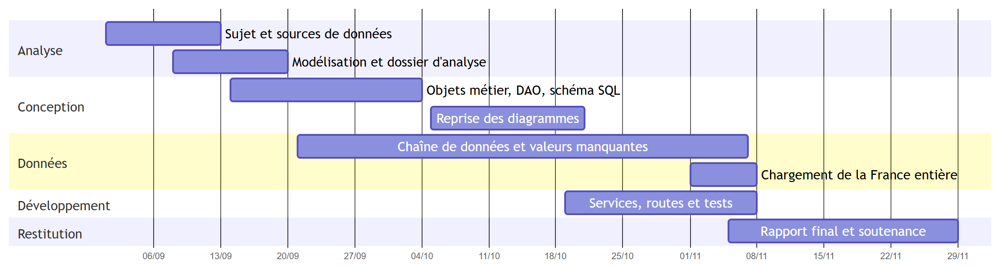
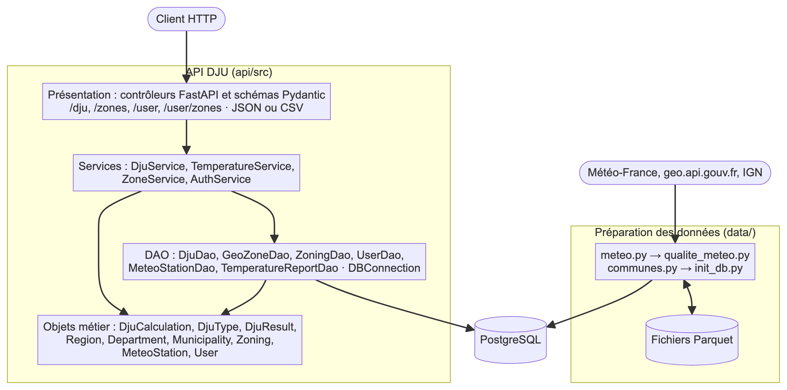
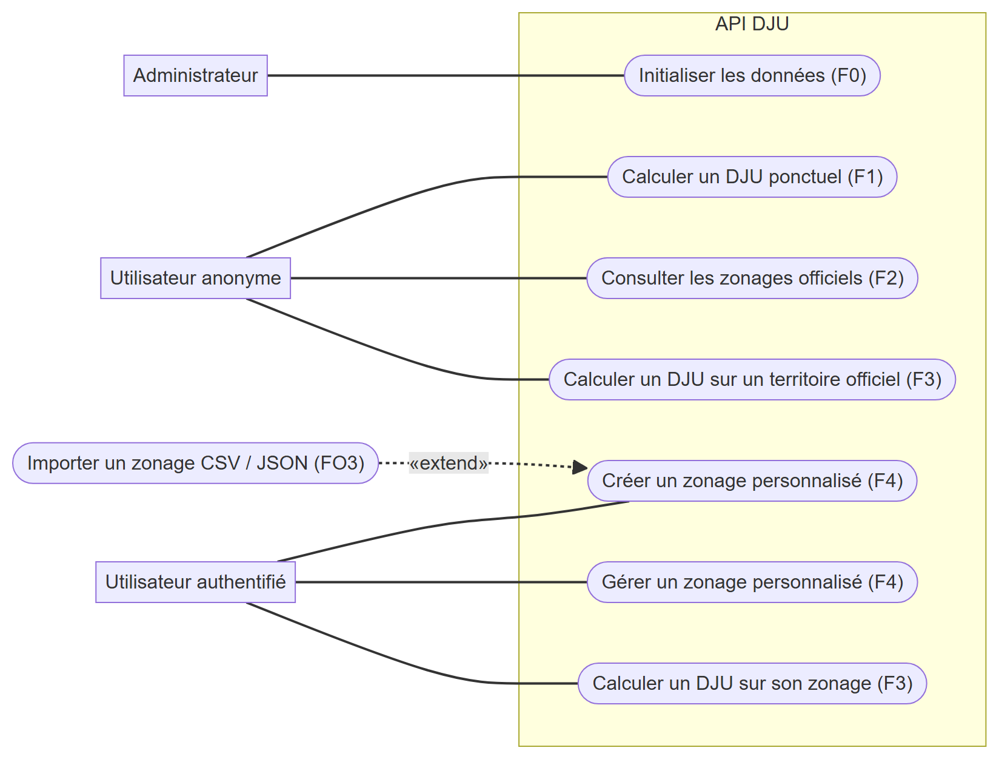
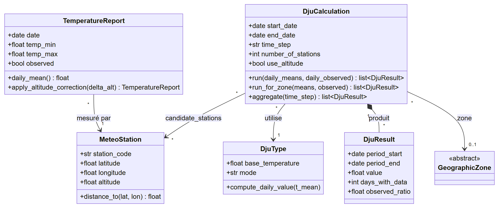
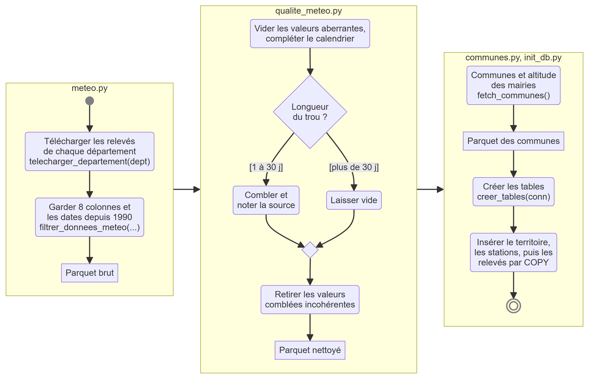
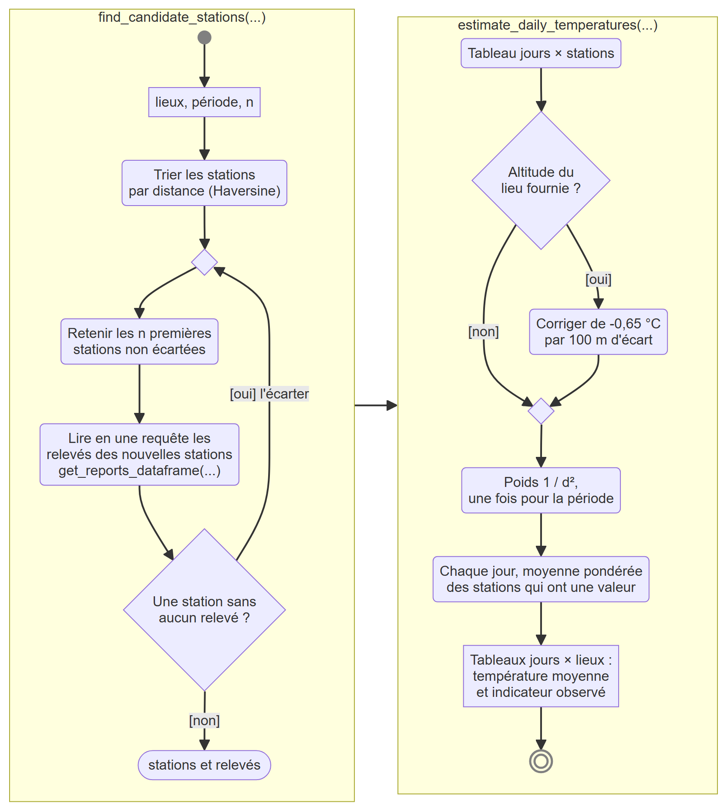
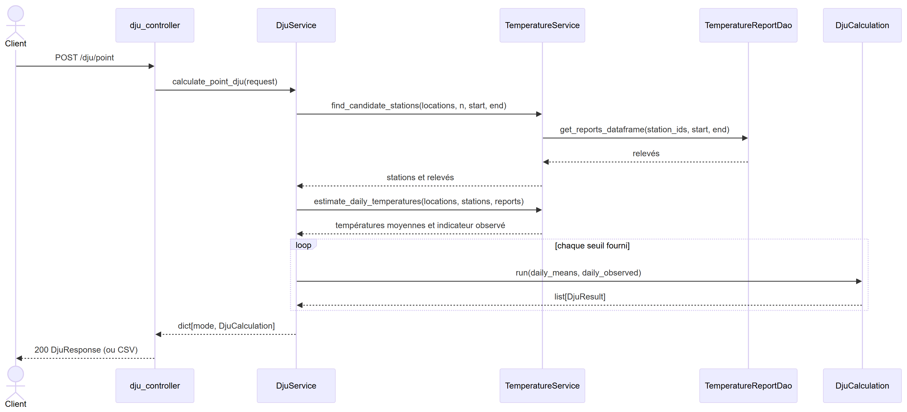
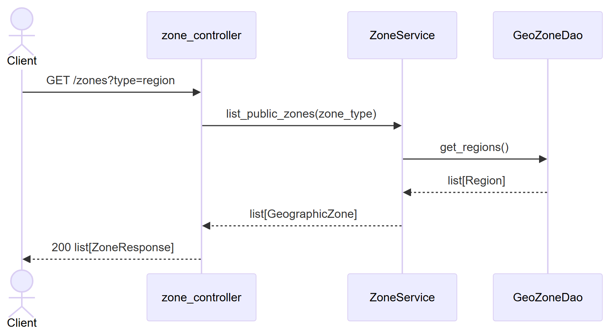
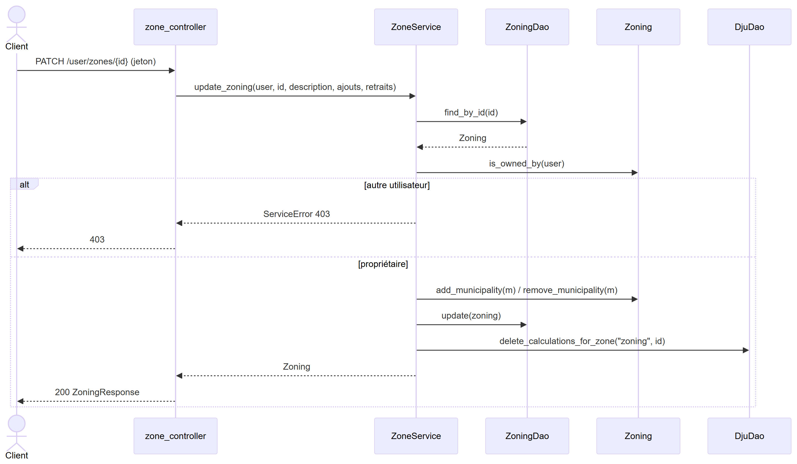

<!-- Partie document -->

\begin{titlepage}
\centering

\begin{flushright}
\tiny Campus de Ker Lann rue Blaise Pascal\\
BP37203 35172 BRUZ CEDEX\\
Tél : +33 (0) 2 99 05 32 32\\
communication@ensai.fr\\
www.ensai.fr\\
\end{flushright}

\includegraphics[width=0.35\textwidth]{ensai_logo.png}\\
\vspace{0.4cm}

{\Large\textsc{Rapport Final}}\\

\vspace{1.0cm}

\rule{\textwidth}{0.5mm}\\
\vspace{0.4cm}

\begin{flushleft}
\emph{Sujet :}\\
\textbf{API de calcul de DJU}\\
\end{flushleft}

\vspace{0.4cm}
\rule{\textwidth}{0.5mm}\\

\vspace{1.0cm}

\begin{flushleft}
\emph{Groupe 12 :}\\
\textbf{Aziz Yousfi}\\
\textbf{Eudes Sterlin}\\
\textbf{Gabriel Dahan}\\
\textbf{Gwenaël Lassalle}\\
\textbf{Marceau Feral}
\end{flushleft}

\begin{flushright}
\emph{Tuteur :}\\
\textbf{Thierry Mathé}\\
\end{flushright}

\vfill
\begin{center}
ENSAI\\
2026--2027
\end{center}
\end{titlepage}
\begingroup
\setstretch{1.0}
\setlength{\parskip}{0pt}
\setcounter{tocdepth}{1}
\tableofcontents
\endgroup

# Introduction {.unnumbered}

Dans les logements, la consommation d'énergie dépend beaucoup de la météo : on chauffe davantage quand il fait froid, et on climatise davantage quand il fait chaud. Quand on compare les consommations d'une année sur l'autre, il est donc difficile de savoir si une baisse vient d'une amélioration réelle (travaux, changement d'habitudes) ou simplement d'un hiver plus doux.

Pour tenir compte de cet effet, on utilise les *degrés-jours unifiés (DJU)*. Chaque jour, on mesure l'écart entre la température extérieure et un *seuil* de confort thermique, choisi par l'utilisateur dans sa requête. Ce seuil est la température au-dessus de laquelle on ne chauffe plus (ou en dessous de laquelle on ne climatise plus). Pour le chauffage, la littérature retient des valeurs de 15 à 18 °C, et le service statistique du ministère de la Transition écologique (SDES) publie par exemple des DJU calculés avec des seuils de 15 et 17 °C [@sdes_dju]. Plus il fait froid par rapport au seuil, plus les DJU de chauffage sont élevés, ce qui permet de corriger en partie l'influence de la météo sur les consommations.

En pratique, on calcule d'abord la température moyenne du jour $T_m = (T_{\min} + T_{\max}) / 2$. Pour un seuil de chauffage $S_c$ et un seuil de climatisation $S_f$, le DJU d'un jour s'écrit :

$$
\mathrm{DJU}_{\mathrm{chauffage}} = \max(0,\, S_c - T_m),
\qquad
\mathrm{DJU}_{\mathrm{climatisation}} = \max(0,\, T_m - S_f).
$$

Les valeurs quotidiennes sont ensuite additionnées sur la période et le pas de temps demandés. Pour un territoire, on fait en plus la moyenne des communes, pondérée par leur population.

Notre projet consistait à concevoir et à développer une API qui calcule et agrège ces DJU. L'utilisateur peut l'interroger sur un point GPS, sur un *zonage* officiel (département ou région) ou sur un zonage personnalisé qu'il a lui-même défini. Avant toute utilisation, un administrateur alimente l'application à partir des relevés de Météo-France et du référentiel géographique. À la fin du projet, toutes les fonctionnalités obligatoires (F0 à F4) et les trois fonctionnalités optionnelles (FO1 à FO3) sont réalisées, et la base contient les relevés quotidiens de la France entière depuis 1990, soit 4 555 stations et environ 32 millions de relevés.

Nous rappelons d'abord le cahier des charges, les choix techniques, le traitement des données manquantes et l'organisation de l'équipe. Nous présentons ensuite la conception de l'API, fonctionnalité par fonctionnalité, en terminant par un bilan des changements depuis le dossier d'analyse. La dernière partie porte sur la réalisation : les passages du code qui nous ont demandé le plus de travail, les tests, la comparaison de nos résultats avec ceux du SDES, les temps de réponse et les limites de l'API.

# Spécifications et organisation

## Acteurs {#sec-acteurs}

- L'*utilisateur anonyme* calcule des DJU et consulte les zonages officiels sans compte.
- L'*utilisateur authentifié* a les mêmes droits. Il peut en plus créer, modifier, supprimer ou importer des zonages personnalisés, puis lancer des calculs dessus.
- L'*administrateur* n'utilise pas les routes de l'API. Il exécute une fois, en dehors de l'API, les scripts qui téléchargent, nettoient et chargent les données dans la base (F0).

## Notions de base

Un *zonage* est un ensemble de communes. Les zonages officiels (départements et régions) sont visibles par tous, alors qu'un zonage personnalisé n'est visible que par l'utilisateur qui l'a créé.

Le *seuil* est toujours fourni dans la requête. Si l'utilisateur ne donne qu'un seuil de chauffage, seuls les DJU de chauffage sont calculés, et de même pour la climatisation. Il peut aussi demander les deux en même temps ; les températures ne sont alors estimées qu'une fois.

Enfin, il ne faut pas confondre la période des données disponibles, du 1er janvier 1990 aux derniers relevés chargés, avec la période de calcul, celle que demande l'utilisateur (`start_date` à `end_date`), avec un pas d'agrégation quotidien, hebdomadaire, mensuel ou annuel.

## Fonctionnalités de base

**F0 : initialisation des bases.** L'administrateur lance quatre scripts du dossier `data/`. Ils téléchargent les relevés quotidiens des stations Météo-France [@meteofrance_quot] et le référentiel des communes (geo.api.gouv.fr [@geo_api], altitudes de l'IGN [@ign_alti]), traitent les valeurs manquantes, puis remplissent la base PostgreSQL.

**F1 : calcul d'un DJU ponctuel.** À partir de coordonnées GPS (latitude, longitude et, si on le souhaite, altitude), le système estime la température locale puis calcule les DJU sur la période et au pas de temps demandés. Par exemple, les DJU mensuels du 1er janvier 2010 au 31 décembre 2025.

**F2 : consultation des zonages officiels.** Tout utilisateur, même non connecté, peut lister les départements et les régions, puis obtenir le détail d'une zone avec la liste de ses communes.

**F3 : calcul d'un DJU sur un territoire.** Le calcul porte sur une région, un département ou un zonage personnalisé. Les DJU communaux sont agrégés par une moyenne pondérée par la population. Le résultat peut être donné pour la zone entière, pour chacune de ses communes ou, pour une région, pour chacun de ses départements, par exemple les DJU annuels de chaque département d'Île-de-France entre 2015 et 2024.

**F4 : zonages personnalisés.** Un utilisateur authentifié crée ses propres zonages à partir de codes INSEE, les modifie ou les supprime, et lance des calculs dessus.

## Fonctionnalités optionnelles

Nous présentons les fonctionnalités optionnelles dans l'ordre de priorité fixé dans le dossier d'analyse, et non dans l'ordre de leur numéro. La conservation des résultats nous paraissait la plus utile, la mise en forme la moins urgente.

**FO1 : conservation des résultats** (priorité haute). Les calculs sur un territoire sont enregistrés avec tous leurs paramètres, et une requête identique est servie directement depuis la base. Les calculs en un point ne sont pas conservés (voir @sec-cache).

**FO3 : import de zonages** (priorité moyenne). Un zonage peut être créé à partir du contenu d'un fichier CSV ou JSON qui contient des codes INSEE.

**FO2 : mise en forme des résultats** (priorité basse). Les routes de calcul renvoient du JSON par défaut, et un fichier CSV si l'on ajoute le paramètre `format=csv`.

## Questionnement et choix

Pour chaque choix technique, nous donnons la solution retenue et, si elle a changé depuis le dossier d'analyse, ce qui nous a fait changer d'avis.

### Comptes et droits {#sec-comptes}

Le calcul en un point ou sur un zonage officiel est public. Un compte n'est nécessaire que pour les zonages personnalisés, comme prévu dans le dossier d'analyse.

À la connexion (`POST /user/login`), l'API renvoie un jeton JWT signé, valable 24 heures, que le client joint ensuite à l'en-tête `Authorization`. Le dossier d'analyse prévoyait plutôt des sessions, c'est-à-dire que le serveur garde la trace de chaque utilisateur connecté. Avec un jeton, chaque requête porte sa propre authentification : c'est commun pour une API REST, car aucune table de sessions n'est à gérer, et les routes protégées s'essaient directement depuis `/docs`. En contrepartie, un jeton ne peut pas être révoqué avant son expiration (@sec-limites).

Les mots de passe sont hachés avec bcrypt, qui ajoute un sel aléatoire, si bien que deux mots de passe identiques n'ont pas le même hash. Le mot de passe en clair n'est jamais enregistré. Comme bcrypt ignore tout ce qui dépasse 72 octets, l'API refuse les mots de passe plus longs plutôt que de les tronquer en silence.

### Stockage : PostgreSQL, et Parquet pour l'initialisation {#sec-stockage}

La base de l'application a toujours été PostgreSQL. Dans le dossier d'analyse, des fichiers Parquet devaient en plus stocker les données aux étapes intermédiaires, pendant l'initialisation et pour un cache des températures. Finalement, ils ne servent plus qu'à l'initialisation : chaque script de préparation enregistre son résultat en Parquet, ce qui permet de relancer le nettoyage sans retélécharger plusieurs gigaoctets. L'API, elle, ne lit que PostgreSQL.

Dans la base, la contrainte d'unicité sur (`station_id`, `date`) fournit l'index dont a besoin la requête la plus fréquente, celle qui lit les relevés d'un ensemble de stations sur une période. Les clés étrangères garantissent la cohérence des données : un zonage ne peut contenir que des communes qui existent, et il est supprimé en même temps que le compte de son propriétaire.

### Interpolation spatiale et altitude {#sec-idw}

Il y a rarement une station à l'endroit exact demandé. On estime donc la température à partir des $n$ stations les plus proches, pondérées par l'inverse du carré de la distance (IDW) [@shepard1968], calculée avec la formule d'Haversine [@sinnott1984] :

$$
\hat{T}(x) = \frac{\sum_{i} w_i\, T_i}{\sum_{i} w_i},
\qquad w_i = \frac{1}{d(x, s_i)^2}.
$$

Prenons trois stations à 5, 10 et 20 km qui mesurent 4, 6 et 8 °C. Leurs poids normalisés valent 76 %, 19 % et 5 %, et l'estimation 4,6 °C. Avec un poids en $1/d$, on obtiendrait 5,1 °C : le carré privilégie nettement les stations voisines.

**Nombre de stations.** Trois par défaut ($n$ va de 1 à 10). Avec une seule station, le résultat dépend de son emplacement (hauteur, bord de mer, centre-ville) et de ses erreurs de mesure. Avec trois, le lieu est en général entouré, et une station atypique pèse moins. Au-delà, les stations ajoutées sont lointaines et ne changent presque plus rien. $n = 1$ reste possible, par exemple pour reproduire la méthode du SDES (@sec-validation).

**Rayon de recherche.** 50 km, le rayon déjà utilisé pour choisir les voisines lors du comblement des trous (@sec-manquantes). En métropole, la plupart des communes ont plusieurs stations à moins de 20 km, alors qu'à 50 km le relief ou la mer peuvent déjà changer nettement la température. Sans station assez proche (un point en pleine mer, par exemple), le calcul est refusé. S'il y en a moins que $n$, il se fait avec celles qui existent et la réponse le signale. La limite ne repère pas tout : un point du Pays basque espagnol, proche de stations françaises, est encore calculé.

**Correction d'altitude.** Si l'altitude du lieu est fournie, chaque température de station est corrigée de $-0{,}65$ °C par 100 m d'écart avec le lieu, le gradient de l'atmosphère type [@oaci_atmosphere]. Une station à 50 m qui mesure 6 °C donne ainsi 4,05 °C pour un lieu à 350 m. Pour une commune, nous prenons la position et l'altitude de la mairie, plus proche des habitants que le centre géométrique. À Chamonix, la mairie est au fond de la vallée, à 1 036 m, alors que le centre de la commune est à 1 885 m.

### Cache et réutilisation {#sec-cache}

Deux niveaux de cache étaient prévus : les températures quotidiennes de chaque commune, puis les résultats des calculs. Après réflexion et quelques tests, nous n'avons gardé que le second. Un calcul sur territoire est enregistré dans `dju_calculations` et `dju_results`, et retrouvé grâce à tous ses paramètres (zone, mode et seuil, période, pas de temps, nombre de stations, altitude). Modifier ou supprimer un zonage efface ses calculs stockés.

Le cache des températures communales aurait compté des centaines de millions de lignes (près de 35 000 communes sur plus de trente ans), pour des séries rarement redemandées à l'identique. Depuis la vectorisation, les recalculer ne prend de toute façon qu'une fraction de seconde (@sec-vectorisation). Les calculs en un point (F1) ne sont pas stockés non plus, deux utilisateurs donnant très rarement les mêmes coordonnées.

### Période demandée et données disponibles {#sec-periode}

Si l'on demande les DJU depuis 1980 alors que les relevés commencent en 1990, la période est ramenée aux données disponibles plutôt que refusée, et la réponse le signale :

```         
Période raccourcie aux données disponibles : calcul du 1990-01-01 au 2024-12-31
au lieu du 1980-01-01 au 2024-12-31.
```

Une période sans aucune donnée renvoie une erreur 400 qui rappelle les dates disponibles. Chaque résultat indique enfin le nombre de jours pour lesquels une température a pu être estimée (`days_with_data`).

## Gestion des données manquantes {#sec-manquantes}

Les trous des fichiers bruts de Météo-France sont traités une seule fois, par `qualite_meteo.py`, avant le chargement en base. L'API ne voit donc que des séries déjà complétées.

Le script commence par nettoyer les séries. Une température hors de $[-50 ; 50]$ °C est considérée comme aberrante : on vide cette seule valeur, qui sera comblée comme un trou ordinaire, et on garde le reste de la série. Les jours sans aucune température sont retirés. Chaque station est ensuite placée sur un calendrier journalier complet, pour que les jours absents du fichier deviennent des trous visibles.

Seules $T_{\min}$ et $T_{\max}$, utilisées dans le calcul, sont comblées, avec une méthode qui dépend de la longueur du trou. Les « voisines » d'une station sont ses 5 stations les plus proches, à moins de 50 km. Pour fixer les paliers et le dosage, nous avons étudié plusieurs cas de trous réels, puis retiré volontairement des températures connues pour comparer ce que chaque méthode reconstituait aux vraies valeurs. Les règles retenues donnaient des résultats proches des mesures tout en restant simples à calculer et à expliquer.

- Pour un trou de 1 à 2 jours, on fait une interpolation linéaire entre les valeurs qui l'encadrent.
- De 3 à 7 jours, on combine $70\,\%$ de la tendance locale et $30\,\%$ de la moyenne des voisines. Chaque voisine est d'abord ramenée au niveau de la station, en lui ajoutant l'écart moyen entre les deux stations, mesuré sur les jours où les deux ont une observation réelle. Cet écart tient compte d'une différence d'altitude ou de la proximité de la mer.
- De 8 à 30 jours, on ajuste une régression linéaire $T = a_1 T_{v_1} + \dots + a_k T_{v_k} + b$ sur les voisines qui ont une mesure chaque jour du trou, avec au moins 30 jours d'observations communes.
- Au-delà de 30 jours, on ne comble pas, car inventer un mois entier de températures fausserait les DJU.

Pour les trous longs, nous nous appuyons sur les voisines plutôt que sur la série de la station elle-même. Au-delà d'une semaine, une méthode de série temporelle n'a plus d'information sur la météo de la période et reviendrait vers la normale de saison, alors que les stations voisines, très corrélées à moins de 50 km, ont mesuré ces jours-là. Les limites de cette méthode sont discutées en @sec-limites.

Seules les mesures réellement observées des voisines servent au comblement, jamais une valeur déjà comblée. Comme $T_{\min}$ et $T_{\max}$ sont comblées séparément, il peut arriver qu'un jour la $T_{\min}$ obtenue dépasse la $T_{\max}$, ce qui est impossible. Dans ce cas, le script supprime la ou les valeurs comblées de ce jour-là, qui redeviennent manquantes ; une mesure réelle n'est jamais supprimée.

Enfin, chaque valeur garde sa source (`observee`, `interpolee_1_2j`, `interpolee_3_7j`, etc.) dans les colonnes `source_tmin` et `source_tmax`. L'API s'en sert pour indiquer, dans chaque résultat, la part de jours calculés uniquement à partir de mesures observées (`observed_ratio`).

Le dossier d'analyse prévoyait aussi trois règles d'exclusion de stations, que nous n'avons pas gardées. Écarter les stations qui couvrent moins de $65\,\%$ de la période n'est plus utile, puisque l'estimation remplace d'elle-même une station sans relevés par la suivante et ne fait chaque jour la moyenne que sur les stations qui ont une valeur. Les deux autres règles, sur les stations en doublon à moins de 500 m et les séries constantes pendant 30 jours, ne nous ont pas paru vraiment utiles : une station en doublon, par exemple, ne fait que compter deux fois dans la moyenne pondérée.

## Organisation du travail {#sec-organisation}

### Fonctionnement de l'équipe

Nous nous sommes partagé les différentes tâches dès le début, en tenant compte des préférences et des compétences de chacun. L'idée était de couvrir dès la première semaine les grands morceaux du projet, pour que personne n'attende les autres avant de commencer : Gabriel a pris la structure du dépôt et l'organisation, Eudes le socle de l'API, Aziz les objets métier, Marceau les données météo et Gwenaël les communes et la recherche des sources.

Nous travaillions ensemble une fois par semaine, le vendredi, pendant la séance encadrée. C'était le moment de faire le point et de répartir les tâches, que chacun avançait ensuite de son côté pendant la semaine. Le reste du temps, nous échangions sur WhatsApp. Comme le prévoyaient les consignes du projet, un fichier de suivi était rempli chaque jeudi dans `doc/tracking/`. Chacun y notait ce qu'il avait produit depuis la semaine précédente, ou « RAS » s'il n'avait rien produit, et ce qui restait à faire. C'est à partir de ces fichiers que nous avons reconstitué le planning ci-dessous.

{#fig-gantt width="88%" fig-pos="H"}

### Déroulement du projet

En septembre, nous avons analysé le sujet, choisi les sources de données et rédigé le dossier d'analyse, rendu la semaine du 17 septembre. En parallèle, nous avions commencé à modéliser l'application, à dessiner les premiers diagrammes et à écrire un peu de code. Le retour du tuteur, le 25 septembre, comportait de nombreuses remarques, sans être négatif dans l'ensemble. Le document était difficile à lire par endroits, le DJU n'était pas défini, il manquait un modèle de base de données, et le texte ne concordait pas toujours avec les diagrammes. Au vu des remarques, la reprise des diagrammes nous a semblé prioritaire. Certains étaient trop vagues, avec des activités sans entrées ni sorties ou des diagrammes de séquence qui ne montraient pas les classes et les méthodes appelées, et ils employaient parfois des noms différents de ceux du code.

Nous avons donc décidé de les refaire. Marceau a rassemblé la nouvelle version, avec les écarts relevés : des méthodes présentes dans le diagramme de classes mais absentes du code, ou l'inverse, et des diagrammes de séquence qui ne disaient pas quelle méthode était appelée ni dans quelle couche (objets métier, services, DAO). Nous nous sommes mis d'accord sur WhatsApp, sans réunion à part. Les diagrammes ont été réécrits en français, avec les noms du code, et terminés le 8 octobre.

En octobre, le projet a avancé plus lentement, entre les partiels et les autres cours. L'API ne démarrait pas encore : les couches progressaient séparément et n'étaient pas encore reliées entre elles. Gabriel l'a rendue exécutable la semaine du 22 octobre.

Le 3 novembre, nous avons repris le code pour qu'il suive la nouvelle architecture décrite par les diagrammes. Ce travail, fait en local, a été poussé en un seul commit par Gabriel (55 fichiers modifiés), puis relu par l'équipe et vérifié en lançant l'API. Un état des lieux a ensuite comparé tout le code aux diagrammes et listé les écarts restants, par exemple :

- la route d'import attendait un fichier joint, ce qui exige une bibliothèque supplémentaire et empêchait l'API de démarrer sans elle ;
- la lecture des relevés échouait à cause d'un nom de colonne (`station_id`) ;
- les scripts de données remplissaient des tables que l'API ne lisait pas ;
- l'API ne chargeait pas le fichier `.env`.

Une fois ces écarts corrigés, 87 tests passaient et toutes les fonctionnalités marchaient sur une base contenant les données de la Bretagne. La France entière a été chargée la semaine suivante. Les deux dernières semaines ont servi aux tests, aux mesures et au rapport.

En dehors de cette refonte, tout le monde poussait directement sur la branche `main`, sans branche ni relecture systématique. Près d'un commit sur sept est une fusion automatique, créée quand deux personnes poussaient en même temps. Les conflits ont été peu nombreux et vite résolus, et cette façon de faire a suffi tant que chacun restait sur ses fichiers. La charge de travail nous a semblé équilibrée, chacun ayant la responsabilité d'un domaine et testant son propre code :

- **Aziz Yousfi** : objets métier, contrôleurs et schémas Pydantic, diagrammes de classes et de cas d'utilisation, puis tests (validation des entrées de l'API, services, mots de passe, comblement des trous pour une station isolée).
- **Eudes Sterlin** : socle de l'API et premier contrôleur, README, DAO des calculs DJU, schéma SQL final, mise à jour des diagrammes.
- **Gabriel Dahan** : structure du dépôt et gabarit du rapport, connexion à la base, services et routes de toutes les fonctionnalités, gestion des erreurs, alignement de la couche DAO.
- **Gwenaël Lassalle** : recherche des sources de données, import des communes, introduction et spécifications du dossier d'analyse, diagrammes, chargement de la France entière dans PostgreSQL et reconnexion automatique de l'API, rapport final.
- **Marceau Feral** : chaîne de données (`meteo.py`, `qualite_meteo.py`, `communes.py`, `init_db.py`) et ses tests, traitement des valeurs manquantes, vectorisation de l'estimation des températures, réécriture des diagrammes.

### Utilisation de l'IA {#sec-ia}

Nous avons utilisé des assistants d'IA (Claude Code et Cursor), principalement pour :

- débloquer des erreurs (environnement Python, FastAPI, psycopg2, SQL) et relire du code écrit à la main ;
- obtenir des exemples sur des points que nous ne connaissions pas, comme l'authentification par jeton, la commande `COPY` ou la vectorisation avec numpy ;
- les tâches répétitives de la refonte du 3 novembre, quand de nombreux fichiers devaient être renommés et alignés sur les nouveaux diagrammes ;
- trouver les différences entre le code et les diagrammes lorsque nous avions un doute ;
- reformuler certains passages de ce rapport.

Les choix de conception (sources, modèle de données, méthode de calcul, comblement des trous) ont été faits en équipe. Quand l'assistant proposait plusieurs options, par exemple pour le nombre de stations par défaut, nous en discutions avant d'en retenir une. Le code obtenu était relu, puis vérifié par les tests et en appelant l'API.

Cet usage n'a pas toujours bien fonctionné. Une partie de nos premiers diagrammes avait été esquissée avec une IA et pas assez confrontée à ce que nous voulions coder, et c'est en partie ce que le tuteur a relevé. Depuis, nous vérifions chaque diagramme par rapport au code. Avec le recul, l'IA nous a surtout fait gagner du temps sur le débogage et les tâches répétitives, mais c'est en écrivant et en corrigeant nous-mêmes le code que nous avons le plus appris.

# Conception de l'API

Le tableau de toutes les routes de l'API est en annexe ([-@sec-routes]).

## Architecture en couches

L'application est organisée en couches. FastAPI expose les routes REST, et chaque route est traitée par un contrôleur (`dju_controller`, `zone_controller`, `user_controller`) qui valide la requête grâce aux schémas Pydantic puis appelle le service correspondant. Les services (`DjuService`, `TemperatureService`, `ZoneService`, `AuthService`) coordonnent le traitement. Les objets métier (`DjuCalculation`, `GeographicZone`, `Zoning`, etc.) portent les règles du calcul DJU : formule, agrégation par période et pondération par la population. L'estimation des températures (choix des stations, IDW, correction d'altitude) est, elle, faite dans `TemperatureService`, pour pouvoir lire les relevés de toutes les stations en une seule requête (@sec-vectorisation). Seule la couche DAO accède à PostgreSQL, et les scripts de préparation des données sont à part.

{#fig-architecture width="90%" fig-pos="htbp"}

Comme les objets métier n'accèdent pas à la base, on peut les tester avec quelques valeurs écrites à la main. Les services, eux, reçoivent leurs DAO dans leur constructeur, et dans les tests on les remplace par de faux objets (@sec-tests).

## Modèle de données {#sec-modele-donnees}

Le schéma relationnel (`data/init_db.sql`) reprend les entités du domaine en quatre groupes : les utilisateurs, le territoire et les zonages, les données météo et le cache des calculs.

{#fig-mpd width="92%" fig-pos="H"}

La table `users` contient le nom d'utilisateur, déclaré unique, et le mot de passe haché. Si deux personnes s'inscrivent en même temps sous le même nom, la contrainte d'unicité refuse la seconde, et le service renvoie une erreur 409. Chaque zonage personnalisé désigne son propriétaire par la clé étrangère `user_id`, avec l'option `ON DELETE CASCADE` : supprimer un compte supprime ses zonages.

Les tables `regions`, `departments` et `municipalities` reprennent la hiérarchie administrative. Chaque ligne a un identifiant interne (la clé primaire) et son code INSEE, déclaré unique. L'utilisateur ne manipule que les codes INSEE. Les routes de consultation, de calcul et de création de zonages désignent donc une zone par son code, et l'identifiant interne ne sert qu'aux jointures et à la clé du cache. La table `municipalities` contient ce qu'il faut pour un calcul sur un territoire, à savoir les coordonnées de la mairie, l'altitude et la population. Une commune pouvant appartenir à plusieurs zonages, le lien passe par la table `zoning_municipalities`, dont la clé primaire (`zoning_id`, `municipality_id`) empêche d'ajouter deux fois la même commune.

La table `temperature_reports` contient un relevé par station et par jour. Nous ne gardons que $T_{\min}$ (colonne `TN` de Météo-France) et $T_{\max}$ (`TX`). La température moyenne mesurée (`TM`) n'est pas utilisée, car la méthode de référence définit la moyenne comme $(T_{\min} + T_{\max}) / 2$, que nous recalculons au moment du calcul. Les colonnes `source_tmin` et `source_tmax` gardent l'origine de chaque valeur.

Côté cache, la table `dju_types` enregistre une seule fois chaque couple (mode, seuil). La zone d'un calcul est désignée par le couple (`zone_type`, `zone_id`), où `zone_id` est l'identifiant interne de la ligne. Elle peut en effet être une région, un département, une commune ou un zonage, donc une ligne de l'une de quatre tables différentes. Une clé étrangère classique est alors impossible, et c'est le service qui garde la cohérence en supprimant les calculs d'un zonage modifié.

## Vue des cas d'utilisation

Le diagramme des cas d'utilisation reprend les acteurs de la @sec-acteurs et les relie aux fonctionnalités. L'utilisateur authentifié dispose aussi de tous les cas de l'utilisateur anonyme, mais nous n'avons pas répété ces liens pour garder le schéma lisible. « Gérer un zonage » regroupe la modification de la description, l'ajout ou le retrait de communes et la suppression.

{#fig-cas width="85%" fig-pos="htbp"}

## Modèle du domaine {#sec-domaine}

Les objets métier forment trois groupes. Le premier décrit le territoire. `GeographicZone` est une classe abstraite dont héritent `Region`, `Department`, `Municipality` et `Zoning` (@fig-classes-zone). Toutes exposent `get_municipalities()`, si bien qu'un calcul sur un territoire traite de la même façon une région, un département ou un zonage. Le deuxième groupe décrit les données météo, avec `MeteoStation`. Les relevés quotidiens ne sont pas des objets Python : ils sont lus en une requête sous forme de tableau pandas, une ligne par station et par jour, pour que l'estimation soit vectorisée (@sec-vectorisation).

{#fig-classes-zone width="68%" fig-pos="H"}

Le troisième groupe décrit le calcul (@fig-classes-dju). Un `DjuCalculation` représente une demande. Il applique un `DjuType` (mode et seuil) et produit une liste de `DjuResult`, un par période. Comme il ne porte qu'un seul `DjuType`, une demande avec deux seuils crée deux calculs. Un calcul n'est rattaché à aucun utilisateur : un calcul stocké sert à tous ceux qui posent la même question, et seul l'accès aux zonages personnalisés est contrôlé.

{#fig-classes-dju width="85%" fig-pos="H"}

Les services coordonnent ces objets, et ce sont les seuls à utiliser les DAO.

| Service | Méthodes principales | Rôle |
|:------------------|:---------------------------|:------------------------|
| `DjuService` | `calculate_point_dju`, `calculate_zone_dju` | Contrôle la requête, crée les `DjuCalculation`, consulte et remplit le cache des calculs sur territoire |
| `TemperatureService` | `find_candidate_stations`, `estimate_daily_temperatures`, `get_municipality_temperatures` | Choisit les stations, lit leurs relevés et estime les températures par IDW |
| `ZoneService` | `get_zone`, `get_sub_zones`, `create_zoning`, `update_zoning`, `delete_zoning` | Lit les territoires, découpe une zone, gère les zonages et vérifie leur propriétaire |
| `AuthService` | `register`, `authenticate`, `get_current_user` | Crée les comptes, délivre et vérifie les jetons JWT |

: Services de l'API et leurs méthodes principales

Le calcul lui-même se fait en trois étapes. `DjuType.compute_daily_value()` calcule le DJU d'un jour à partir de la température moyenne. Elle accepte aussi bien un nombre qu'un tableau pandas, ce qui permet de traiter toute une période d'un coup. `DjuCalculation.run()` applique ce calcul à chaque jour, puis `aggregate()` additionne les valeurs par jour, semaine ISO, mois ou année. Pour un territoire, `run_for_zone()` fait la même chose sur un tableau qui a une colonne par commune, puis agrège les communes par une moyenne pondérée par la population.

## F0 — Initialisation des données

L'initialisation enchaîne quatre scripts, que l'administrateur lance à la main, en dehors de l'API. Ils se transmettent leurs résultats par des fichiers Parquet rangés dans `data/raw_data/` :

``` bash
python data/meteo.py           # relevés Météo-France        -> meteo_france_brut.parquet
python data/qualite_meteo.py   # aberrations et trous        -> meteo_france_nettoye.parquet
python data/communes.py        # régions, départements, communes (+ altitude)
python data/init_db.py         # création des tables et chargement dans PostgreSQL
```

Le diagramme ci-dessous résume l'enchaînement, détaillé ensuite script par script.

{#fig-act-f0 width="78%" fig-pos="H"}

**Relevés météo.** `meteo.py` télécharge, pour chaque département, l'archive 1950–2024 et les données 2025–2026 de Météo-France, et ne garde que huit colonnes (`NUM_POSTE`, `DATE`, `NOM_USUEL`, `TN`, `TX`, `LAT`, `LON`, `ALTI`) à partir de 1990. Chaque département est enregistré à part, ce qui permet de se limiter à quelques départements (`python data/meteo.py 22 29 35 56` pour la Bretagne).

Au début, Marceau téléchargeait ces fichiers à la main, un par département, et le script les lisait depuis Onyxia. Il fallait refaire une centaine de téléchargements à chaque mise à jour, et un fichier oublié suffisait à faire disparaître un département. Sur le conseil de notre tuteur, le script télécharge désormais lui-même chaque fichier à partir de son lien direct, avec trois essais en cas d'erreur réseau. Les lignes sans aucune température sont retirées dès la lecture.

**Nettoyage.** `qualite_meteo.py` comble les trous (@sec-manquantes) département par département, en chargeant aussi les stations à moins de 50 km qui peuvent servir de voisines. Le résultat est le même qu'avec un traitement global, pour bien moins de mémoire.

**Communes.** `communes.py` récupère régions, départements et communes sur geo.api.gouv.fr, puis l'altitude des mairies auprès de l'IGN par lots de 250 points (le centre de la commune sert si la mairie est inconnue). Dans la première version, un lot en erreur restait entièrement sans altitude. Le script réessaie maintenant point par point, et ignore la valeur $-99\,999$ que l'IGN renvoie quand il ne connaît pas l'altitude.

**Chargement.** `init_db.py` crée les tables et les remplit. Insérer 32 millions de relevés ligne par ligne aurait pris des heures. Le script les envoie donc par lots de 500 000 avec `COPY` dans une table temporaire, puis les insère avec `ON CONFLICT DO NOTHING`, ce qui permet de le relancer sans doublons pour ajouter des relevés récents.

## Estimation des températures locales

Tout calcul de DJU commence par une série quotidienne de températures pour chaque lieu : le point GPS pour F1, la mairie de chaque commune pour F3. `TemperatureService` la produit pour plusieurs lieux à la fois, sous forme de deux tableaux jours × lieux. Le premier contient la température moyenne estimée, le second indique si elle ne repose que sur des mesures observées.

`find_candidate_stations()` garde, pour chaque lieu, les $n$ stations les plus proches à moins de 50 km, et lit leurs relevés en une seule requête, même quand une station sert à plusieurs lieux. Une station sans relevé sur la période est remplacée par la suivante. L'estimation applique ensuite la correction d'altitude et la pondération IDW (@sec-idw). Le diagramme d'activité correspondant est en annexe (@fig-act-temp).

## F1 — Calcul d'un DJU ponctuel

Supposons qu'un utilisateur veuille les DJU de chauffage mensuels d'un bâtiment du centre de Rennes en 2024, avec un seuil de 18 °C. Il envoie :

``` json
POST /dju/point
{
  "latitude": 48.111, "longitude": -1.680,
  "start_date": "2024-01-01", "end_date": "2024-12-31",
  "heating_threshold": 18, "time_step": "month"
}
```

Sans altitude, aucune correction n'est faite, et le nombre de stations prend sa valeur par défaut, 3. Ajouter `"cooling_threshold": 24` donnerait en plus les DJU de climatisation, sans réestimer les températures.

La requête est contrôlée deux fois. Le schéma Pydantic `DjuPointRequest` vérifie d'abord le format (bornes des coordonnées, dates, $n$ entre 1 et 10, pas de temps parmi `day`, `week`, `month`, `year`) et renvoie 422 en cas d'erreur. Le service vérifie ensuite la cohérence (au moins un seuil, dates dans l'ordre, période qui recoupe les données) et renvoie 400 avec un message lisible, par exemple « Il faut au moins un seuil de chauffage ou de climatisation. ».

Le service estime alors les températures une seule fois, crée un `DjuCalculation` par seuil et appelle `run()`, sans rien stocker. Pour chaque mode, la réponse donne les périodes avec leur valeur, `days_with_data` et `observed_ratio`. Elle liste aussi les stations utilisées (code, nom, position, altitude, distance), pour que l'utilisateur puisse juger de la représentativité du résultat. Le champ `warning` signale une période raccourcie ou un manque de stations proches (« Seulement 2 station(s) avec des relevés à moins de 50 km du point, au lieu des 3 demandées. »), et un point sans aucune station à moins de 50 km reçoit une erreur 404. Les diagrammes de F1 sont en annexe.

## F2 — Consultation des zonages officiels {#sec-f2}

`GET /zones?type=department` (ou `region`, `all`) liste les zonages officiels avec leur code INSEE et leur nom, sans les communes, qui seraient près de 35 000. Le détail d'une zone passe par `GET /zones/{zone_type}/{insee_code}`. Pour les Côtes-d'Armor :

``` json
GET /zones/department/22
{ "insee_code": "22", "name": "Côtes-d'Armor", "zone_type": "department",
  "municipalities": [ { "insee_code": "22278", "name": "Saint-Brieuc" }, ... ] }
```

Les zones sont toujours désignées par leur code INSEE. L'identifiant interne (21 pour les Côtes-d'Armor) ne sert qu'aux jointures et au cache, et n'est jamais exposé.

## F3 — Calcul d'un DJU sur un territoire {#sec-f3}

`POST /dju/zone` désigne la zone par `zone_type` (`region`, `department` ou `zoning`) et `zone_code`, qui est soit un code INSEE (« 53 », « 2A »), soit l'identifiant du zonage personnel. Aux paramètres de F1 s'ajoutent `aggregation_level` (un résultat pour la zone, par commune, ou par département pour une région) et `use_altitude` (vrai par défaut). Un zonage personnalisé n'est accessible qu'à son propriétaire : 401 sans jeton, 403 pour un autre utilisateur, 404 s'il n'existe pas.

Le service découpe d'abord la zone en sous-zones selon le niveau d'agrégation et cherche pour chacune un calcul déjà stocké. Il estime ensuite, en une fois, les températures des seules communes qui manquent (figure \ref{fig-seq-f3}, page \pageref{fig-seq-f3}). Si quelqu'un a déjà demandé l'Ille-et-Vilaine avec les mêmes paramètres, une demande de la Bretagne par département réutilise ce résultat et ne calcule que les trois autres départements.

\begin{figure}[p]
\centering
\oldincludegraphics[angle=90,width=\linewidth,height=0.9\textheight,keepaspectratio]{resources/diagrams_final/fig-seq-f3.png}
\caption{Calcul d'un DJU sur un territoire (F3)}\label{fig-seq-f3}
\end{figure}

Dans `run_for_zone()`, le DJU d'une zone $Z$ pour le jour $t$ est la moyenne des DJU communaux pondérée par la population $p_c$ :

$$
\mathrm{DJU}_Z(t) = \frac{\sum_{c \in Z_t} p_c\, \mathrm{DJU}_c(t)}{\sum_{c \in Z_t} p_c},
$$

où $Z_t$ est l'ensemble des communes qui ont, ce jour-là, une valeur de DJU et une population connue. Le dénominateur est donc la population de ces seules communes, et non celle de toute la zone. Si aucune commune de la zone n'a de population connue, toutes reçoivent le même poids.

Cette pondération reprend la méthode du SDES [@sdes_note]. Les DJU servant à analyser des consommations d'énergie, Rennes et ses quelque 225 000 habitants doivent peser bien plus qu'un village d'Ille-et-Vilaine.

## F4 — Zonages personnalisés {#sec-f4}

Après inscription (`POST /user/register`) et connexion, l'utilisateur gère ses zonages sur `/user/zones`. Avant chaque route protégée, la dépendance FastAPI `get_current_user` décode le jeton (401 s'il est absent, invalide ou expiré).

**Création.** On envoie un nom, une description facultative et des codes INSEE, par exemple trois communes de la métropole rennaise :

``` json
POST /user/zones
Authorization: Bearer <jeton>
{ "name": "Rennes et communes voisines", "description": "Zone d'étude du chauffage",
  "codes_insee": ["35238", "35051", "35281"] }
```

`ZoneService.create_zoning()` nettoie les codes (espaces, doublons) et retrouve les communes en une requête. Un seul code inconnu suffit à faire refuser tout le zonage (« Codes INSEE inconnus : 35999. », erreur 400). Il nous a semblé préférable de prévenir l'utilisateur plutôt que d'enregistrer un zonage qui ne contient pas ce qu'il croit.

**Import (FO3).** `POST /user/zones/import` reçoit le contenu du fichier comme texte dans un corps JSON, par exemple `{"filename": "ecoles.csv", "content": "code_insee\n35238\n35051"}`, puis suit le même chemin. Un vrai fichier joint aurait demandé une bibliothèque de plus, sans laquelle l'API ne démarrait pas. Ainsi, toutes les routes reçoivent du JSON, Pydantic valide tout en une fois, et les tests envoient un simple dictionnaire. Les CSV peuvent utiliser la virgule ou le point-virgule (colonne `code_insee`, sinon la première), et les JSON peuvent être une liste ou un objet `{"codes_insee": [...]}`.

**Modification et suppression.** `PATCH /user/zones/{id}` change la description, ajoute (`add_codes_insee`) ou retire (`remove_codes_insee`) des communes, et `DELETE` supprime le zonage. Dans les deux cas, `Zoning.is_owned_by()` vérifie le propriétaire (403 sinon) et les calculs stockés du zonage sont effacés. Un zonage garde toujours au moins une commune.

## Évolutions depuis le dossier d'analyse {#sec-evolutions}

Pendant le développement, nous sommes revenus sur plusieurs choix du dossier d'analyse, le plus souvent pour une solution plus simple, parfois pour tenir compte des remarques du tuteur :

- **Stockage** : les fichiers Parquet ne servent plus qu'à l'initialisation, l'API ne lit que PostgreSQL ([-@sec-stockage]).
- **Cache** : seuls les résultats des calculs sur territoire sont conservés ([-@sec-cache]).
- **Nettoyage** : aucune station n'est exclue ; les valeurs aberrantes sont vidées puis comblées comme des trous ([-@sec-manquantes]).
- **Période** : une période qui dépasse les données est raccourcie au lieu d'être refusée ([-@sec-periode]).
- **Paramètres** : ajout du pas hebdomadaire, du nombre de stations, du niveau d'agrégation et de l'option d'altitude ([-@sec-f3]).
- **Comptes** : un jeton JWT remplace les sessions ([-@sec-comptes]).
- **Import (FO3)** : le contenu du fichier est envoyé comme texte dans un corps JSON ([-@sec-f4]).
- **Diagrammes** : réécrits en français, avec les noms du code ([-@sec-organisation]).

Aucune fonctionnalité du cahier des charges n'a été abandonnée.

# Réalisation et validation

## Tenue du code

Le dépôt sépare l'API (`api/src`, un dossier par couche), les scripts de données (`data/`) et la documentation (`doc/`). Le README de la racine présente le projet (méthode, données, installation, chargement de la base) et celui d'`api/` l'API elle-même (routes, exemples, erreurs, architecture, tests). Un fichier `.env.example` sert de modèle de configuration. Chaque module, classe et fonction a une docstring en français, d'une ligne quand c'est possible, et les commentaires expliquent plutôt un choix qu'ils ne répètent le code. Ruff, configuré dans `api/pyproject.toml` et appliqué aussi à `data/`, n'a été lancé systématiquement qu'en fin de projet ; tout le code passe désormais `ruff check` et `ruff format --check`. Le suivi est resté dans le dépôt, avec les comptes rendus hebdomadaires de `doc/tracking/` (@sec-organisation).

## Points techniques notables

### Estimation vectorisée des températures {#sec-vectorisation}

Juste après la refonte du 3 novembre, F3 fonctionnait, mais le calcul d'un seul département prenait environ une minute et demie, ce qui rendait les calculs sur une région inutilisables en pratique. Le tuteur nous avait conseillé de vectoriser. En en discutant avec lui, nous avons compris que la lenteur ne venait pas du calcul lui-même, mais de la manière d'aller chercher les données.

Dans cette première version, les communes étaient traitées une par une. Pour chacune, le code triait les 4 555 stations par distance, faisait deux requêtes (stations ayant des relevés, puis leurs relevés), convertissait chaque relevé en objet Python, bouclait jour par jour pour la moyenne pondérée, puis écrivait les 366 températures de l'année dans le cache. Pour l'Ille-et-Vilaine, cela faisait plus d'un millier de requêtes vers une base distante et 121 512 lignes écrites. Et comme des communes voisines partagent leurs stations, les mêmes relevés étaient relus des dizaines de fois.

Désormais, toutes les communes sont traitées ensemble :

- une seule requête lit les relevés de toutes les stations utiles et calcule directement $(T_{\min} + T_{\max})/2$ et l'indicateur « observé » ;
- les relevés sont pivotés en un tableau jours × stations ;
- les poids $1/d^2$ d'un lieu, qui ne dépendent que des distances, sont calculés une seule fois pour toute la période.

La moyenne pondérée de tous les jours tient alors en quelques opérations matricielles :

``` python
values = means_by_station[ids].to_numpy(dtype=float)      # jours x stations
weights = 1 / np.maximum(distances, MIN_DISTANCE_KM) ** 2  # une fois pour la période
has_value = ~np.isnan(values)
weighted_sum = np.where(has_value, values * weights, 0.0).sum(axis=1)
weight_total = (has_value * weights).sum(axis=1)
means[key] = weighted_sum / weight_total                   # NaN si aucune station ce jour-là
```

Le masque `has_value` retire du dénominateur, jour par jour, les stations sans valeur. Si aucune n'en a, la moyenne vaut `NaN` et le jour n'est pas compté dans `days_with_data`. La distance minimale de 10 m évite une division par zéro quand le lieu est sur une station. Les distances elles-mêmes viennent de `haversine_km`, écrite avec numpy, qui calcule en une opération la distance d'un lieu aux 4 555 stations.

Sur les 332 communes d'Ille-et-Vilaine en 2024, l'estimation est passée de 90,8 s à 0,9 s, pour exactement les mêmes 121 512 températures. C'est aussi ce gain qui a rendu inutile le cache des températures communales (@sec-cache).

### Découpage calendaire des périodes {#sec-agregation}

`aggregate()` regroupe les DJU journaliers par semaine ISO (du lundi au dimanche), par mois ou par année, puis ramène les bornes à la période demandée. Une demande du 15 janvier au 10 mars au pas mensuel donne ainsi trois résultats : du 15 au 31 janvier, février entier, puis du 1er au 10 mars. Chaque `DjuResult` porte `days_with_data` et `observed_ratio`, pour signaler une valeur qui repose sur des données incomplètes ou comblées.

### Codes d'erreur

Les services lèvent une seule exception, `ServiceError`, qui porte un message et un code HTTP, et les contrôleurs la traduisent avec `http_error()`. La logique métier ne dépend ainsi pas de FastAPI, et l'utilisateur reçoit un message explicite plutôt qu'une erreur 500.

\needspace{10\baselineskip}

| Code | Cas |
|:-----------------|:-----------------------------------------------------|
| 400 | Paramètres incohérents : aucun seuil, dates dans le désordre, période sans données, code INSEE inconnu, fichier illisible |
| 401 | Jeton absent, invalide ou expiré ; identifiants incorrects |
| 403 | Zonage appartenant à un autre utilisateur |
| 404 | Zone ou zonage introuvable ; aucune station à moins de 50 km du point |
| 409 | Nom d'utilisateur déjà pris |
| 422 | Format de requête invalide, détecté par Pydantic |
| 503 | Route `/health` uniquement : la base de données ne répond pas |

: Codes d'erreur renvoyés par l'API

## Tests {#sec-tests}

Nous avons écrit 145 tests avec pytest. Ils passent tous sans base de données ni réseau : les DAO sont remplacées par de faux objets, et les routes sont appelées avec le `TestClient` de FastAPI. On peut donc les lancer sur n'importe quelle machine, et leur résultat ne dépend pas du contenu de la base.

\needspace{12\baselineskip}

| Couche testée | Fichier | Tests | Ce qui est vérifié |
|:-----------------|:-----------------|-----------------:|:------------------|
| Objets métier | `test_business_objects.py` | 25 | Formule du DJU, agrégation avec périodes coupées, pondération par la population, Haversine |
| Services | `test_services.py` | 53 | IDW, altitude, station sans relevés, lieu isolé, cache F3, codes 400 à 409 |
| Contrôleurs et routes | `test_api.py` | 42 | Codes HTTP, validation Pydantic (422), sortie CSV, `/health` |
| Scripts de données | `test_data.py` | 25 | Chaque palier du comblement, chargement sur une fausse connexion |

: Répartition des tests (les trois premiers fichiers sont dans `api/test/`, le dernier dans `data/`)

La couverture, mesurée avec `coverage` sur tout le code de l'API (`api/src`), atteint 79 %. Elle est de 97 % pour les objets métier comme pour les services, de 87 % pour les contrôleurs et de 100 % pour les schémas Pydantic. Côté données, elle atteint 99 % pour `qualite_meteo.py`. Les DAO font exception, car elles ne font qu'exécuter du SQL et n'ont de sens que face à une vraie base. Nous les avons vérifiées en appelant toutes les fonctionnalités, d'abord sur la base Bretagne, puis sur la base complète.

## Validation des résultats {#sec-validation}

Les tests vérifient que le code fait ce que nous avons prévu, pas que les valeurs obtenues sont justes. Pour cela, nous avons comparé nos DJU 2024 à ceux que le SDES publie pour les 96 départements métropolitains [@sdes_dju]. Sa méthode [@sdes_note] est proche de la nôtre, avec la même température moyenne et la même pondération par la population. Elle s'en distingue sur trois points que l'API permet de reproduire : un seuil de 17 °C, une somme limitée à la saison de chauffe (janvier à mai et octobre à décembre), et une seule station par commune, sans correction d'altitude.

Nous avons donc fait le calcul deux fois, avec ces réglages puis avec les réglages par défaut (3 stations, correction d'altitude). Ces calculs ont utilisé le code de l'API sans passer par le cache, pour ne pas y stocker de calculs de test.

| Réglages de l'API | Écart moyen (en valeur absolue) | Départements à moins de 5 % | Corrélation |
|:----------------------|----------------:|----------------:|----------------:|
| Proches du SDES (1 station, sans altitude) | 1,8 % | 92 % | 0,99 |
| Par défaut (3 stations, avec altitude) | 2,6 % | 85 % | 0,98 |

: Comparaison avec les DJU départementaux 2024 du SDES (17 °C, saison de chauffe, 96 départements)

\needspace{12\baselineskip}

| Département     |  SDES | API (1 station) |   Écart | API (par défaut) |  Écart |
|:----------------|------:|----------------:|--------:|-----------------:|-------:|
| Finistère       | 1 569 |           1 565 |  −0,2 % |            1 537 | −2,0 % |
| Ille-et-Vilaine | 1 657 |           1 652 |  −0,3 % |            1 643 | −0,8 % |
| Haute-Garonne   | 1 365 |           1 356 |  −0,7 % |            1 354 | −0,8 % |
| Bas-Rhin        | 2 022 |           1 977 |  −2,2 % |            1 938 | −4,2 % |
| Rhône           | 1 759 |           1 670 |  −5,0 % |            1 657 | −5,8 % |
| Paris           | 1 611 |           1 497 |  −7,1 % |            1 474 | −8,5 % |
| Corse-du-Sud    |   962 |             862 | −10,3 % |              962 | +0,1 % |

: Exemples de départements, du plus proche au plus éloigné des valeurs du SDES

Comme ce résultat dépend de toutes les étapes (téléchargement, comblement, estimation, agrégation), il donne confiance dans l'ensemble de la chaîne. Les écarts restants viennent surtout du choix des stations. Le SDES en utilise environ 590 et garde toujours la même pour une commune, alors que nous en avons 4 555, si bien que la station la plus proche d'une commune n'est pas toujours celle du SDES. L'effet est le plus fort là où la température varie vite d'un endroit à l'autre, dans les grandes villes (Paris, Rhône) ou sur un littoral montagneux (Corse-du-Sud). D'autres différences jouent moins, comme l'année de la population ou le comblement des valeurs manquantes. Enfin, le SDES n'est pas une vérité de terrain : ces écarts ne disent pas quels réglages sont les plus justes.

## Performances {#sec-perf}

Les temps ci-dessous ont été mesurés depuis un ordinateur portable relié à la base complète, échanges réseau compris. Chaque mesure n'a été faite qu'une fois et ne donne qu'un ordre de grandeur.

\needspace{12\baselineskip}

| Requête (chauffage, pas mensuel sauf mention) | Communes | Premier calcul | Même requête (cache FO1) |
|:----------------------|----------------:|----------------:|----------------:|
| F1 : point GPS (Rennes), 2024 | — | 0,1 s | non stocké |
| F3 : Ille-et-Vilaine, 2024 | 332 | 1,3 s | 0,5 s |
| F3 : Bretagne, 2024 | 1 202 | 2,0 s | 0,6 s |
| F3 : Bretagne, 2015–2024, pas annuel | 1 202 | 4,9 s | 0,7 s |
| F3 : Grand Est, 2024 | 5 115 | 4,7 s | 0,9 s |

: Temps de réponse mesurés sur la base complète

Le temps croît bien moins vite que le nombre de communes. Le Grand Est en compte quatre fois plus que la Bretagne, mais prend à peine plus du double du temps, car les relevés partagés entre communes voisines ne sont lus qu'une fois. Le calcul de toute la métropole (environ 35 000 communes) pour la validation a pris environ 40 s par réglage. Seul le premier appel après le démarrage est lent, environ 10 s, le temps d'une requête `MIN`/`MAX` sur 32 millions de lignes dont le résultat est ensuite gardé en mémoire.

## Utilisation de l'API

Une fois le `.env` rempli (connexion PostgreSQL et clé `JWT_SECRET`), l'API se lance depuis `api/src` avec `python main.py`. FastAPI fournit alors une documentation interactive sur `http://localhost:5001/docs`, où chaque route peut être essayée directement.

Prenons les DJU de chauffage mensuels de chaque département breton en 2024, avec un seuil de 18 °C. Le code de la Bretagne (53) se trouve avec `GET /zones?type=region`, puis on envoie :

``` json
POST /dju/zone
{ "zone_type": "region", "zone_code": "53", "aggregation_level": "department",
  "start_date": "2024-01-01", "end_date": "2024-12-31",
  "heating_threshold": 18, "time_step": "month" }
```

La réponse contient une entrée par département. En voici un extrait réel, réduit à janvier pour les Côtes-d'Armor :

``` json
{ "zones": [ { "zone_type": "department", "zone_code": "22", "name": "Côtes-d'Armor",
    "results": { "heating": [ { "period_start": "2024-01-01", "period_end": "2024-01-31",
      "value": 363.28, "days_with_data": 31, "observed_ratio": 1.0 }, ... ] } }, ... ],
  "warning": null }
```

\needspace{10\baselineskip}

| Département     | Janvier | Juillet | Décembre | Total 2024 |
|:----------------|--------:|--------:|---------:|-----------:|
| Côtes-d'Armor   |   363,3 |    32,8 |    311,2 |      2 105 |
| Finistère       |   342,6 |    41,6 |    286,8 |      2 014 |
| Ille-et-Vilaine |   376,6 |    17,1 |    328,0 |      2 047 |
| Morbihan        |   356,9 |    30,3 |    309,7 |      2 015 |

: DJU de chauffage (seuil de 18 °C) des départements bretons en 2024

## Limites et pistes d'amélioration {#sec-limites}

L'API a été pensée pour un usage local ou de démonstration, avec peu d'utilisateurs en même temps. Plusieurs limites deviendraient gênantes pour un service ouvert au public.

- **Une seule connexion pour toutes les requêtes.** FastAPI traite les requêtes simultanées dans plusieurs fils d'exécution, alors que `DBConnection` ne fournit qu'une connexion partagée. Si deux utilisateurs appellent l'API en même temps, la fin de transaction de l'un peut valider ou annuler le travail de l'autre. Un pool de connexions (`psycopg2.pool`), avec une connexion par requête, réglerait ce problème.
- **Aucune limite sur la taille d'un calcul.** Même sans compte, on peut demander une région au niveau des communes, au pas journalier, de 1990 à 2025. Le calcul prend alors près de deux minutes, le service consulte le cache avec une requête par commune, et des dizaines de millions de lignes sont écrites dans `dju_results`. Il faudrait borner le nombre de communes × périodes, ou réserver les gros calculs aux comptes authentifiés.
- **Jetons non révocables.** Un JWT reste valable jusqu'à son expiration. Le révoquer imposerait une liste noire côté serveur, ce qui retirerait l'intérêt d'une API sans état. Avec une durée de 24 heures, le compromis nous a paru acceptable.

**Disparition d'une source de données.** Si les relevés de Météo-France n'étaient plus disponibles mais qu'une source équivalente existait, seule une petite partie du code serait concernée. Seul `meteo.py` dépend du format de Météo-France : il télécharge les fichiers et les ramène à huit colonnes fixes (identifiant et nom de la station, date, $T_{\min}$, $T_{\max}$, coordonnées et altitude). Il suffirait de réécrire ce script pour produire les mêmes colonnes à partir de la nouvelle source. Le chargement en base et toute l'API, qui ne lit que PostgreSQL, resteraient inchangés. Le comblement des trous aussi, à un détail près : il regroupe les stations par département à partir des premiers chiffres de leur identifiant Météo-France, qu'il faudrait alors déduire autrement, par exemple des coordonnées. Il en irait de même pour le référentiel des communes avec `communes.py`. Enfin, il faudrait vider les calculs déjà stockés, qui reposent sur les anciens relevés.

D'autres améliorations n'ont pas pu être faites, faute de temps.

- **Création des zonages.** Une recherche de communes par nom, et la possibilité d'ajouter d'un coup toutes les communes d'un département, rendraient F4 plus pratique.
- **Comblement des trous.** La régression des trous de 8 à 30 jours est ajustée sur tout l'historique commun aux stations, toutes saisons confondues. Or l'écart entre deux stations peut changer selon la saison, par exemple entre une station côtière et une station de l'intérieur ; l'ajuster sur les mêmes mois que le trou serait plus juste. De même, les poids du palier de 3 à 7 jours (70 % et 30 %) ont été fixés à partir de quelques essais et pourraient être affinés.
- **Tests et exploitation.** Les DAO ne sont vérifiées qu'à la main. Des tests sur un schéma PostgreSQL dédié, vidé après chaque test, compléteraient la couverture. Une mise à jour planifiée des relevés et un conteneur Docker faciliteraient aussi l'exploitation.
- **Correction climatique.** L'API pourrait calculer les coefficients de rigueur climatique, c'est-à-dire le rapport entre un DJU de référence (la moyenne 1991–2020, par exemple) et le DJU observé, utilisés pour corriger les consommations.

# Conclusion {.unnumbered}

L'API que nous rendons couvre toutes les fonctionnalités demandées (F0 à F4) et les trois optionnelles. Elle calcule des DJU de chauffage ou de climatisation, en un point ou sur un territoire, pour tout seuil, période et pas de temps, à partir des relevés de toute la France depuis 1990. Avec des réglages comparables, nos DJU départementaux 2024 s'écartent en moyenne de 1,8 % de ceux du SDES, et une région se calcule en quelques secondes.

Ces résultats tiennent surtout au traitement des données manquantes, fait une seule fois en amont et traçable jusqu'à l'utilisateur, et à la vectorisation de l'estimation des températures, sans laquelle les calculs sur une région restaient inutilisables.

Le projet a beaucoup évolué depuis le dossier d'analyse (@sec-evolutions). Après les remarques du tuteur, nous avons repris toute la modélisation ; cela nous a pris du temps en octobre, mais en novembre tout le monde utilisait les mêmes noms, et les services se sont écrits rapidement.

Côté équipe, la répartition par domaine et le suivi hebdomadaire ont bien fonctionné, mais l'avancement a été irrégulier : octobre a été plus calme, et l'intégration s'est concentrée sur la fin. Si c'était à refaire, nous rendrions l'API fonctionnelle de bout en bout dès les premières semaines, quitte à n'avoir qu'une fonctionnalité, avec les tests écrits en même temps que le code et une relecture du travail des autres avant chaque fusion. Nous utiliserions de nouveau l'IA, mais en vérifiant dès le départ ce qu'elle produit, en particulier pour les diagrammes (@sec-ia).

\begingroup
\renewcommand{\clearpage}{\vspace{1.5em}}

# Références {.unnumbered}

\endgroup
\begingroup
\small
\setstretch{1.0}

::: {#refs}
:::

\endgroup

\appendix

# Annexes

## Diagrammes d'activité complémentaires

\FloatBarrier

{#fig-act-temp width="70%" fig-pos="H"}

{#fig-act-f1 width="62%" fig-pos="H"}

{#fig-act-create width="62%" fig-pos="H"}

{#fig-act-manage width="62%" fig-pos="H"}

\FloatBarrier

## Diagrammes de séquence complémentaires

{#fig-seq-f1 width="90%" fig-pos="H"}

{#fig-seq-f2 width="76%" fig-pos="H"}

{#fig-seq-login width="76%" fig-pos="H"}

{#fig-seq-create width="83%" fig-pos="H"}

{#fig-seq-manage width="83%" fig-pos="H"}

\FloatBarrier

## Synthèse des routes {#sec-routes}

| Fonct. | Route | Auth. | Paramètres d'entrée | Description |
|:--------------|:--------------|:--------------|:--------------|:--------------|
| F1 | `POST /dju/point` | Aucune | `latitude`, `longitude`, `altitude?`, `start_date`, `end_date`, `time_step?`, `heating_threshold?`, `cooling_threshold?`, `number_of_stations?` | DJU sur un point GPS |
| F2 | `GET /zones` | Aucune | `type` (`department` \| `region` \| `all`) | Liste des zonages officiels |
| F2 | `GET /zones/{zone_type}/{insee_code}` | Aucune | `zone_type`, `insee_code` | Détail d'une zone et de ses communes |
| F3 | `POST /dju/zone` | Optionnelle¹ | `zone_type`, `zone_code`, `aggregation_level?`, paramètres de F1, `use_altitude?` | DJU sur un territoire |
| F4 | `POST /user/register` | Aucune | `username`, `password` | Création de compte |
| F4 | `POST /user/login` | Aucune | `username`, `password` | Connexion, renvoie un jeton |
| F4 | `GET /user/zones` | Requise | — (jeton) | Zonages de l'utilisateur |
| F4 | `POST /user/zones` | Requise | `name`, `description?`, `codes_insee[]` | Création d'un zonage |
| F4 | `PATCH /user/zones/{id}` | Propriétaire | `description?`, `add_codes_insee[]`, `remove_codes_insee[]` | Modification d'un zonage |
| F4 | `DELETE /user/zones/{id}` | Propriétaire | `id` | Suppression d'un zonage |
| FO1 | — | — | Paramètres de F3 | Réutilisation des calculs sur territoire |
| FO2 | `?format=csv` | — | `json` (défaut) ou `csv` | Sortie de F1 et F3 en CSV |
| FO3 | `POST /user/zones/import` | Requise | `filename`, `content`, `name?`, `description?` | Import d'un zonage CSV ou JSON |
| — | `GET /health` | Aucune | — | Vérifie que l'API et la base répondent |

: Routes de l'API (¹ authentification obligatoire pour un zonage personnalisé ; au moins un des deux seuils est requis pour F1 et F3 ; `?` : paramètre facultatif)

## Bilans personnels

### Aziz Yousfi

Au début, j'ai surtout aidé à chercher les sources de données et fait un premier nettoyage des valeurs manquantes. Ensuite j'ai écrit la plupart des objets métier (zones, stations, DJU, utilisateur) et les diagrammes de classes et de cas d'utilisation, puis les contrôleurs et les schémas Pydantic des trois groupes de routes. Quand on a repris les diagrammes, j'ai relevé ce qui ne collait pas entre le modèle, les DAO et les contrôleurs. Sur la fin, je me suis mis aux tests : validation des entrées de l'API, services, limite de 72 octets des mots de passe avec bcrypt, et une correction du comblement des trous pour les stations isolées.

Ce qui m'a pris le plus de temps, c'est de faire coller mes schémas avec le reste du code. Je nommais un champ d'une certaine façon, les services l'attendaient sous un autre nom, et on ne s'en rendait compte qu'en lançant l'API. Écrire des tests sans base de données m'a aussi demandé un moment d'adaptation, le temps de comprendre comment remplacer les DAO par de faux objets.

Je retiens surtout l'intérêt de Pydantic pour contrôler ce qui arrive dans l'API, et le fait que beaucoup de cas limites, je ne les ai découverts qu'en écrivant les tests.

### Eudes Sterlin

Dans ce projet, je me suis principalement occupé de la partie API. J’ai notamment travaillé sur sa mise en place avec FastAPI, la gestion des paramètres d’entrée et le lien avec les fonctions de calcul des DJU. J’ai bien aimé ce projet, car contrairement aux TP habituels, on devait développer une application complète. Au départ, j’ai eu un peu de mal à comprendre comment structurer le projet et comment faire communiquer les différentes parties du code. Le développement de l’API et son déploiement ont aussi pris du temps, notamment à cause de certains outils que je ne maîtrisais pas encore. Il m’est arrivé de passer beaucoup de temps sur des problèmes qui étaient finalement assez simples à résoudre. Cela m’a permis de gagner en autonomie et de mieux comprendre le fonctionnement d’une API. J’ai aussi compris l’intérêt de bien organiser son code et de le tester au fur et à mesure, surtout lorsqu’on travaille à plusieurs. Concernant le travail de groupe, je pense qu’on aurait pu mieux s’organiser dès le début, ce qui nous aurait évité de perdre du temps par la suite. Dans l’ensemble, je suis satisfait de ce que j’ai pu apprendre durant ce projet, aussi bien sur le plan technique que sur la façon de travailler en équipe.

### Gabriel Dahan

Je me suis d'abord occupé de l'organisation : la structure du dépôt, le gabarit des rapports, la connexion à la base et les fichiers de suivi du jeudi. Pour le dossier d'analyse, j'ai fait plusieurs diagrammes de séquence et d'activité, je les ai convertis en images pour le rapport, et j'ai corrigé le dossier après le retour du tuteur. J'ai aussi écrit la DAO des utilisateurs et complété le script de création des tables.

La période la plus chargée pour moi a été la fin octobre et le début novembre. J'ai commencé par rendre l'API exécutable (gestion commune des erreurs, enregistrement des routes), puis j'ai codé les services et les routes de toutes les fonctionnalités, en alignant les DAO sur le nouveau modèle. Comme chacun avait avancé sur sa couche de son côté, beaucoup de choses ne se branchaient pas du premier coup. Le fait d'avoir refait les diagrammes avec les vrais noms du code m'a énormément aidé à ce moment-là.

Avant ce projet, je ne savais pas ce qu'était un DJU, et je n'avais jamais eu à estimer une température à partir de stations météo éloignées les unes des autres. J'ai aussi compris en pratique à quoi servent les diagrammes : pas seulement à remplir un dossier, mais à se mettre d'accord sur ce qu'on va produire avant de coder.

### Gwenaël Lassalle

Mon point de départ a été la recherche des sources de données, puis l'import du référentiel des communes. Pour le dossier d'analyse, j'ai rédigé l'introduction et la première partie, et fait plusieurs diagrammes que j'ai repris après les remarques du tuteur. J'ai aussi regardé les différentes méthodes possibles pour les données manquantes. Sur la fin du projet, j'ai mis les données de la France entière dans la base PostgreSQL distante (4 555 stations, environ 32 millions de relevés), ajouté la reconnexion automatique de l'API et rédigé le rapport final.

Le chargement a été plus compliqué que prévu. Insérer les relevés un par un aurait pris des heures, et c'est à cette occasion que j'ai découvert la commande `COPY`. Ensuite, le serveur coupait les connexions restées inactives, si bien que la première requête après une pause échouait à chaque fois. Il a fallu comprendre d'où ça venait avant de pouvoir le corriger.

Au début, je voyais mal à quoi servaient toutes ces couches. C'est en les manipulant que la logique est devenue claire pour moi : le contrôleur vérifie ce qu'on lui envoie, le service organise, les objets métier calculent et les DAO vont chercher les données. J'ai aussi pas mal progressé en pandas et en SQL sur de gros volumes, et appris à travailler à cinq sur le même dépôt.

### Marceau Feral

Je me suis occupé des données météo depuis le début : import et premier nettoyage des relevés, script d'initialisation de la base, puis une première version des DAO. Dans le dossier d'analyse, j'ai écrit la partie sur les valeurs manquantes et la conclusion. J'ai ensuite codé le comblement des trous et réécrit les diagrammes avec leurs explications. Pendant la dernière phase, j'ai repris toute la chaîne de données (`meteo.py`, `qualite_meteo.py`, `communes.py`, `init_db.py`) avec ses tests, ajouté le filtrage des valeurs aberrantes et vectorisé l'estimation des températures.

Le plus délicat a été le comblement. Il ne fallait jamais s'appuyer sur une valeur déjà comblée, et en même temps traiter les départements un par un pour que la mémoire tienne. C'est là que j'ai vu l'intérêt de garder la source de chaque valeur : sans ça, on n'aurait pas pu dire à l'utilisateur quelle part de ses jours repose sur de vraies mesures.

J'ai bien aimé pouvoir appliquer ce qu'on avait vu en complément d'informatique, une API et une architecture en couches, sur un vrai sujet avec de vraies données, et l'ambiance dans l'équipe était bonne. Par contre, on a mal réparti le travail dans le temps : l'essentiel du code date de novembre, et on a commencé à coder avant que les diagrammes soient justes, ce qui nous a obligés à reprendre pas mal de choses ensuite. Je pense quand même qu'on s'est posé les bonnes questions sur les fonctionnalités et les choix à faire, et au final je suis content de ce qu'on a rendu.