<!-- Partie document -->

\begin{titlepage}
\centering

\begin{flushright}
\tiny Campus de Ker Lann rue Blaise Pascal\\
BP37203 35172 BRUZ CEDEX\\
Tél : +33 (0) 2 99 05 32 32\\
communication@ensai.fr\\
www.ensai.fr\\
\end{flushright}

\includegraphics[width=0.35\textwidth]{ensai_logo.png}\\
\vspace{0.4cm}

{\Large\textsc{Rapport Final}}\\

\vspace{1.0cm}

\rule{\textwidth}{0.5mm}\\
\vspace{0.4cm}

\begin{flushleft}
\emph{Sujet :}\\
\textbf{API de calcul de DJU}\\
\end{flushleft}

\vspace{0.4cm}
\rule{\textwidth}{0.5mm}\\

\vspace{1.0cm}

\begin{flushleft}
\emph{Groupe 12 :}\\
\textbf{Aziz Yousfi}\\
\textbf{Eudes Sterlin}\\
\textbf{Gabriel Dahan}\\
\textbf{Gwenaël Lassalle}\\
\textbf{Marceau Feral}
\end{flushleft}

\begin{flushright}
\emph{Tuteur :}\\
\textbf{Thierry Mathé}\\
\end{flushright}

\vfill
\begin{center}
ENSAI\\
2026--2027
\end{center}
\end{titlepage}

\begingroup
\setstretch{1.0}
\setlength{\parskip}{0pt}
\tableofcontents
\endgroup

# Introduction {.unnumbered}

Dans les secteurs résidentiel et tertiaire, les consommations d'énergie dépendent beaucoup de la météo : on chauffe davantage quand il fait froid, et on climatise davantage quand il fait chaud. Ainsi, lorsque l'on compare les consommations d'une année sur l'autre, il n'est pas toujours facile de savoir si une baisse vient d'une amélioration réelle (travaux, changements d'habitudes) ou simplement d'un hiver plus doux.

Pour tenir compte de cet effet, on utilise un indicateur appelé *Degré Jour Unifié (DJU)*. Jour après jour, on mesure l'écart entre la température extérieure et un *seuil* de confort thermique. Ce seuil est une température de référence fournie par l'utilisateur dans sa requête (par exemple $18$ °C pour le chauffage, ou un seuil distinct pour la climatisation). Il correspond à la température au-dessus de laquelle on ne chauffe plus (ou en dessous de laquelle on ne climatise plus) ; la littérature retient des valeurs de 15 à 18 °C pour le chauffage. Plus le climat est rigoureux par rapport à ce seuil, plus les DJU sont élevés. Cela permet ensuite de comparer des consommations en corrigeant, au moins en partie, l'influence de la météo.

En pratique, on calcule d'abord la température moyenne quotidienne $T_m = (T_{\min} + T_{\max}) / 2$. Pour un seuil de chauffage $S_c$ et un seuil de climatisation $S_f$, le DJU journalier s'écrit :

$$
\mathrm{DJU}_{\mathrm{chauffage}} = \max(0,\, S_c - T_m),
\qquad
\mathrm{DJU}_{\mathrm{climatisation}} = \max(0,\, T_m - S_f).
$$

Les valeurs quotidiennes sont ensuite sommées sur la période et le pas de temps demandés, puis, pour un territoire, moyennées entre communes en les pondérant par la population.

Notre projet a consisté à concevoir et à développer une API capable de calculer et d'agréger automatiquement ces DJU. L'utilisateur peut interroger le système sur un point GPS, sur un *zonage* officiel (département ou région), ou sur un zonage personnalisé qu'il a lui-même défini. Un *Administrateur* alimente l'application, avant toute utilisation, à partir des relevés de Météo-France et du référentiel géographique. Au terme du projet, toutes les fonctionnalités obligatoires (F0 à F4) et les trois fonctionnalités optionnelles (FO1 à FO3) sont réalisées. La base contient les relevés quotidiens de la France entière depuis 1990, soit 4 555 stations et environ 32 millions de relevés.

Dans un premier temps, nous rappelons le cahier des charges, structuré par fonctionnalités, ainsi que les choix techniques retenus et le traitement des données manquantes, en indiquant ce qui a évolué depuis le dossier d'analyse. Dans un deuxième temps, nous présentons la conception de l'API : architecture, modèle de données, cas d'utilisation, modèle du domaine, puis chaque fonctionnalité. Enfin, nous détaillons la réalisation : les points techniques les plus importants du code, les tests, l'utilisation de l'API et ses limites.

# Spécifications et organisation

Cette partie formalise le périmètre, les acteurs, les fonctionnalités, les choix réalisés et l'organisation du travail.

## Acteurs et concepts de base

Trois profils interagissent avec le système.

L'*utilisateur anonyme* calcule des DJU et consulte les zonages officiels sans compte.

L'*utilisateur authentifié* dispose des mêmes droits et peut en plus créer, modifier, supprimer ou importer des zonages personnalisés, puis lancer des calculs dessus.

L'*Administrateur* n'utilise pas l'API métier : il exécute, une seule fois et en dehors de l'API, les scripts qui téléchargent, nettoient et chargent les données sources dans la base (F0).

Un *zonage* désigne un ensemble de communes. On distingue les zonages officiels (départements, régions), publics pour tous, et les zonages personnalisés, propres à un utilisateur authentifié.

Le *seuil* de calcul est toujours fourni dans la requête. Si l'utilisateur ne fournit qu'un seuil de climatisation, seuls les DJU de climatisation sont calculés. S'il ne fournit qu'un seuil de chauffage, seuls les DJU de chauffage sont calculés. Les deux seuils peuvent être demandés simultanément ; les températures ne sont alors estimées qu'une seule fois.

## Fonctionnalités de base

Deux notions de période coexistent : la période des données disponibles (relevés Météo-France conservés à partir du 1er janvier 1990) et la période de calcul demandée par l'utilisateur (intervalle `[start_date, end_date]` de la requête, avec un pas d'agrégation quotidien, hebdomadaire, mensuel ou annuel).

**F0 — Initialisation des bases.** L'Administrateur lance quatre scripts du dossier `data/`. Ils téléchargent les relevés quotidiens des stations Météo-France et le référentiel des communes (geo.api.gouv.fr, altitudes de l'IGN), traitent les valeurs manquantes, puis remplissent la base PostgreSQL.

**F1 — Calcul d'un DJU ponctuel.** À partir de coordonnées GPS (latitude, longitude, altitude facultative), le système estime la température locale puis calcule les DJU sur la période et le pas de temps demandés. Exemple : DJU mensuels du 1er janvier 2010 au 31 décembre 2025.

**F2 — Consultation des zonages officiels.** Tout client peut lister les départements et les régions, puis obtenir le détail d'une zone avec la liste de ses communes.

**F3 — Calcul d'un DJU sur un territoire.** Le calcul porte sur une région, un département ou un zonage personnalisé. Les DJU communaux sont agrégés par une moyenne pondérée par la population. Un niveau d'agrégation permet d'obtenir un résultat pour la zone entière, pour chacun de ses départements ou pour chacune de ses communes. Exemple : DJU annuels de chaque département d'Île-de-France entre 2015 et 2024.

**F4 — Zonages personnalisés.** Un utilisateur authentifié crée et conserve ses propres zonages à partir de codes INSEE, peut les modifier ou les supprimer, et lance des calculs DJU dessus.

## Fonctionnalités optionnelles

Les trois fonctionnalités optionnelles ont été développées, dans l'ordre de priorité annoncé dans le dossier d'analyse.

**FO1 — Conservation des résultats** (priorité haute). Les calculs sur un territoire sont enregistrés avec tous leurs paramètres : une requête identique est servie directement depuis la base. Les calculs ponctuels ne sont pas conservés (voir section 1.4.4).

**FO3 — Import de zonages** (priorité moyenne). Un zonage peut être créé à partir du contenu d'un fichier CSV ou JSON contenant des codes INSEE.

**FO2 — Mise en forme des résultats** (priorité basse). Les routes de calcul renvoient du JSON par défaut et un fichier CSV si l'on ajoute le paramètre `format=csv`.

## Questionnement et choix

La conception a nécessité plusieurs arbitrages techniques. Pour chacun, nous indiquons le choix retenu dans la version finale et, s'il a changé, pourquoi.

### Authentification et droits

Les consultations de DJU ponctuels ou sur zonages officiels restent publiques. En revanche, la sauvegarde de zonages personnalisés impose un compte. Nous avons conservé ce double niveau d'accès.

L'authentification repose sur un jeton JWT signé, valable 24 heures, renvoyé par `POST /user/login` et transmis ensuite dans l'en-tête `Authorization`. Le jeton contient l'identifiant de l'utilisateur ; il n'est pas stocké en base, ce qui évite de gérer une table de sessions. Les mots de passe sont hachés avec bcrypt, qui ajoute un sel aléatoire à chaque mot de passe : deux utilisateurs ayant le même mot de passe n'ont pas le même hash. Le mot de passe en clair n'est jamais enregistré, et l'attribut correspondant de la classe `User` est privé.

### Stockage : Parquet en amont, PostgreSQL pour l'API

Le dossier d'analyse prévoyait de laisser les séries de températures dans des fichiers Parquet lus par l'API. Nous avons finalement réservé Parquet à la chaîne de préparation des données : chaque script écrit son résultat dans un fichier Parquet, ce qui permet de relancer le nettoyage sans retélécharger plusieurs gigaoctets. L'API, elle, ne lit que PostgreSQL.

Ce changement a trois raisons. D'abord, il donne une seule source de données pendant les calculs. Ensuite, la contrainte d'unicité sur (`station_id`, `date`) fournit un index qui rend rapide la requête la plus fréquente : les relevés de quelques stations sur une période. Enfin, les clés étrangères garantissent la cohérence entre territoire, zonages et calculs.

### Interpolation spatiale et altitude

Il est rare d'avoir une station exactement sur le point demandé. Les distances sont calculées par la formule d'Haversine ; les températures sont estimées par pondération inverse du carré de la distance (IDW) entre les $n$ stations les plus proches :

$$
\hat{T}(x) = \frac{\sum_{i} w_i\, T_i}{\sum_{i} w_i},
\qquad w_i = \frac{1}{d(x, s_i)^2}.
$$

Le nombre $n$ de stations est un paramètre facultatif de la requête (entre 1 et 10, 3 par défaut). Seules les stations qui ont des relevés sur la période sont retenues. Un jour donné, la moyenne n'est faite que sur les stations qui ont une valeur ce jour-là.

L'altitude cible est facultative. Si elle est absente, aucune correction n'est appliquée. Si elle est fournie, chaque température de station est corrigée de $-0{,}65$ °C par 100 m d'écart entre le lieu et la station. Pour une commune, on utilise les coordonnées et l'altitude de la mairie plutôt que du centre géométrique, car la mairie est plus proche de l'endroit où vivent les habitants (à Chamonix, 1 036 m à la mairie contre 1 885 m au centre de la commune).

### Cache et réutilisation

Le dossier d'analyse prévoyait deux niveaux de cache : les températures quotidiennes estimées de chaque commune, puis les résultats finaux. Nous n'avons gardé que le second.

Les résultats finaux d'un calcul sur un territoire sont enregistrés dans les tables `dju_calculations` et `dju_results`. Un calcul est identifié par l'ensemble de ses paramètres : zone, type de DJU (mode et seuil), période, pas de temps, nombre de stations et prise en compte de l'altitude. Si un seul paramètre manquait dans cette clé, deux demandes différentes pourraient recevoir le même résultat. Lorsqu'un zonage personnalisé est modifié ou supprimé, ses calculs stockés sont supprimés, car ils ne correspondent plus à son contenu.

Le cache des températures communales a été abandonné. Une table remplie à l'avance aurait représenté des centaines de millions de lignes (près de 35 000 communes sur plus de trente ans). Surtout, après la vectorisation de l'estimation (section 3.1), estimer les températures de toutes les communes d'une région ne demande plus qu'une requête par groupe de stations et quelques opérations matricielles : relire un cache n'apportait plus de gain suffisant pour justifier sa complexité. La classe `MunicipalityTemperatureDao`, écrite pour ce cache, est restée dans le code mais n'est plus utilisée.

Les calculs ponctuels (F1) ne sont pas stockés : deux utilisateurs donnent très rarement les mêmes coordonnées, et ces résultats ne seraient presque jamais réutilisés. Les DJU journaliers ne sont pas stockés non plus, car ils dépendent du seuil, qui est libre, et se recalculent par une simple soustraction.

### Période demandée et données disponibles

Une requête peut demander une période qui dépasse les données chargées (par exemple à partir de 1980). Plutôt que de refuser la requête, le service ramène la période aux dates disponibles et la réponse contient un champ `warning` qui le signale. Si la période demandée ne recoupe aucune donnée, une erreur 400 est renvoyée avec les dates disponibles. Chaque résultat indique en outre le nombre de jours réellement calculés (`days_with_data`), pour que l'utilisateur sache si une période est incomplète.

## Gestion des données manquantes

Les fichiers Météo-France bruts comportent des périodes sans données. Le traitement est fait une seule fois, par le script `qualite_meteo.py` de F0, avant le chargement en base : l'API ne voit que des séries déjà complétées. L'ordre est le suivant : nettoyage, comblement, contrôle, persistance.

**Nettoyage.** Les températures hors de $[-50 ; 50]$ °C sont considérées comme aberrantes : seule la valeur est vidée, puis comblée comme un trou ordinaire ; le reste de la série de la station est conservé. Les jours sans aucune température sont retirés, ce qui élimine les stations qui ne mesurent que la pluie. Chaque station est ensuite placée sur un calendrier journalier complet, pour que les jours sans ligne deviennent des trous explicites.

**Comblement.** Seules $T_{\min}$ et $T_{\max}$ sont comblées, car elles seules servent au calcul. La méthode est choisie automatiquement selon la longueur du trou, et non par l'utilisateur. Les voisines d'une station sont ses 5 stations les plus proches, à moins de 50 km.

- 1 à 2 jours : interpolation linéaire entre les valeurs qui encadrent le trou.
- 3 à 7 jours : $70\,\%$ de la tendance locale et $30\,\%$ de la moyenne des voisines. Chaque voisine est d'abord ramenée au niveau de la station en lui ajoutant leur écart moyen, mesuré sur les jours où les deux ont une observation réelle (cet écart tient compte de l'altitude ou de la proximité de la mer).
- 8 à 30 jours : régression linéaire $T = a_1 T_{v_1} + \dots + a_k T_{v_k} + b$ sur les voisines qui ont une mesure chaque jour du trou, ajustée sur au moins 30 jours d'observations communes.
- Au-delà de 30 jours : aucun comblement. Inventer un mois entier de températures fausserait les DJU.

Seules des mesures réellement observées servent à estimer les voisines : une valeur comblée n'est jamais utilisée pour en combler une autre.

**Contrôle.** $T_{\min}$ et $T_{\max}$ étant comblées séparément, elles peuvent se croiser. Une valeur comblée qui donne $T_{\min} > T_{\max}$ est retirée ; une mesure réelle est toujours conservée.

**Traçabilité.** Chaque valeur porte sa source (`observee`, `interpolee_1_2j`, `interpolee_3_7j`, etc.) dans les colonnes `source_tmin` et `source_tmax`. L'API s'en sert pour calculer, pour chaque résultat, la part de jours calculés uniquement à partir de mesures observées (`observed_ratio`).

Par rapport au dossier d'analyse, deux règles ont été abandonnées. L'exclusion des stations couvrant moins de $65\,\%$ de la période n'est plus utile : l'estimation remplace d'elle-même une station sans relevés sur la période par la suivante, et fait chaque jour la moyenne sur les seules stations qui ont une valeur. La correction saisonnière prévue pour les trous longs n'a pas été retenue, car la régression sur les voisines suit déjà les variations saisonnières, que les stations proches subissent en même temps.

## Organisation du travail

La coordination s'est appuyée sur un dépôt GitHub commun. Un suivi hebdomadaire est tenu dans `doc/tracking/` : chaque jeudi, un fichier récapitule les tâches réalisées par chacun et le backlog de la semaine suivante.

Le projet s'est déroulé en trois phases. La première (septembre) a porté sur l'analyse du sujet, la recherche des sources de données et le dossier d'analyse. La deuxième (fin septembre à mi-octobre) a consisté à reprendre la modélisation à partir des remarques du tuteur : tous les diagrammes ont été réécrits en français, avec les mêmes noms que dans le code, puis un état des lieux a comparé le code à ces diagrammes et listé les écarts à corriger. La troisième (fin octobre à novembre) a été consacrée au développement des services et des routes, au chargement de la France entière en base, aux tests et au rapport final. Le diagramme ci-dessous a été reconstitué à partir du suivi hebdomadaire.

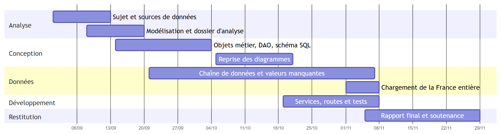{#fig-gantt width=97% fig-pos="H"}

La répartition s'est faite par domaine, chacun restant responsable des tests de son code.

- **Aziz Yousfi** : objets métier, contrôleurs et schémas, puis réécriture du calcul des DJU (`run()`, `run_for_zone()`) et tests des objets métier.
- **Eudes Sterlin** : socle de l'API et premier contrôleur, README, DAO des calculs DJU, schéma SQL final, mise à jour des diagrammes et état des lieux du code.
- **Gabriel Dahan** : structure du dépôt et gabarit du rapport, connexion à la base, services et routes de toutes les fonctionnalités, gestion des erreurs, alignement de la couche DAO.
- **Gwenaël Lassalle** : recherche des sources de données, import des communes, introduction et spécifications du dossier d'analyse, diagrammes, chargement de la France entière dans PostgreSQL et reconnexion automatique de l'API, rapport final.
- **Marceau Feral** : chaîne de données (`meteo.py`, `qualite_meteo.py`, `communes.py`, `init_db.py`) et ses tests, traitement des valeurs manquantes, vectorisation de l'estimation des températures, réécriture des diagrammes.

Un assistant d'IA (Claude Code) a été utilisé ponctuellement, notamment pour comparer le code aux diagrammes lors de l'état des lieux ; chaque proposition a été relue et testée par l'équipe.

# Conception de l'API

Cette partie décrit l'architecture et, pour chaque fonctionnalité, les traitements et les classes qui la réalisent. Les noms de classes et de méthodes sont ceux du code ; les libellés des diagrammes sont en français.

## Architecture en couches

L'application suit une architecture en couches. La couche de présentation expose l'API REST avec FastAPI : chaque route est prise en charge par un contrôleur (`dju_controller`, `zone_controller`, `user_controller`), qui valide la requête grâce aux schémas Pydantic puis délègue au service correspondant. La couche de services (`DjuService`, `TemperatureService`, `ZoneService`, `AuthService`) orchestre le métier. Les objets métier (`DjuCalculation`, `GeographicZone`, `Zoning`, etc.) portent les règles de calcul. La couche DAO est la seule à accéder à PostgreSQL. Les scripts de préparation des données sont séparés de l'API.

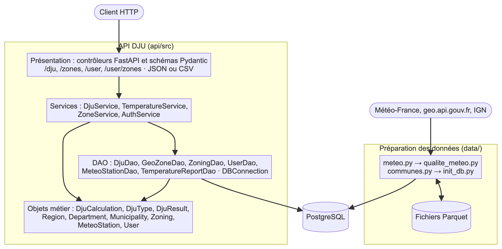{#fig-architecture width=90% fig-pos="H"}

Cette séparation a deux avantages. Les objets métier n'accèdent jamais à la base : ils ne font que des calculs sur leurs propres données, et peuvent être testés sans base. Les services reçoivent leurs DAO en paramètre du constructeur, ce qui permet de les remplacer par de faux objets dans les tests (section 3.2).

## Modèle de données

Le schéma relationnel (`data/init_db.sql`) reprend les entités du domaine. Il se divise en trois groupes : le territoire et les zonages, les données météo, et le cache des calculs.

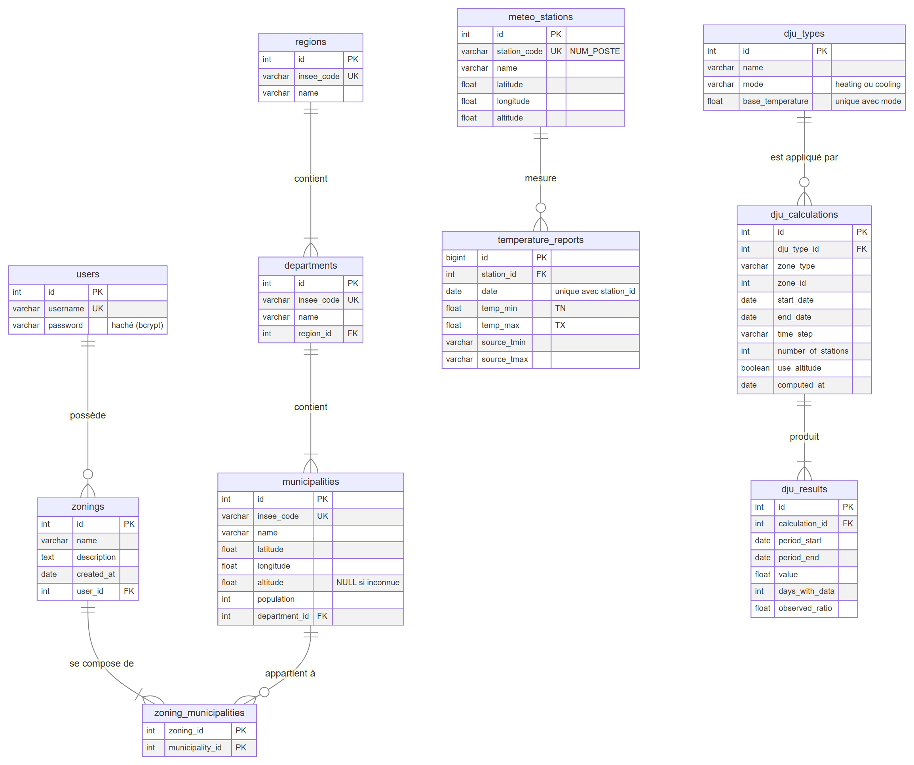{#fig-mpd width=97% fig-pos="H"}

**Territoire et zonages.** Les tables `regions`, `departments` et `municipalities` reprennent la hiérarchie administrative. Chaque niveau est identifié par son code INSEE, déclaré unique, qui est la clé naturelle utilisée par l'utilisateur et par les fichiers d'import. La table `municipalities` contient les trois informations nécessaires au calcul sur un territoire : les coordonnées de la mairie, l'altitude et la population. Comme un zonage contient plusieurs communes et qu'une commune peut appartenir à plusieurs zonages, la relation passe par la table de liaison `zoning_municipalities`, dont la clé primaire (`zoning_id`, `municipality_id`) empêche d'ajouter deux fois la même commune. L'option `ON DELETE CASCADE` supprime ces liens avec le zonage.

**Données météo.** La table `temperature_reports` contient un relevé par station et par jour. Seules $T_{\min}$ (colonne `TN` de Météo-France) et $T_{\max}$ (`TX`) sont stockées : la température moyenne mesurée (`TM`) n'est pas utilisée, car la méthode de référence définit la moyenne comme $(T_{\min} + T_{\max}) / 2$, recalculée au moment du calcul. La stocker aurait créé une information redondante. Les colonnes `source_tmin` et `source_tmax` gardent l'origine de chaque valeur.

**Cache des calculs.** La table `dju_types` enregistre une seule fois chaque couple (mode, seuil). La zone d'un calcul est désignée par le couple (`zone_type`, `zone_id`), car elle peut être une région, un département, une commune ou un zonage, c'est-à-dire des lignes de tables différentes. Cela empêche une clé étrangère classique : la cohérence est assurée par le service, qui supprime les calculs d'un zonage modifié.

## Vue des cas d'utilisation

Le diagramme des cas d'utilisation reprend les acteurs définis en section 1.1 et les aligne sur F0 à F4 et FO3. L'utilisateur authentifié dispose aussi de tous les cas de l'utilisateur anonyme ; pour la lisibilité, ces liens ne sont pas répétés. « Gérer un zonage » couvre la modification de la description, l'ajout ou le retrait de communes, et la suppression.

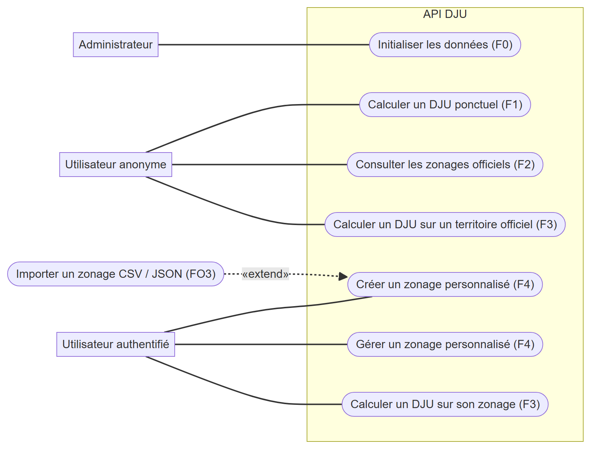{#fig-cas width=85% fig-pos="H"}

## Modèle du domaine

Le modèle du domaine structure les objets métier en trois groupes, et les services qui les orchestrent.

Le premier groupe décrit le territoire. `GeographicZone` est une classe abstraite dont héritent `Region`, `Department`, `Municipality` et `Zoning` (figure 2.4). Toutes exposent `get_municipalities()`, ce qui permet de traiter de la même façon une région, un département ou un zonage lors d'un calcul sur un territoire (polymorphisme). Le deuxième groupe décrit les données météo : `MeteoStation` et `TemperatureReport`. Le troisième décrit le calcul (figure 2.5) : un `DjuCalculation` représente une demande, applique un `DjuType` (mode et seuil) et produit une liste de `DjuResult`, un par période. Un `DjuCalculation` ne porte qu'un seul `DjuType` : avec deux seuils, deux calculs sont créés.

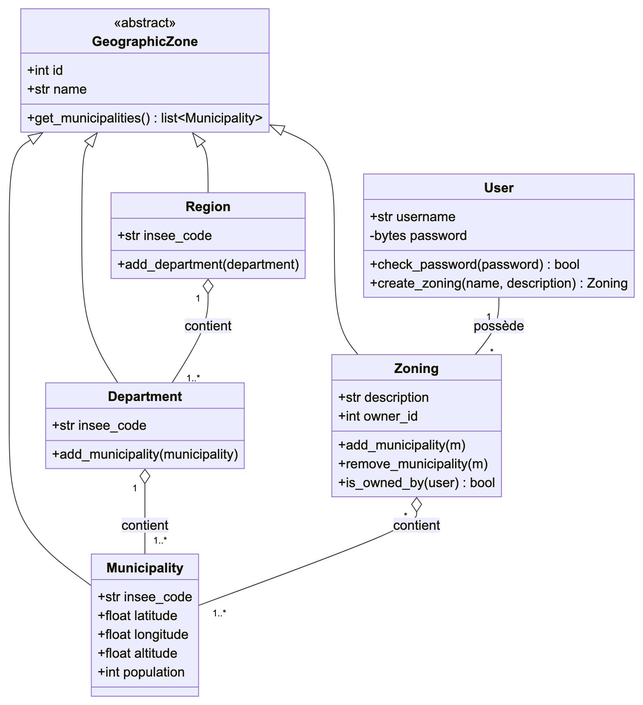{#fig-classes-zone width=80% fig-pos="H"}

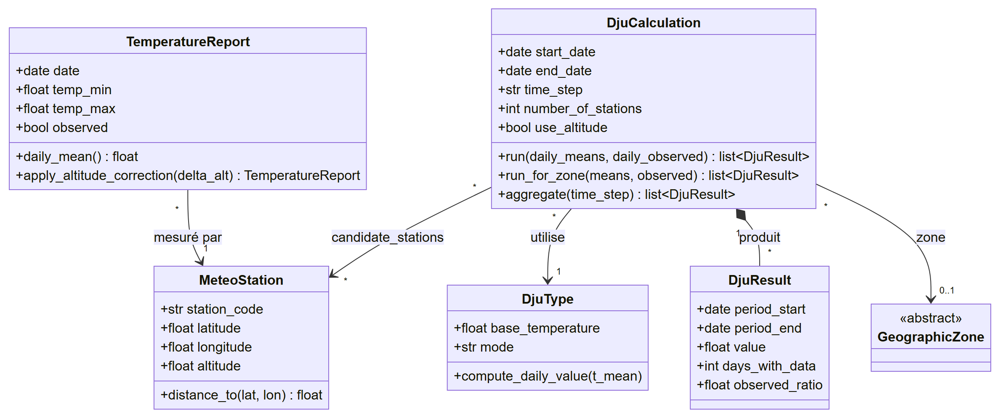{#fig-classes-dju width=95% fig-pos="H"}

Les services orchestrent ces objets. Ils reçoivent leurs DAO dans leur constructeur et sont les seuls à les utiliser.

| Service | Méthodes principales | Rôle |
|:--------|:---------------------|:-----|
| `DjuService` | `calculate_point_dju(request)`, `calculate_zone_dju(request, user)` | Contrôle la requête, crée les `DjuCalculation`, utilise le cache des calculs sur territoire |
| `TemperatureService` | `find_candidate_stations(...)`, `estimate_daily_temperatures(...)`, `get_municipality_temperatures(...)` | Choisit les stations, lit leurs relevés, estime les températures par IDW |
| `ZoneService` | `list_public_zones`, `get_zone`, `get_sub_zones`, `create_zoning`, `import_zoning`, `update_zoning`, `delete_zoning` | Lit les territoires, découpe une zone, gère les zonages et contrôle leur propriétaire |
| `AuthService` | `register`, `authenticate`, `get_current_user` | Crée les comptes, délivre et vérifie les jetons JWT |

Le calcul est réparti entre les classes en trois étapes. `DjuType.compute_daily_value()` calcule le DJU d'un jour à partir de la température moyenne ; elle accepte un nombre comme un tableau pandas, ce qui permet de traiter toute une période d'un coup. `DjuCalculation.run()` applique ce calcul à chaque jour, puis `aggregate()` additionne les valeurs par jour, semaine ISO, mois ou année. Pour un territoire, `run_for_zone()` fait la même chose sur un tableau qui a une colonne par commune, puis agrège les communes par une moyenne pondérée par la population.

## F0 — Initialisation des données

L'initialisation enchaîne quatre scripts, séparés par des fichiers Parquet. Elle est lancée par l'Administrateur en dehors de l'API.

`meteo.py` télécharge, pour chaque département, l'archive 1950–2024 et les données récentes 2025–2026 de Météo-France. Il ne garde que huit colonnes (`NUM_POSTE`, `DATE`, `NOM_USUEL`, `TN`, `TX`, `LAT`, `LON`, `ALTI`), renommées `TMIN` et `TMAX` pour les températures, et les dates à partir de 1990. Chaque département est enregistré à part : une coupure réseau ne fait perdre que le département en cours. `qualite_meteo.py` traite les valeurs manquantes (section 1.5) département par département, avec en contexte les stations situées à moins de 50 km, ce qui limite la mémoire tout en donnant le même résultat qu'un traitement global. `communes.py` récupère régions, départements et communes sur geo.api.gouv.fr, puis l'altitude de chaque mairie auprès de l'API d'altimétrie de l'IGN, par lots de 250 points.

`init_db.py` crée les tables puis les remplit. Pour les quelque 32 millions de relevés, un `INSERT` ligne par ligne aurait pris des heures : les relevés sont copiés par lots dans une table temporaire avec la commande `COPY` de PostgreSQL, puis insérés avec `ON CONFLICT DO NOTHING`. Le script peut ainsi être relancé sans créer de doublons, par exemple pour ajouter les relevés récents.

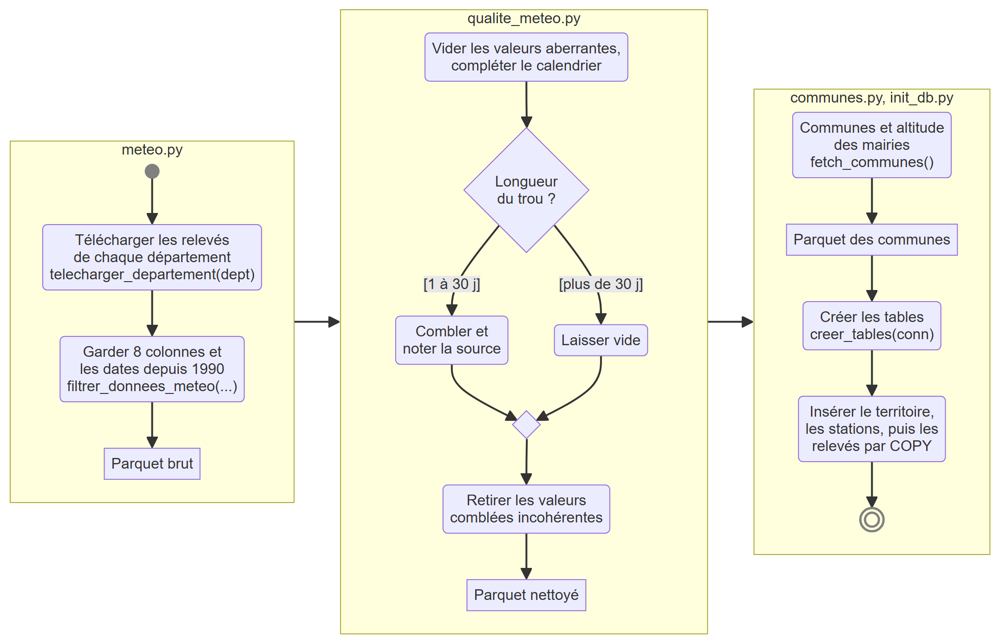{#fig-act-f0 width=100% fig-pos="H"}

## Estimation des températures locales

Avant tout calcul DJU, le système estime une série quotidienne de températures pour chaque lieu demandé : un point GPS (F1) ou la mairie de chaque commune d'un territoire (F3). C'est `TemperatureService` qui s'en charge.

**Entrées** : un ou plusieurs lieux (latitude, longitude, altitude ou rien), la période et le nombre $n$ de stations. **Sortie** : deux tableaux avec une ligne par jour et une colonne par lieu, l'un pour la température moyenne estimée, l'autre indiquant si la valeur ne repose que sur des mesures observées.

`find_candidate_stations()` trie les stations par distance et retient pour chaque lieu les $n$ plus proches. Les relevés de toutes les stations retenues sont lus en une seule requête SQL, même si une station sert à plusieurs lieux. Une station qui n'a aucun relevé sur la période est écartée et remplacée par la suivante, jusqu'à ce que chaque lieu ait $n$ stations avec des données. `estimate_daily_temperatures()` applique ensuite la correction d'altitude et la pondération inverse à la distance.

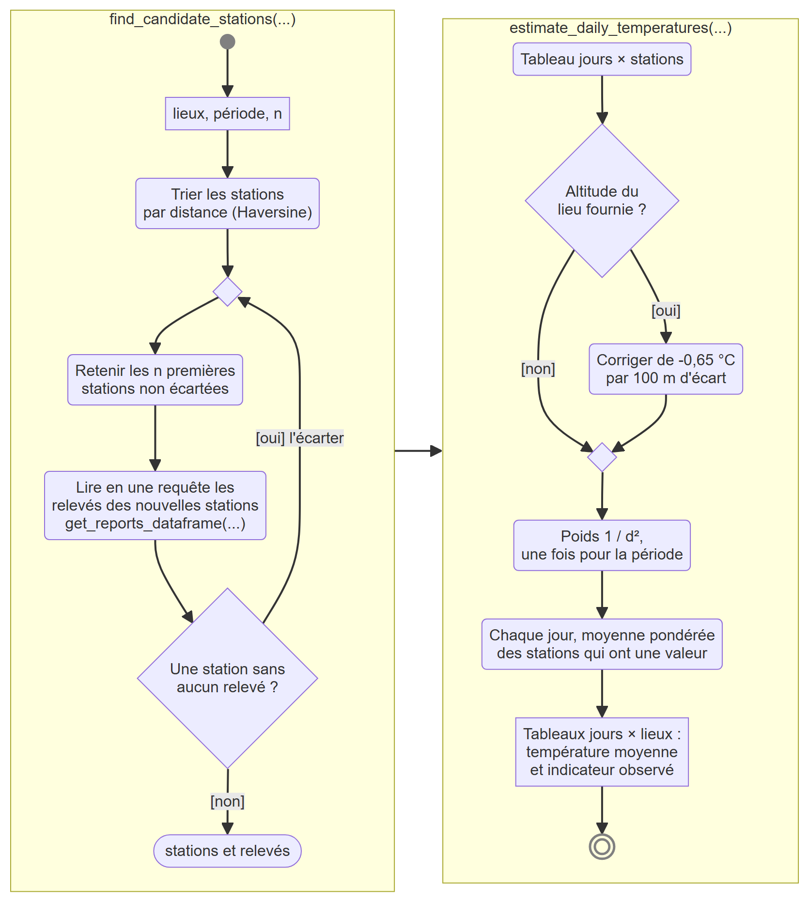{#fig-act-temp width=85% fig-pos="H"}

## F1 — Calcul d'un DJU ponctuel

La requête `POST /dju/point` fournit la latitude, la longitude, éventuellement l'altitude, la période, le pas de temps, le nombre de stations et au moins un seuil (chauffage et/ou climatisation).

La validation se fait en deux niveaux. Le schéma Pydantic `DjuPointRequest` contrôle automatiquement le format : latitude entre $-90$ et $90$, longitude entre $-180$ et $180$, dates valides, nombre de stations entre 1 et 10, pas de temps parmi `day`, `week`, `month` et `year`. Une erreur de format donne une réponse 422. Le service contrôle ensuite la cohérence entre les paramètres : au moins un seuil, date de début avant la date de fin, période qui recoupe les données disponibles. Une incohérence donne une réponse 400.

`DjuService.calculate_point_dju()` estime ensuite les températures du point une seule fois, puis crée un `DjuCalculation` par seuil fourni et appelle `run()`. Aucun résultat n'est stocké. Les diagrammes d'activité et de séquence de F1 sont en annexe.

## F2 — Consultation des zonages officiels

Tout client peut lister les régions, les départements ou les deux avec la route `GET /zones?type=...`, traitée par `list_public_zones()` de `ZoneService`. Cette liste est volontairement légère : elle ne contient pas les communes, qui seraient près de 35 000 pour la France entière. Le détail d'une zone, avec ses communes, est donné par `GET /zones/{zone_type}/{zone_id}`. Ces routes permettent de connaître les identifiants des zones avant de lancer un calcul F3. Les diagrammes correspondants figurent en annexe.

## F3 — Calcul d'un DJU sur un territoire

La requête `POST /dju/zone` désigne une zone par `zone_type` et `zone_id`, avec les mêmes paramètres qu'en F1, un niveau d'agrégation (`zone`, `department` ou `municipality`) et l'indicateur `use_altitude`. Les zonages officiels sont publics ; un zonage personnalisé exige un jeton, et que l'appelant en soit le propriétaire (401 sans jeton, 403 pour un autre utilisateur, 404 si la zone n'existe pas).

Le traitement se fait en deux temps, comme le montre la figure suivante. Le service découpe d'abord la zone en sous-zones selon le niveau d'agrégation, et cherche pour chaque sous-zone et chaque seuil un calcul déjà stocké. Il ne garde de côté que les calculs absents. Ensuite seulement, il estime en une fois les températures de toutes les communes de ces calculs : une région découpée par département ne lit donc les relevés qu'une seule fois.

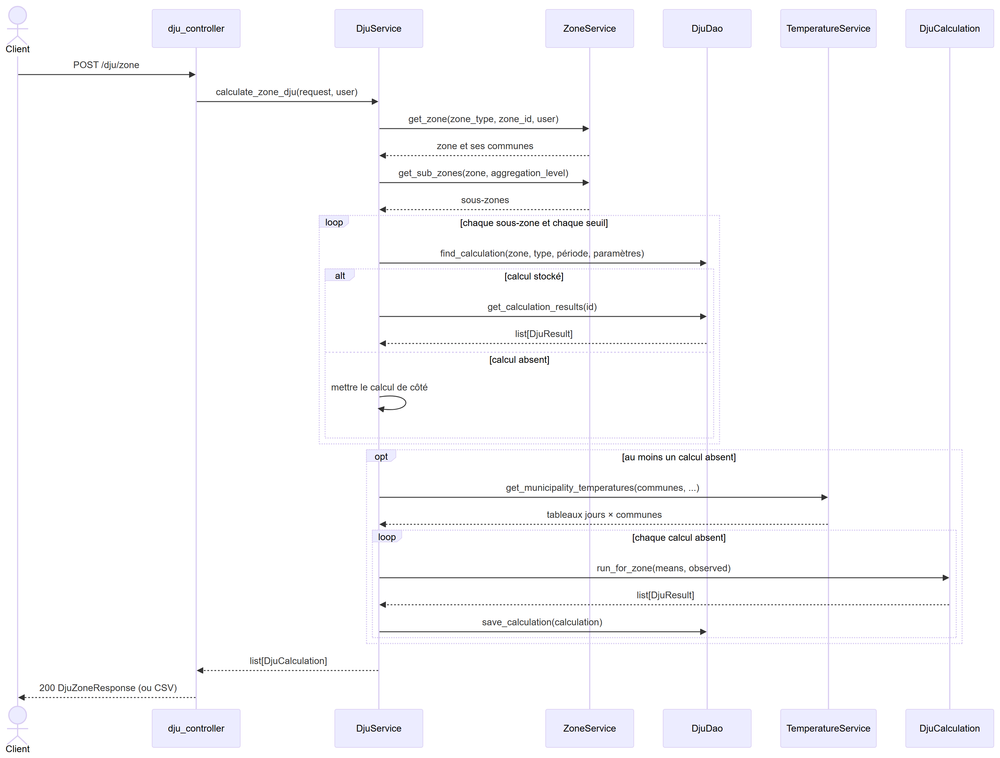{#fig-seq-f3 width=100% fig-pos="H"}

Dans `run_for_zone()`, le DJU d'un jour pour une zone $Z$ est la moyenne des DJU communaux pondérée par la population $p_c$, calculée sur les seules communes qui ont une valeur ce jour-là :

$$
\mathrm{DJU}_Z(t) = \frac{\sum_{c \in Z} p_c\, \mathrm{DJU}_c(t)}{\sum_{c \in Z} p_c}.
$$

Une commune dont la population est inconnue ne compte pas ; si aucune population n'est connue, la moyenne devient une moyenne simple. Ce choix reprend la méthode du service statistique du ministère (Sdes) : les DJU servant à analyser des consommations d'énergie, une commune très peuplée doit peser davantage qu'un village.

## F4 — Zonages personnalisés

Après inscription (`POST /user/register`) et connexion (`POST /user/login`), l'utilisateur gère ses zonages sur les routes `/user/zones`. Une dépendance FastAPI (`get_current_user`) décode le jeton avant chaque route protégée et renvoie 401 s'il est absent, invalide ou expiré.

La création envoie un nom, une description et une liste de codes INSEE. `ZoneService.create_zoning()` nettoie les codes (espaces, doublons), retrouve toutes les communes en une requête et refuse l'ensemble du zonage avec une erreur 400 qui liste les codes inconnus : on n'enregistre jamais un zonage partiellement faux sans que l'utilisateur s'en aperçoive. Le zonage est ensuite créé par `User.create_zoning()` et enregistré.

L'import FO3 (`POST /user/zones/import`) suit le même chemin, une fois les codes extraits du fichier. Pour rester simple, le contenu du fichier est envoyé sous forme de texte dans un corps JSON, et non comme fichier uploadé. Un CSV peut utiliser la virgule ou le point-virgule ; les codes sont lus dans la colonne `code_insee` si elle existe, sinon dans la première colonne. Un JSON peut être une liste de codes ou un objet `{"codes_insee": [...]}`.

La modification (`PATCH`) peut changer la description, ajouter et retirer des communes ; la suppression (`DELETE`) retire le zonage et ses liens. Dans les deux cas, `Zoning.is_owned_by()` vérifie d'abord que l'utilisateur est le propriétaire (403 sinon), puis les calculs stockés du zonage sont supprimés. Un zonage doit toujours contenir au moins une commune.

## Synthèse

| Fonct. | Route | Auth. | Paramètres d'entrée | Description |
|:-------|:------|:------|:--------------------|:------------|
| F1 | `POST /dju/point` | Aucune | `latitude`, `longitude`, `altitude?`, `start_date`, `end_date`, `time_step`, `heating_threshold?`, `cooling_threshold?`, `number_of_stations?` | DJU sur un point GPS |
| F2 | `GET /zones` | Aucune | `type` (`department` \| `region` \| `all`) | Liste des zonages officiels |
| F2 | `GET /zones/{zone_type}/{zone_id}` | Aucune | `zone_type`, `zone_id` | Détail d'une zone et de ses communes |
| F3 | `POST /dju/zone` | Optionnelle¹ | `zone_type`, `zone_id`, `aggregation_level?`, mêmes paramètres qu'en F1, `use_altitude?` | DJU sur un territoire |
| F4 | `POST /user/register` | Aucune | `username`, `password` | Création de compte |
| F4 | `POST /user/login` | Aucune | `username`, `password` | Connexion, renvoie un jeton |
| F4 | `GET /user/zones` | Requise | — (jeton) | Zonages de l'utilisateur |
| F4 | `POST /user/zones` | Requise | `name`, `description?`, `codes_insee[]` | Création d'un zonage |
| F4 | `PATCH /user/zones/{id}` | Propriétaire | `description?`, `add_codes_insee[]`, `remove_codes_insee[]` | Modification d'un zonage |
| F4 | `DELETE /user/zones/{id}` | Propriétaire | `id` | Suppression d'un zonage |
| FO1 | — | — | Paramètres de F3 | Réutilisation automatique des calculs sur territoire |
| FO2 | `?format=csv` | — | `json` (défaut) ou `csv` | Mise en forme de la sortie de F1 et F3 |
| FO3 | `POST /user/zones/import` | Requise | `filename`, `content`, `name?`, `description?` | Import d'un zonage CSV ou JSON |

¹ Authentification obligatoire lorsque la zone ciblée est un zonage personnalisé. Au moins un des deux seuils est requis pour F1 et F3.

# Réalisation et validation

Cette partie présente les points du code qui ont demandé le plus de réflexion, la stratégie de test, l'utilisation de l'API et ses limites.

## Points techniques notables

### Une estimation vectorisée

La première version estimait les températures commune par commune et jour par jour, avec une requête SQL par station. Pour une région de plusieurs milliers de communes sur plusieurs années, ce calcul était beaucoup trop lent. Comme le suggérait le tuteur, nous l'avons vectorisé avec numpy et pandas.

Les relevés de toutes les stations utiles sont lus en une seule requête, qui calcule directement la moyenne $(T_{\min} + T_{\max}) / 2$ et l'indicateur observé. Ils sont ensuite pivotés en un tableau avec une ligne par jour et une colonne par station. Pour chaque lieu, les poids $1/d^2$ ne dépendent que des distances : ils sont calculés une seule fois pour toute la période, et non pour chaque jour. La moyenne pondérée de tous les jours s'obtient alors par des opérations matricielles :

```python
values = means_by_station[ids].to_numpy(dtype=float)      # jours x stations
weights = 1 / np.maximum(distances, MIN_DISTANCE_KM) ** 2  # une fois pour la période
has_value = ~np.isnan(values)
weighted_sum = np.where(has_value, values * weights, 0.0).sum(axis=1)
weight_total = (has_value * weights).sum(axis=1)
means[key] = weighted_sum / weight_total                   # NaN si aucune station ce jour-là
```

Le masque `has_value` règle le cas des jours où une station n'a pas de valeur : son poids est simplement retiré du dénominateur ce jour-là. La distance minimale de 10 m évite une division par zéro quand le lieu est exactement sur une station. Les distances sont elles aussi calculées par une version vectorisée de la formule d'Haversine.

### Une agrégation temporelle calendaire

`aggregate()` regroupe les DJU journaliers par période calendaire grâce à la fonction `period_bounds()` : une semaine va du lundi au dimanche (semaine ISO), un mois du premier au dernier jour du mois. Les bornes sont ensuite ramenées à la période demandée : une demande du 15 janvier au 10 mars en pas mensuel donne trois résultats, du 15 au 31 janvier, pour février, puis du 1er au 10 mars. Chaque `DjuResult` indique le nombre de jours réellement calculés (`days_with_data`) et la part de jours observés (`observed_ratio`), pour que l'utilisateur sache si une valeur repose sur des données complètes.

### Une connexion robuste à la base

La base de production est hébergée sur un serveur distant qui ferme les connexions inactives. `DBConnection` est un singleton : toutes les DAO partagent une seule connexion. Avant de la fournir, il vérifie qu'elle est toujours ouverte (avec une requête `SELECT 1` si elle n'a pas servi depuis 30 secondes) et la rouvre si besoin. Sans ce mécanisme, la première requête après une pause renvoyait une erreur. Les DAO qui lisent des données stables (liste des stations, période des relevés) les gardent en mémoire après la première lecture.

### Une gestion uniforme des erreurs

Les services lèvent une seule exception, `ServiceError`, qui porte un message et un code HTTP. Les contrôleurs la traduisent en réponse HTTP par une fonction commune, `http_error()`. Le métier ne dépend ainsi pas de FastAPI, et chaque erreur renvoie un message compréhensible.

| Code | Cas |
|:-----|:----|
| 400 | Incohérence entre paramètres : aucun seuil, dates dans le désordre, période sans données, code INSEE inconnu, fichier illisible |
| 401 | Jeton absent, invalide ou expiré ; identifiants incorrects |
| 403 | Zonage appartenant à un autre utilisateur |
| 404 | Zone ou zonage introuvable ; aucune station près du point |
| 409 | Nom d'utilisateur déjà pris |
| 422 | Format de requête invalide, contrôlé par Pydantic |

## Tests

Les tests ont été écrits avec pytest, couche par couche. Aucun ne demande de base de données ni d'accès au réseau : ils peuvent être lancés sur n'importe quelle machine, et leur résultat ne dépend pas du contenu de la base.

| Couche testée | Fichier | Tests | Méthode |
|:--------------|:--------|------:|:--------|
| Objets métier | `test_business_objects.py` | 25 | Données construites à la main |
| Services | `test_services.py` | 38 | DAO remplacées par de faux objets |
| Contrôleurs et routes | `test_api.py` | 31 | Services remplacés, `TestClient` |
| Scripts de données | `test_data.py` | 24 | Fichiers fictifs, fausse connexion |

Les trois premiers fichiers sont dans `api/test/`, le dernier dans `data/`.

Les tests des objets métier vérifient la formule du DJU (valeur jamais négative, chauffage et climatisation), l'agrégation par semaine, mois et année avec des périodes coupées, la pondération par la population (y compris des populations inconnues), la distance d'Haversine entre Paris et Lyon et la correction d'altitude. Pour les services, les DAO sont remplacées par de faux objets qui renvoient des données fixes : cela permet de tester l'estimation IDW sur deux stations, le remplacement d'une station sans relevés, l'utilisation du cache F3, ou encore les codes d'erreur 400, 401, 403, 404 et 409. Les tests de routes vérifient les codes HTTP, la validation Pydantic (422) et le format CSV. Les tests des scripts de données vérifient chaque palier du comblement et le chargement en base sur une fausse connexion.

Les 118 tests passent. La couverture de code, mesurée avec `coverage`, est la suivante :

| Partie du code | Couverture |
|:---------------|-----------:|
| Objets métier | 92 à 100 % |
| Services | 84 à 97 % |
| Contrôleurs et schémas | 68 à 100 % |
| DAO | 0 à 40 % |
| Total de l'API | 74 % |
| `qualite_meteo.py` (traitement des valeurs manquantes) | 99 % |

Les DAO sont peu couvertes, car elles ne font qu'exécuter des requêtes SQL et n'ont de sens que face à une vraie base. Elles ont été vérifiées de bout en bout : toutes les fonctionnalités ont été appelées sur une base contenant les données de la Bretagne, puis sur la base complète de la France.

## Utilisation de l'API

L'API se lance depuis `api/src` avec `python main.py`, après avoir renseigné le fichier `.env` (connexion PostgreSQL et clé `JWT_SECRET`). La documentation interactive générée par FastAPI est alors disponible sur `http://localhost:5001/docs` : elle décrit chaque route, ses paramètres et ses réponses, et permet de les essayer directement.

Par exemple, la requête suivante demande les DJU de chauffage mensuels de chaque département de la région 3 en 2024, avec un seuil de 18 °C :

```json
POST /dju/zone
{
  "zone_type": "region", "zone_id": 3, "aggregation_level": "department",
  "start_date": "2024-01-01", "end_date": "2024-12-31",
  "heating_threshold": 18, "time_step": "month"
}
```

La réponse contient une entrée par département, et pour chaque mode demandé la liste des périodes :

```json
{
  "zones": [
    { "zone_type": "department", "zone_id": 12, "name": "...",
      "results": { "heating": [
        { "period_start": "2024-01-01", "period_end": "2024-01-31",
          "value": ..., "days_with_data": 31, "observed_ratio": ... },
        ... ] } },
    ... ],
  "warning": null
}
```

Avec `?format=csv`, la même requête renvoie un fichier `dju.csv` dont les colonnes sont `zone`, `mode`, `period_start`, `period_end`, `value`, `days_with_data` et `observed_ratio`, directement exploitable dans un tableur.

## Limites et pistes d'amélioration

Plusieurs points pourraient être améliorés avec plus de temps.

- **Recherche de communes.** Pour créer un zonage, il faut connaître les codes INSEE des communes. Une route de recherche par nom, et la possibilité d'ajouter d'un coup toutes les communes d'un département, rendraient F4 plus simple à utiliser.
- **Temps de calcul à grande échelle.** Le premier calcul sur un territoire très étendu (la France entière, commune par commune) reste coûteux. Nous n'avons pas mesuré précisément ce temps ; un cache des températures communales pourrait redevenir utile pour ce cas.
- **Tests des DAO.** Les DAO ne sont vérifiées qu'à la main. Des tests automatiques sur un schéma PostgreSQL dédié, vidé après chaque test, compléteraient la couverture.
- **Code inutilisé.** La classe `MunicipalityTemperatureDao`, issue du cache abandonné, devrait être retirée.
- **Mise à jour des données.** Les relevés récents sont ajoutés en relançant les scripts à la main. Une mise à jour planifiée, et un conteneur Docker pour déployer l'API, faciliteraient l'exploitation.
- **Correction climatique.** L'API pourrait aller jusqu'au calcul des coefficients de rigueur du climat, rapport entre un DJU de référence (par exemple la moyenne 1991–2020) et le DJU observé, qui servent à corriger les consommations.

# Conclusion {.unnumbered}

Ce projet a abouti à une API complète de calcul des DJU, qui couvre toutes les fonctionnalités demandées (F0 à F4) et les trois fonctionnalités optionnelles. Elle calcule des DJU de chauffage et de climatisation en un point ou sur un territoire, pour n'importe quel seuil, période et pas de temps, à partir des relevés de toute la France depuis 1990.

La qualité des résultats repose sur deux choix principaux. Le premier est un traitement explicite des données manquantes, fait une seule fois avant le chargement en base, avec une méthode adaptée à la longueur de chaque trou et une traçabilité qui remonte jusqu'à l'utilisateur sous la forme de la part de jours observés. Le second est une estimation des températures par pondération inverse à la distance, corrigée de l'altitude, puis vectorisée pour rester rapide sur des milliers de communes.

Le projet a aussi beaucoup évolué depuis le dossier d'analyse : le stockage des séries en Parquet, un des deux niveaux de cache et deux règles de nettoyage ont été abandonnés, chaque fois au profit d'une solution plus simple qui répondait au même besoin. Les remarques du tuteur ont conduit à réécrire la modélisation pour qu'elle corresponde exactement au code, ce qui a rendu le développement des services beaucoup plus rapide. Enfin, l'architecture en couches et l'injection des DAO dans les services nous ont permis d'écrire 118 tests qui ne dépendent d'aucune base de données.

\appendix

# Annexes

## Diagrammes d'activité complémentaires

\FloatBarrier

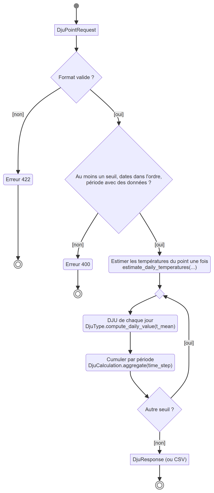{#fig-act-f1 width=62% fig-pos="H"}

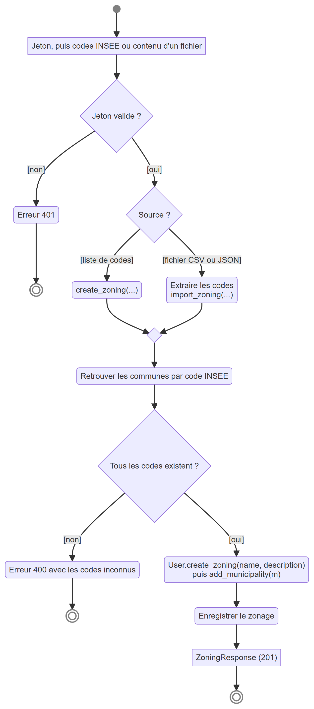{#fig-act-create width=62% fig-pos="H"}

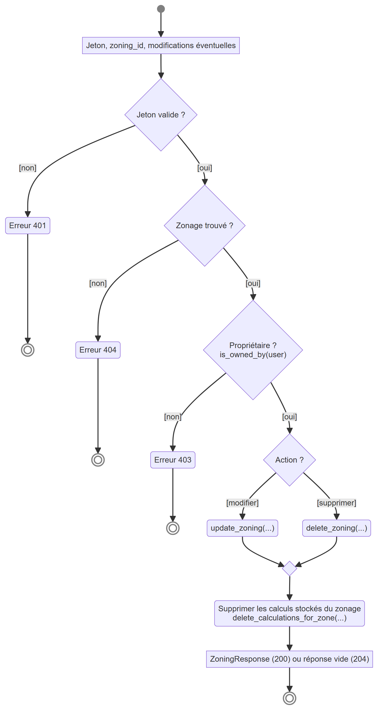{#fig-act-manage width=62% fig-pos="H"}

\FloatBarrier

## Diagrammes de séquence complémentaires

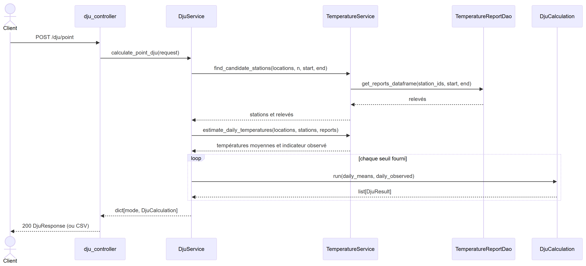{#fig-seq-f1 width=90% fig-pos="H"}

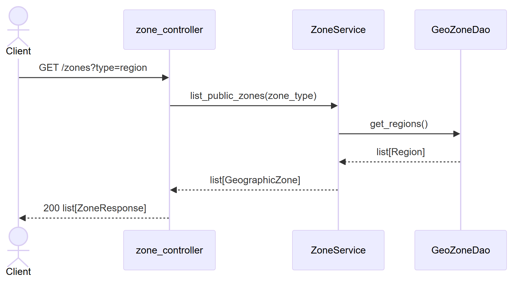{#fig-seq-f2 width=76% fig-pos="H"}

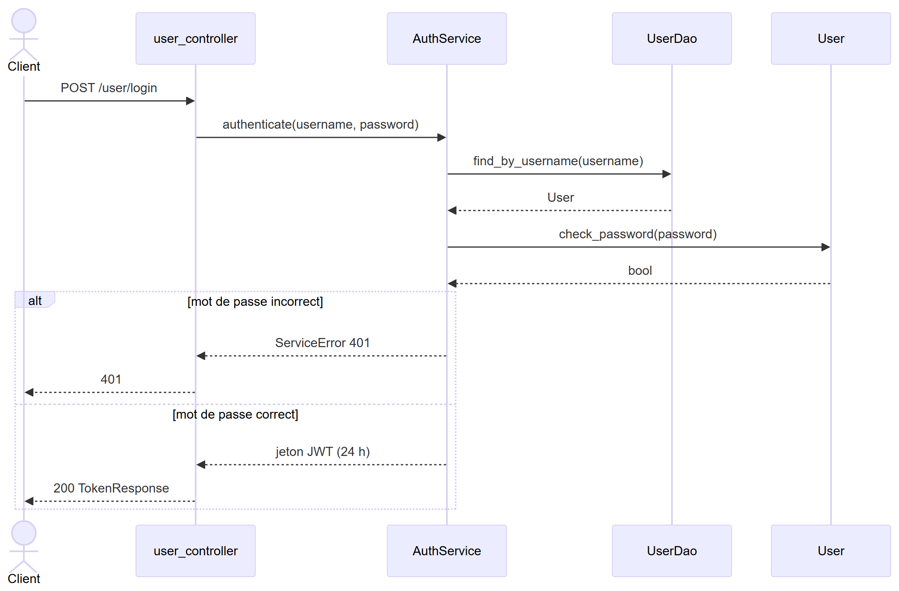{#fig-seq-login width=76% fig-pos="H"}

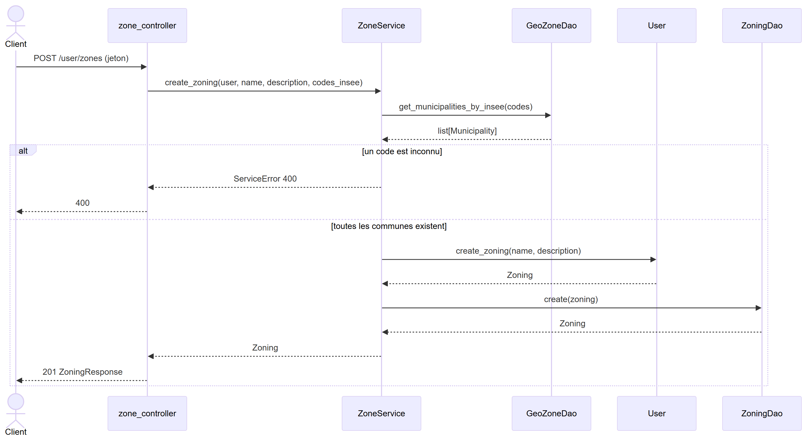{#fig-seq-create width=83% fig-pos="H"}

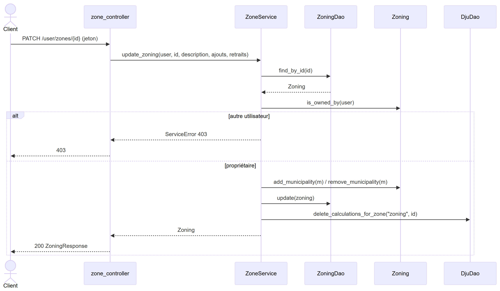{#fig-seq-manage width=83% fig-pos="H"}

\FloatBarrier

## Bilans personnels

### Aziz Yousfi

*À rédiger.*

### Eudes Sterlin

*À rédiger.*

### Gabriel Dahan

*À rédiger.*

### Gwenaël Lassalle

*À rédiger.*

### Marceau Feral

*À rédiger.*
